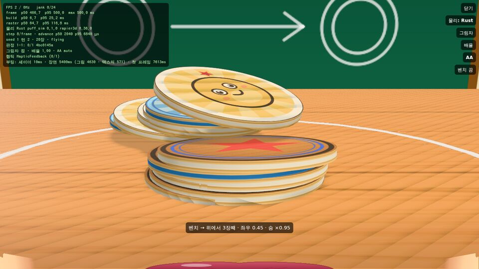
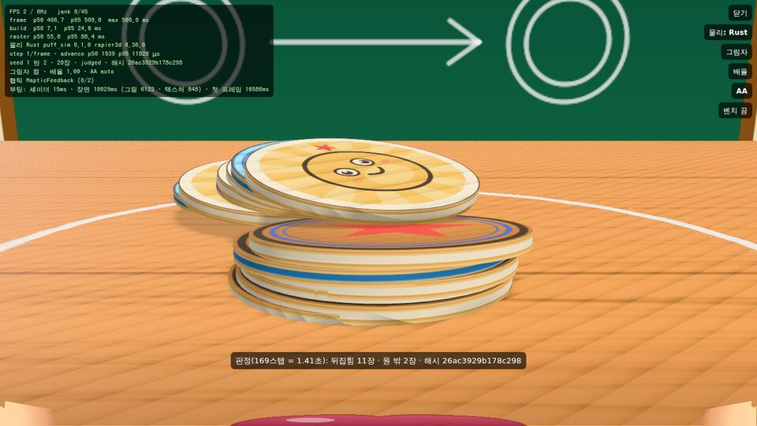
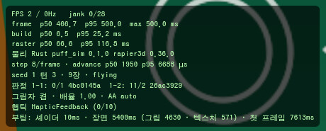

## 🧭 핵심 가설

**가설**: 네이티브 경기 장면(Flutter `flutter_scene` + Rust rapier 물리를 `dart:ffi`로 동기 호출)은 쓸 만하다. 근거는 두 가지다. (일부 확인됨)

- 물리 1스텝(딱지 20장)이 120Hz 프레임 예산 8.3ms의 몇 %밖에 안 된다.
- 화면 주사율과 상관없이 **고정 1/120초 스텝 + 결정적 숨 해석**으로 돌리면, 같은 판·같은 입력이 어느 기기에서나 같은 결과(해시)를 낸다. 이것이 PvP의 바탕이다.

판가름은 아래 둘이다.

- **(리눅스, 확인됨)** 누르기 → 놓기 경로가 Rust CLI와 해시까지 같아야 한다.
  - 화면 시계가 120·90·60Hz이든, 떨리든, 실제 앱이 2FPS로 기든 마찬가지다.
  - 실제 앱 화면(리눅스 데스크톱, Impeller)에서 판 하나가 끝까지 돌아야 한다.
- **(아이폰, 미검증)** 다음이 모두 맞아야 한다.
  - HUD에 `물리 Rust …`가 뜬다.
  - FPS가 115 이상, frame p95가 9ms 이하다.
  - `advance` p95가 1ms 안쪽이다.
  - 벤치 2번째 판정 해시가 `26ac3929`로 같다.

**가설 수정 (1회)**

- 처음 가설: "rules.js `resolveShot`을 Dart로 그대로 옮기면 된다."
- 틀린 이유: `dart:math`의 `log`·`cos`는 플랫폼 libm을 부른다. 리눅스(glibc)에서 Rust libm과 마지막 비트가 다른 호출이 log 6%, cos 3%였다.
- 결과: 숨이 넘친 샷의 조준 흔들림(gauss)이 기기마다 1ulp씩 달라질 수 있다. 그러면 물리 해시가 갈라져 PvP가 깨진다.
- 바꾼 것: fdlibm(log·cos)을 순수 Dart로 옮겼다(`app/lib/native/detmath.dart`). 지금은 Rust와 **20만 개 중 0개** 다르다.

이 문서는 B 시제품의 마지막 조각(INTEGRATE)이다. Rust 물리(`native/puff_sim`)를 Flutter 네이티브 데모(`app/lib/native`)에 FFI로 붙였다.

- 물리 쪽: `native/puff_sim/README.md`
- 렌더러 쪽: `docs/app/native-renderer.md`

## 한눈에

| 질문 | 답 | 근거 |
|---|---|---|
| 손가락 → 물리 → 화면이 한 줄로 이어지나 | **된다.** 웹뷰 없이 Impeller가 그리고, 물리는 Rust가 동기로 돈다. | 리눅스 데스크톱 실제 앱 화면(아래). `flutter test` 48개 |
| 화면 주사율이 결과를 바꾸나 | **안 바꾼다.** 스텝 수로만 정해진다. | 120·90·60Hz·떨림 시계 × 5판 11샷 모두 CLI와 해시·스텝·장수가 같다. 2FPS 실제 앱의 해시도 120Hz 재생과 같다. |
| 120Hz에서 프레임당 몇 스텝 | **정확히 1스텝**이라 보간이 필요 없다(지연 0). 60Hz는 2스텝이다. | `native_sim_ffi_test` |
| 프레임당 물리 비용 | AOT 182~275µs, 자세 읽기 0.5µs(16장, 붐비는 x86 컨테이너). JIT 시험에서는 `advance` p50 151µs, p95 416µs. **폰 값은 미검증.** | `ffi_check`(AOT), 시험 출력 |
| 앱 숨 해석 = Rust 숨 해석? | **비트 단위로 같다.** 무작위 2만 샷이고 절반은 숨이 넘친다. | `native_sim_ffi_test` |
| 앱 숨 해석 = 웹(rules.js)? | 넘치지 않는 숨은 같다. 넘친 숨은 흔들림만 1~2ulp 다르다(500샷 중 3샷). | `native_resolve_test`. V8의 Math.log·cos가 fdlibm과 가끔 다르다(gauss 2000개 중 34개). 웹↔앱은 어차피 엔진이 달라 해시가 같을 수 없으니 상관없다. |
| iOS 정적 라이브러리 | 리눅스에서 **교차 컴파일까지 확인**했다. `aarch64-apple-ios`·`-sim`, `puff_*` 심볼 35/35, minos 13.0/14.0, 필요한 시스템 라이브러리는 `-lSystem -lc -lm`뿐이다. | 링크·서명·실행은 맥에서 해야 한다. |
| 웹뷰 게임이 기본인가 | **그대로다.** iOS 링크도 `build-ios.sh`를 돌렸을 때만 켜진다(`#include?`). | `app/lib/main.dart` 무변경, `app/ios/Flutter/*.xcconfig` |





이 화면은 리눅스 데스크톱(GTK)에서 찍었다(`app/tool/linux_check.sh`).

- 판정 그림과 HUD 그림은 **따로 띄운 두 번의 실행**에서 나왔는데, 해시가 같다.

- 렌더링은 Impeller(OpenGLES), Mesa 소프트웨어 GL, Flutter GPU, `flutter_scene`이다. 물리는 Rust `.so`다. iOS와 같은 코드 경로다.
- FPS 2는 소프트웨어 GL이라 그렇고, 의미 없는 값이다. 한 프레임에 0.5초가 밀리니 8스텝 상한에 걸려 슬로모션이 된다.
- 그래도 판정 해시는 120Hz 재생 시험과 같다.

## 흐름: 누르기 → 판정

```
손가락 (Listener, 제스처 경쟁 대기 없음)
  └ 누름: 카메라 광선 → 더미 원기둥 → 조준 높이 h · 좌우 lat           coords.dart aimFromSceneRay
  └ 당김: 숨 = pouchPower(당긴 거리), 꽉·버팀·콜록 + Core Haptics      rules.dart · rich_haptics.dart
  └ 놓기: LiveSim.fire                                                  live_sim.dart
        rng = Mulberry32(seed·1000 + 턴)                               detmath.dart (JS·Rust 와 같은 수열)
        resolveShot(lat, h, 숨, 살아 있는 장수, 꼭대기, rng)            rules.dart (순수 Dart fdlibm → Rust 와 같은 비트)
        puff_set_rng_state(rng 상태)   ← 숨 해석에 쓴 줄기를 blow 의 jitter·텀블이 이어 씀(turn.js ShotRun 과 같은 순서)
        조준점 = c − D·√(1−lat²) + side·lat                             rules.dart aimPoint (= Rust aim_point)
        puff_blow_v(조준점, 세기, 돌풍)
화면 프레임마다 (SceneView onTick 의 dt)
  └ LiveSim.advance(dt): 밀린 시간 > 0.25ms 면 1/120초 스텝(puff_step_judge) — 최대 8, 그 너머는 버림(슬로모션, 결과 불변)
        puff_frame → 자세 f32 버퍼(복사 없이) → prev/cur
        보간 비율 = 1 + 밀린 시간/dt  (한 스텝 앞서 시뮬하고 되돌려 보간 → 120Hz 에선 보간 없음·지연 0)
  └ applyFrame: 오른손→왼손(z 뒤집기), 노드 행렬을 제자리에서 고침(프레임마다 할당 0), 가져간 딱지 숨김
스텝 판정 순간 (0.6초 뒤 · 느림 0.08 · 2.5초 뒤 0.5 · 상한 5초 — sim.js 와 같은 조건)
  └ 뒤집힘 · 원 밖 · 상태 해시 → HUD '판정' 줄, 착지 햅틱 + 딴 장수만큼 톡톡
  └ 1.8초 뒤 puff_take_flipped → puff_restack → 화면에서 가라앉힘(puff_settle_step, puff_settle 과 같은 해시)
     다 땄으면 새 판(seed + 1)
```

## 만든 것

| 파일 | 하는 일 |
|---|---|
| `app/lib/native/live_sim.dart` | **경기 루프**다. Dart 숨 해석 → Rust blow → 고정 스텝 → 보간 버퍼 → 판정 → 가져가기·다시 쌓기를 맡는다. 렌더러와 독립이라 시험으로 돌린다. |
| `app/lib/native/detmath.dart` | 결정적 수학이다. Mulberry32, gauss, fdlibm `log`·`cos`를 libm 0.2.16에서 그대로 옮겼다. 연산 순서도 같다. |
| `app/lib/native/rules.dart` (+) | `resolveShot`, `physSweetFor`, `aimPoint`를 rules.js·Rust와 비트로 같게 옮겼다. |
| `app/lib/native/sim_core*.dart` | 물리 인터페이스다. `sim_core_ffi.dart`는 Rust를 부르고, `sim_core_stub.dart`는 웹·라이브러리 없음용이라 녹화 재생으로 돈다. 조건부 import라 웹 빌드도 계속 된다. |
| `app/lib/native/demo_scene.dart` (+) | `applyFrame`/`applyFrameTo`다. 자세 버퍼를 노드로 옮기며 보간하고, 할당이 없다. |
| `app/lib/native/demo_page.dart` (+) | 실물리를 기본으로 하고, Rust가 없으면 녹화 재생으로 간다. 그 밖에 `물리: Rust/녹화` 토글, HUD 물리 줄(스텝/프레임, advance p50·p95, seed·턴, 판정 기록), 벤치(정해진 샷 5개를 돌아가며), `--dart-define=NATIVE_BENCH=true`가 있다. |
| `native/puff_sim/src/ffi.rs` (+) | 구조체와 malloc 없이 부르는 함수를 더했다. 결과는 핸들이 들고 있는 고정 버퍼로 준다. `puff_blow_v`, `puff_fire_v`, `puff_resolve_v`, `puff_info`, `puff_rng_state`/`puff_set_rng_state`, `puff_settle_begin`/`puff_settle_step`, `puff_math_v`(검증용 libm), `puff_version_cstr`. 헤더는 `include/puff_sim.h`다. |
| `native/puff_sim/src/lib.rs` `fire_turn` | turn.js `ShotRun.fire` 순서의 Rust 기준이다. CLI·C ABI·시험이 같이 쓴다. |
| `native/puff_sim/dart/` | dart:ffi 바인딩을 **path 패키지** `puff_sim_ffi`로 만들었다. 앱과 CLI 확인(`bin/ffi_check.dart`)이 바인딩 하나를 같이 쓴다. 의존성은 0이다. |
| `native/puff_sim/src/bin/puff_parity.rs` `shots` | 앱 대조용 JSON이다(5판 11샷, turn.js 순서). `app/test/fixtures/sim_cli_shots.json`이 이것이다. |
| `native/puff_sim/tests/app_abi.rs` | Rust 시험 5개다. 새 C ABI 길 = 구조체 길 = Table 직접, settle을 나눠 불러도 같음, resolve 2000개, null 안전. |
| `native/puff_sim/scripts/build-ios.sh` | (맥) staticlib을 만들고 임베디드 비트코드를 벗긴 뒤 lipo로 묶고 `dist/ios/link.xcconfig`로 링크를 켠다. 옵션은 `--device-only`, `--xcframework`, `--off`. |
| `native/puff_sim/ios/PuffSim.xcconfig` | `-force_load`(SDK별, 만든 것만)와 `STRIP_STYLE = non-global`을 담는다. |
| `app/ios/Flutter/Debug.xcconfig`·`Release.xcconfig` | `#include? ".../dist/ios/link.xcconfig"`. 파일이 없으면 건너뛰므로 평소 빌드는 그대로다. Profile 빌드도 Release.xcconfig를 쓴다. |
| `app/test/native_sim_ffi_test.dart` | 리눅스·맥 호스트에서 `.so`·`.dylib`를 연다. Rust와 비트 대조, CLI 고정본 대조, 화면 시계 4종, 실제 앱 해시 재현을 본다. 라이브러리가 없으면 이유를 보이고 건너뛴다. |
| `app/test/native_resolve_test.dart` | rules.js 표본(`app/tool/make_resolve_fixture.mjs`)과 대조한다. |
| `app/test/native_apply_frame_test.dart` | `applyFrame`이 `poseMatrix`와 같은 행렬을 내는지, 숨김과 보간이 맞는지, 제자리에서 고치는지 본다. |
| `app/tool/linux_check.sh` | 실제 앱을 리눅스 데스크톱 + Xvfb로 띄워 화면을 찍는다. |
| `app/tool/web_check.mjs` (수정) | path 의존성을 절대 경로로 바꾼다. 웹은 dart:ffi가 없어 녹화 재생으로 돈다. |

## 리눅스에서 확인한 것 (2026-10-13, 이 컨테이너)

```bash
cd native/puff_sim && cargo build --release && cargo test --release     # 14 통과(단위 4 · 결정성 5 · 앱 ABI 5, 황금 해시 그대로)
(cd dart && dart run bin/ffi_check.dart ../target/release/libpuff_sim.so) # Dart = Rust = C: a6be48c3edfb264d
cd ../../app && flutter analyze && flutter test                            # 문제 0 · 48 통과
app/tool/linux_check.sh                                                     # 실제 앱 화면(위 그림)
PW=$(npm root -g)/playwright node app/tool/web_check.mjs                   # 웹 빌드도 그대로(녹화 재생, 오류 0)
```

### 비트 대조

| 대조 | 표본 | 결과 |
|---|---|---|
| `detLog`·`detCos`(Dart) vs Rust libm | 각 10만 개 + 특수값 15개(0, −0, ∞, 비정규, π/2 근처 …) | **0개 다름** |
| `dart:math` log·cos vs Rust libm(같은 표본) | 각 10만 개 | log **5,963개**, cos **3,030개** 다름 → 순수 Dart 판이 필요한 이유 |
| gauss Dart vs Rust | 2000개(숨 넘친 샷의 h 흔들림으로 간접 대조) | 0개 다름 |
| `resolveShot` Dart vs Rust `rules::resolve_shot` | 무작위 2만 샷(절반은 숨 넘침), 난수 상태까지 | 0개 다름 |
| `resolveShot` Dart vs rules.js(V8) | 500샷 | 넘치지 않는 250샷은 비트 일치. 넘친 250샷 중 247샷 비트 일치, 3샷은 흔들림 1e-14 이내 |
| gauss Dart vs JS(V8) | 2000개 | 34개가 1~2ulp 다름. V8의 Math.log·cos가 fdlibm과 다르다. |

### 경기 루프 = Rust CLI

`puff_parity shots`는 다섯 판(시드 3·11·29·41·7, 20·20·12·5·1장)에 샷 11개다. 초록, 옆, 가운데, 약함, 돌풍 1.08~1.3, 1장 판이 들어 있다. 판정 스텝 상한(600)에 걸리는 샷도 있다.

| 화면 시계 | 숨 해석·조준점·blow 뒤 난수 | 판정(스텝·뒤집힘·원 밖·해시) | 다시 쌓기(스텝·해시) | 프레임당 스텝 |
|---|---|---|---|---|
| 120Hz(8333µs) | 같음 | 같음 | 같음 | **정확히 1** |
| 60Hz | 같음 | 같음 | 같음 | 2 |
| 90Hz | 같음 | 같음 | 같음 | 1·1·2 + 보간 |
| 120Hz 떨림(8333/8334µs) + 37프레임마다 떨굼 | 같음 | 같음 | 같음 | 1(떨굼 때 2) |
| 실제 앱(리눅스 AOT profile, ≈2FPS, 8스텝 상한) | — | 벤치 2번째 샷 169스텝·11·2·`26ac3929b178c298` = 120Hz 재생 | — | 8 |

### 비용

- **Dart → Rust 한 프레임** (step + 자세 읽기): AOT `dart compile exe`로 182~275µs, 16장. 자세 읽기는 0.5µs다. 4코어 x86에 부하 평균 5.4로 다른 작업과 나눠 쓴 값이다.
- **`LiveSim.advance` 1스텝/프레임, 20장 이하**: JIT 디버그(`flutter test`)에서 p50 151µs, p95 416µs, max 705µs다. 120Hz 예산 8.3ms의 2~5%다.
- **Rust 단독**: 20장 170~176µs/스텝, 40장 450~470µs/스텝(x86, `README` 성능 표). 폰 코어 값은 미검증이다.
- **앱 크기**: 정적 라이브러리 `.a`는 기기용 7.3MB(비트코드 벗긴 뒤)다. 실제 코드는 리눅스 `.so` 기준 약 2.6MB다. 링크할 때 dead-strip이 쓰지 않는 코드를 지운다.

### 맥이 없어 생긴 일: 임베디드 비트코드 (리눅스에서 재현해 고침)

- rust-std에 미리 컴파일돼 들어 있는 `compiler_builtins` 오브젝트(약 50개)에 `__LLVM,__bitcode` 섹션이 붙어 있다. Rust의 LLVM, 지금 22로 만든 것이다.
- LLVM 계열 도구는 이런 오브젝트를 IR로 읽는다. 리눅스 `llvm-lipo`(LLVM 18)가 `Unknown attribute kind (102)`로 넘어졌다.
- Xcode의 lipo·ld가 Rust보다 낡은 LLVM(libLTO)을 쓰면 같은 일이 날 수 있다.
- 그래서 `build-ios.sh`가 Rust와 같은 LLVM의 `llvm-objcopy`로 오브젝트마다 그 섹션만 지우고 `llvm-ar`로 원래 순서대로 다시 묶는다. 기계어는 그대로이고, `rustup component add llvm-tools`로 받는다.
- 벗긴 뒤 확인한 것:
  - LLVM 18 lipo가 시뮬레이터 fat(arm64 + x86_64)을 만든다.
  - 기기 `.a`는 IR 멤버 0개에 심볼 35개다.
- 덧붙여: LLVM 18 `llvm-lipo -info`는 얇은(thin) Mach-O 아카이브에서 따로 죽는다. 멤버 3개짜리도 죽는 리눅스 도구 버그다. 맥의 `lipo`와는 무관하다.

## 재윤님 맥에서 (단계별)

준비물은 Xcode, Flutter 3.47.5, 아이폰 Pro(ProMotion)다. 저전력 모드는 끈다. 켜 두면 60Hz로 묶인다.

```bash
# 0) Rust (한 번만)
curl --proto '=https' --tlsv1.2 -sSf https://sh.rustup.rs | sh -s -- -y && source "$HOME/.cargo/env"

# 1) 받기
cd G2 && git pull

# 2) (권장, 2분) 맥 호스트에서 결정성 먼저 — Apple Silicon = 아이폰과 같은 arm64
cd native/puff_sim && cargo build --release && cargo test --release
#    → golden_cross_platform 통과 = x86 리눅스에서 박은 황금 해시가 arm64 macOS 에서도 같음
cd ../../app && flutter pub get && flutter test test/native_sim_ffi_test.dart
#    → libpuff_sim.dylib 로 같은 시험(CLI 고정본 해시 · 26ac3929…) — arm64 에서 리눅스 x86 과 같은 비트인지

# 3) iOS 정적 라이브러리 + 링크 켜기 (아이폰만이면 --device-only, 약 1.5분)
cd .. && native/puff_sim/scripts/build-ios.sh --device-only
#    끝 줄: "dist/ios/device/libpuff_sim.a: puff_* 심볼 35 / 헤더 35 · … arm64" · "→ 링크 켜짐"

# 4) 아이폰에서 데모 (profile = 실제 속도 + FrameTiming)
cd app && flutter run --profile -t lib/native/demo_main.dart -d <아이폰>
#    손 안 대고 재기: --dart-define=NATIVE_BENCH=true 를 덧붙이면 벤치로 시작
```

화면에서 볼 것은 왼쪽 위 HUD다.

1. **`물리 Rust puff_sim 0.1.0 rapier3d 0.36.0`** 줄이 있으면 링크가 된 것이다.
   - `물리: 녹화 재생 (Rust 없음)`이면 아래 '안 될 때'를 본다.
   - 화면 아래 줄에 이유가 나온다.
2. `FPS … / 120Hz`, `frame p95`, `jank`는 GFX 판정표 그대로다(`docs/app/native-renderer.md`).
3. `step 1/frame`은 120Hz에서 1이어야 맞다.
   - `advance p50 … p95 … µs`가 물리와 자세 읽기 비용이다.
   - **p95가 1000µs 안쪽이면 물리는 병목이 아니다.**
4. **기기 간 결정성**은 벤치를 켜고 HUD의 `판정` 줄을 본다.
   - 시작 직후 두 판정이 `1-1: 0/1 4bc0145a  1-2: 11/2 26ac3929`여야 한다. 리눅스 x86과 같은 비트다.
   - 다르면 PvP 계약이 깨진 것이니 그 값을 알려 주면 된다.
5. 직접 해 보기: 더미를 누르고 아래로 당겼다 놓는다.
   - 초록 숨이면 '퍽' 햅틱과 함께 Rust 물리로 날아간다.
   - 판정 뒤 딴 장수만큼 톡톡 하고, 1.8초 뒤 다시 쌓는다.
   - `물리: Rust` 버튼을 누르면 녹화 재생과 비교할 수 있다.

평소 앱(웹뷰 게임)은 그대로다. `flutter run --release`로 띄우고 왼쪽 위 노치 옆을 1.5초 누르면 같은 데모가 열린다.

### 안 될 때

| 증상 | 확인 | 처방 |
|---|---|---|
| HUD `Rust 물리 라이브러리를 못 엶 … symbol not found` | `nm -gU build/ios/iphoneos/Runner.app/Runner \| grep -c _puff_` (35여야 함) | `native/puff_sim/dist/ios/link.xcconfig`가 있는지 본다. 없으면 3)을 다시 한다. Xcode → Runner → Build Settings에서 `PUFF_SIM_LDFLAGS`에 경로가 보이는지, Strip Style이 `Non-Global Symbols`인지 본다. |
| 심볼은 35개인데 못 찾음 | Release·Profile만 그런가 | dead-strip 쪽이다. `OTHER_LDFLAGS`에 `-Wl,-exported_symbol,_puff_*`를 더해 본다(시험 필요). |
| 링크 오류 `…libpuff_sim.a not found` | 시뮬레이터로 빌드했는데 `--device-only`로 구웠나 | `link.xcconfig`는 만든 SDK만 적는다. 그래도 나면 `build-ios.sh`(전부)를 다시 돌린다. |
| `could not parse bitcode` · `Unknown attribute kind` | 스크립트를 거치지 않은 `.a`를 썼나 | `build-ios.sh`가 벗긴 `dist/ios/…/libpuff_sim.a`만 링크한다. 다시 돌린다. |
| 원래대로 되돌리기 | — | `native/puff_sim/scripts/build-ios.sh --off`. 링크가 꺼지고 앱은 이전과 같아진다. |

안드로이드는 `native/puff_sim/scripts/build-android.sh`(cargo-ndk → `jniLibs`)로 한다. 이 컨테이너에는 NDK가 없어 **미검증**이다.

## 판단 기록

- **plain `dart:ffi`를 쓰고 flutter_rust_bridge는 쓰지 않았다.**
  - 프레임마다 동기 leaf 호출 몇 개와 고정 버퍼 3개뿐이다(자세 f32, 판 상태 f64, 샷 결과 f64). 주소가 고정이라 뷰를 한 번만 만든다.
  - FRB의 코드 생성기, 비동기 런타임, 직렬화는 120Hz 루프에서 얻을 게 없고 의존성과 버전 고정만 는다.
  - 바인딩은 `native/puff_sim/dart` path 패키지 하나다.
- **iOS는 staticlib + `#include?` xcconfig 방식이다(과제 지정).**
  - Flutter 빌드 훅(native assets)으로 cargo를 부르면 기기와 시뮬레이터를 알아서 맞춰 주는 장점이 있다. 대신 **웹뷰 게임만 빌드할 때도 Rust 도구가 필요**해진다.
  - 그래서 '돌렸을 때만 켜지는' 지금 방식을 골랐다. 네이티브로 갈아타기로 정하면 빌드 훅으로 옮기는 것을 다시 본다.
- **숨 해석은 Dart가 하고, 결과(세기·돌풍·조준점)만 Rust에 넘긴다(과제 지정).**
  - 같은 일을 하는 Rust 기준(`fire_turn`·`puff_fire_v`)을 두고 비트 대조한다.
  - 숨 해석이 쓰는 초월함수는 순수 Dart fdlibm이다. 플랫폼 libm은 쓰지 않는다.
- **고정 스텝 + 한 스텝 앞서 시뮬해 되돌려 보간하는 방식을 썼다.**
  - 흔한 'prev와 cur 사이 보간'은 120Hz에서도 늘 한 스텝(8.3ms) 늦게 그린다.
  - 앞서 시뮬하면 120Hz에서 보간이 없고 지연도 0이다. 다른 주사율에서만 보간한다.
  - 밀린 시간이 8스텝을 넘으면 버린다. 그러면 화면이 슬로모션이 될 뿐 결과는 그대로다.
- **물리는 UI 스레드에서 동기로 돈다.**
  - 1스텝이 프레임의 몇 %라 isolate를 나눌 이유가 아직 없다.
  - 폰에서 p95가 예산을 먹으면 판 하나를 백그라운드 isolate로 옮긴다. 자세 버퍼만 넘기면 된다.

## 남은 위험 · 미검증

- **아이폰 실행 전체가 미검증이다.** Metal에서 120Hz, `-force_load`, `STRIP_STYLE`, `$(inherited)` 동작, dead-strip, Core Haptics Swift 컴파일이 다 여기 든다. 정적 라이브러리는 교차 컴파일과 심볼까지만 확인했다.
- **폰 코어에서의 비용을 모른다.** 숫자는 x86 컨테이너 값이다. A17·A18 한 코어가 x86보다 빠를 수도 있지만 열 제한(스로틀)은 모른다.
- **flutter_scene(1.0 전)에 기댄다.** GFX 문서의 위험이 그대로 남는다. 렌더러는 `applyFrame` 한 겹 뒤에 있어서 바꿀 수 있다.
- **레벨 보정과 봇은 아직 JS 물리 기준이다.** `botlib`·`levelbot`·`calibrate`를 Rust로 옮기는 일이 남았다(`native/puff_sim/README.md`).
- **웹 숨 해석(V8)과 앱은 숨이 넘친 샷에서 1~2ulp 다를 수 있다.** 웹과 앱은 물리 엔진부터 달라 PvP를 같이 못 하니 지금은 문제가 아니다. 웹도 `puff_sim`(WASM)으로 바꾸면 숨 해석도 Rust 하나로 모으는 편이 깔끔하다(`puff_resolve_v`가 이미 있다).
- **데모의 범위는 좁다.** 판정 뒤 '가져가기'는 뒤집힌 딱지를 지우기만 한다. 수집, 판돈, 레벨 흐름은 웹 게임에만 있다.
