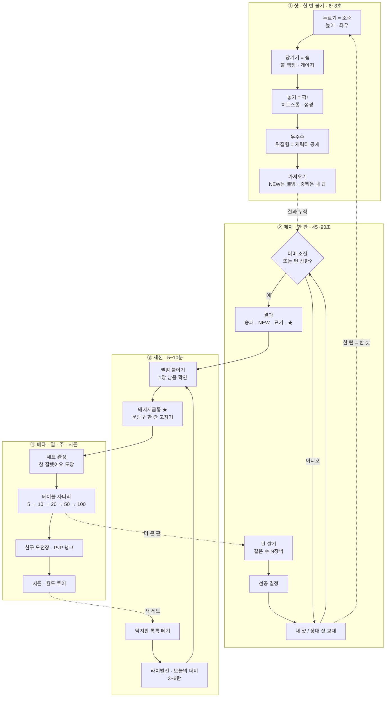

# PUFF! — 게임 기획서 v0.1

> **날짜** 2026-10-12 · **상태** 목업 v0.1 기준 초안 (웹, three.js 0.162 + Rapier compat 0.12.0, 나 vs AI). 다음 루프는 목업 v0.2다.
> **이 문서의 출처**: 리서치 9관점과 팩트체크, 기획 제안서 3종(코어 필·매치 루프 / 수집·경제 / 글로벌·PvP), 심사 2건을 하나로 합쳤다. 충돌은 심사 권고대로 해소했고, 해소한 자리마다 `결정 근거`를 한 줄씩 남겼다.

**근거 표기**
- 관점 번호는 `docs/research/raw/research-lenses.json` 순서를 따른다. [L0 원천문화] [L1 글로벌 유사놀이] [L2 게임필] [L3 입력] [L4 수집 메타] [L5 PvP·규제] [L6 아트] [L7 시장] [L8 물리]
- 다음 근거는 검색 한도가 소진된 상태에서 **기억에 기대 작성**됐다: L4 전부, L7 전부, L5 중 Apple 문서를 뺀 나머지, L6의 스타일 원칙. 이런 근거에서 나온 수치와 주장은 모두 **(미검증)**으로 다룬다.
- [FC]는 팩트체크(`docs/research/raw/fact-checks.json`)다.
- [실측]은 목업 물리(`mockup/src/sim.js`, TUNE #73)로 돌린 정책 시뮬레이션이다. 단발 샷 약 6,300회, 매치 약 6,200판이고 스크립트는 `tools/scratch/coreloop/`에 있다. 사람이 아니라 노이즈를 준 정책이 플레이했으므로 **방향과 크기 차이만 믿고 소수점은 믿지 않는다.**
- [경제시뮬]은 몬테카를로 시뮬레이션(시드 300)이다. 가정은 §10.7에 있다.
- 문서 안의 '판돈'은 내부 설계 용어다. 실제 화면 문구는 §11.7 금지어 사전을 따른다.

---

## 🧭 핵심 가설

- **H1 (미검증)**: 재미의 단위는 '한 판'이 아니라 '한 번 불기'(6~8초, 4막)다. 샷 하나가 모으기 → 퍽 → 우수수 → 가져오기로 끝까지 닫히면, 설명이 없어도 플레이어는 다음 판을 누른다. **판가름 지표**: 첫 세션에서 2판째로 자발적으로 넘어가는 비율. [→ E0](#e0) [→ E1](#e1)
- **H2 (미검증)**: 뒤집기가 곧 공개다. 그림면을 아래로 쌓아 두면 '몇 장 넘겼나'의 쾌감과 '무엇을 땄나'의 수집 쾌감이 한 프레임에 겹친다. 그 결과 자발적으로 하는 판 수가 20% 이상 늘어난다. [→ E4](#e4)
- **H3 (실측으로 확인됨 / 사람의 학습 속도는 미검증)**: 처음 가르칠 것은 파워가 아니라 '맨 위를 노리기'다. 높이와 좌우만 맞혀도 한 번 불 때 평균 1.3장이던 것이 4.75장으로 오른다. 반면 파워만 맞히면 2.65장에 그친다. [→ E2](#e2)
- **H4 (실측으로 확인됨 / 왕복전에 남은 편향은 미검증)**: 원작 단판 룰은 먼저 부는 쪽이 이긴다. 같은 실력의 고수끼리 선공 승률이 69.5%이고, 5장 판에서는 83%다. 그래서 따먹기와 랭크전은 라운드마다 선공을 바꾸는 왕복 2라운드로 한다. [→ E6](#e6)
- **H5 (미검증)**: 앨범은 영원히 남고, 걸 수 있는 것은 더미뿐이다. 처음 얻은 1장을 절대 잃지 않게 하면 따먹기의 긴장은 남고 분노 때문에 떠나는 일은 막힌다. [→ E5](#e5)
- **H6 (Apple 정의는 확인됨 / 실제 심사 결과는 미검증)**: 원안의 '진짜 따먹기'(내 딱지를 걸고 잃음)는 전연령 등급과 함께 갈 수 없다. 그래서 판에 깔리는 딱지의 출처(플레이어 더미인지, 시스템이 발행한 것인지)를 서버 스위치로 분리한다. 손맛 검증은 원안 그대로 한다. [→ E16](#e16)

---

## 2. 한 줄 피치 / 엘리베이터 피치

| | 한국어 | English |
|---|---|---|
| 한 줄 | 같은 수 걸고, 후~ 불어서, 뒤집힌 만큼 내 것! | Stack. Puff. Whatever flips is yours. |
| 태그라인 | 후~ 불고, 뒤집고, 가져가! | Blow. Flip. Keep. |
| 포지셔닝 | 세계의 운동장 놀이, 한국식 한 숨 | The playground flip game every country had — now you BLOW. |

**엘리베이터 피치 (한국어, 30초)**
> PUFF!는 90년대 문방구 앞에서 하던 '딱지 불어먹기'를 손가락 하나로 옮긴 아케이드 게임입니다. 나와 상대가 같은 수의 동그란 캐릭터 딱지를 그림이 아래로 가게 쌓습니다. 더미를 짚고 당기면 볼이 빵빵해지고, 놓으면 '퍽!' 하고 바람이 터지면서 뒤집힌 딱지가 내 것이 됩니다. 뒤집히는 순간 그림이 드러나기 때문에 '무엇을 땄나'가 바로 수집이 됩니다. 맨 위를 노려 안정적으로 딸지, 가운데를 노려 한 방을 노릴지, 마지막 한 장을 살살 불지가 실력입니다. 한 판은 1분이고 설명은 0줄입니다.

**Elevator pitch (English, 30 sec)**
> PUFF! turns the playground flip game every country once had — milk caps, bafo, menko — into a one-finger arcade duel with a Korean twist: you blow. Both players stack the same number of round character discs face-down. Press the stack, pull back to puff your cheeks, let go — PUFF! Every disc that lands face-up is yours, and every flip reveals who you just won. Aim high for a steady harvest, go for the middle for a huge sweep, or ease off for that one last disc. One match, one minute, zero tutorials.

---

## 3. 디자인 필러

| # | 필러 | 이렇게 한다 | 하지 않을 것 | 근거 |
|---|---|---|---|---|
| P1 | **퍽 한 번은 한 편의 단편이다** | 6~8초 안에 예고(모으기) → 타격(퍽) → 여운(우수수) → 보상(가져오기)이 닫힌다. 연출 강도는 뒤집힌 장수에 비례해 계단식으로 올린다. | 장마다 히트스톱 넣기. 일반 샷 연출 2.5초 초과. 성과와 무관한 과장 연출. 결과보다 큰 축하. | L2 Swink, Juice it or lose it, Kao 2020·2024 (Kao 2024는 FC에서 미재확인) |
| P2 | **결과는 진짜이고, 실력은 '참기와 읽기'다** | 물리 결과는 조작하지 않고 연출만 결과에 맞춘다. 덜 불 줄 알고 노릴 곳을 아는 사람이 이긴다. 운은 플레이어가 직접 고른 위험(도박샷, 과파워)으로만 존재한다. | 조작된 near-miss. 숨은 랜덤. 판 중간의 숨은 난이도 조정(러버밴딩). 판돈 매치에 숨은 봇. 세게 불수록 무조건 이득인 구조. | Clark 2009는 '가짜 통제감만으로도 near-miss 효과가 난다'는 결과다. 그래서 조작은 곧 다크패턴이 된다[FC2]. Menko '기술이 힘만큼' [L1]. bafo '손 큰 아이가 유리해 금지' [L1]. |
| P3 | **뒤집기는 공개이고, 앨범은 영원하다** | 그림면을 아래로 쌓는다. 뒤집히면 캐릭터와 희귀도가 공개된다. 처음 얻은 디자인은 앨범에 '붙어' 절대 줄지 않는다. 걸 수 있는 것은 중복분뿐이다. | 처음 얻은 디자인을 잃게 하기. 유료 랜덤팩. 돈으로 걸 수 있는 딱지 사기. | L2 I6, L4 I0·I1 (미검증), MTG ante 폐지 (FC: 사유는 법적 우려 쪽) |
| P4 | **설명 대신 몸짓, 한국은 양념** | 텍스트 0, 버튼 0, 권한 요청 0으로 12초 안에 첫 퍽. 규칙은 각국에 이미 있는 '같은 수 걸고, 뒤집힌 건 내 것'으로 설명한다. 한국은 문방구, 퍽!, 캐릭터 톤으로 드러낸다. | '한국 고유 전통'이라는 기원 주장. 오징어게임 비주얼. POG·Tazos·Flippo 상표를 키워드로 쓰기. 첫 판에 마이크 묻기. | L1 F0·I0·I8, L3 I6·I7, FC0 '불기 = 한국 고유' 주장은 약화됨 |

---

## 4. 타겟 & 포지셔닝

### 4.1 세그먼트 우선순위

| 순위 | 세그먼트 | 이 게임에서의 역할 | 무엇으로 붙잡나 | 성공 신호 | 근거 |
|---|---|---|---|---|---|
| 1 | **한국 28~43세 향수층(1995~2005년 초등생)과 그 자녀** | 바이럴 씨앗. 재윤님 세대이기도 함 | 문방구·'퍽!' 톤, 카톡 도전장, 가족이 한 폰으로 번갈아 하는 모드, 띠부씰식 앨범 | 도전장 링크 클릭 → 플레이 ≥35% | L7 I6 (미검증). 연령은 FC7에 따라 '30~45세'를 28~43세로 정정 |
| 2 | **글로벌 10~24세 웹 포털·숏폼 이용자** | 물량. 향수 없이 손맛만으로 붙는지 검증하는 층 | 무설명 첫 퍽, 9초 클립, 오늘의 더미 | 30초 안에 '한 판 더' (E1) | L1 I7, L7 I7 |
| 3 | **'아 그거!' 기억 세대**: 미국 milk caps(40~44세), 중남미·스페인 '뒤집기 따먹기' 세대(30대 중후반~40대 초), 브라질 bafo(지금도 하는 놀이라 전 연령) | 지역별 카피 훅 | 로딩 팁, 스토어 카피, 월드 투어 무대 | 지역 카피 CTR +20% (E18) | L1 F0·F6·F10, FC1·FC7 |
| 4 | **60세 이상, 운동 제약이 있는 사람** | '남녀노소'를 보증 | 홀드 차지 입력, 큰 터치 영역, 모션 줄이기 | 무도움 완주 ≥80% (E1의 60세 이상 그룹) | L3 F16 |

> **결정 근거**: 웹 포털의 주 이용자(아동·10대)와 향수 타겟(한국 30~40대)은 감성 코드가 다르다(L7 리스크). 그래서 **코어는 향수 없이도 재밌어야 하고, 향수는 카피와 아트 레이어로만 쓴다.**

### 4.2 포지셔닝

- **For** 손가락 하나로 1분 만에 '와!'를 원하는 모든 연령
- **PUFF!는** 쌓인 딱지를 '퍽' 불어 뒤집힌 만큼 갖는 물리 아케이드 대전이다
- **다른 점**: ① 물리로 쌓은 더미(물리 기반 다장 더미) ② 숨 제스처의 손맛 ③ 뒤집기 = 캐릭터 공개(수집)

### 4.3 선행작과 차별점

| 선행작 | 형태 | 우리와의 차이 | 신뢰도 |
|---|---|---|---|
| 넥슨 '메이플스토리 메모리즈 2005' (2024.9) | 원형 딱지 140여 종 수집, 코스트 덱 배틀 | 덱 배틀이다. 물리 뒤집기는 없다 | 미검증 [L0 F6, FC0] |
| 오징어게임 이후 나온 딱지·달고나 클론 | 단발성 하이퍼캐주얼 미니게임 | 메타(수집·판)가 없어 수명이 짧았던 것으로 보인다 | 미검증 [FC7] |
| Ddakji Side (Google Play) | 1만+ 다운로드, 별점 2.4~2.8 | 사각 딱지 시뮬레이터 | 검색 요약 [L1 F11] |
| POGs: The Mobile Game (2018) | AR 스캔, 컬렉션을 건 PvP | 출시 여부를 확인하지 못함 | 미검증 [L1 F11] |

**차별점 문구**: '한국 고유 놀이'라고 쓰지 않는다. 대신 **"불기를 메인 동사로 삼은 유일한 뒤집기 게임"**이라는 제품 차별점으로 쓴다[FC0].

### 4.4 네이밍

| 항목 | 결정 | 이유 |
|---|---|---|
| 타이틀 | **PUFF!** (목업 유지) | 언어 의존이 거의 없는 의성어이고 동사가 곧 규칙이다 [L1 I5] |
| 부제 | **Blow. Flip. Keep.** / 후~ 불고, 뒤집고, 가져가! | 세 단어로 규칙 전체를 담는다 |
| 고유명사 | **ddakji (dak-jee)**는 부제와 수집품 이름에만 쓴다. 첫 등장 때 'Korean flip discs'를 붙인다 | 타이틀로 올리면 사각 딱지·따귀·데스게임 연상과 기대 불일치가 생긴다 [L1 F9, FC1] |
| 금지 | 타이틀·스토어 키워드·광고에 'POG', 'Tazos', 'Flippo' 사용 금지 | 현역 상표다(WPF, PepsiCo 계열) [L1 F14]. 상표 판단은 법무 미검증 |

---

## 5. 코어 루프

### 5.1 네 겹의 루프



### 5.2 루프별 시간 예산과 '왜 다시 하나'

| 루프 | 길이 | 다시 하게 만드는 것 | 측정 |
|---|---|---|---|
| 샷 | 6~8초 = 조준 1.5~3초 + 연출 2.5~4초 + 재정렬 0.75초 | 우수수 음계, 공개, 아깝다 리플레이 | 샷당 건너뛰기율, 헛바람 직후 이탈 |
| 매치 | 45~90초 (20장 판 기준 고수 5.1샷, 중수 6.8샷, 초보 11.9샷 [실측]) | 막판 긴장, 현상금, 승패 | 2판째 진입률, 판당 하이라이트 0.5~1.5회 |
| 세션 | 5~10분 | 딱지판 적립, '1장 남음', 오늘의 더미 3회 | 세션당 판 수 ≥3 |
| 메타 | 12시간(딱지판), 2일(현상금), 매일(오늘의 더미·라이벌 지갑 리필), 주(세트·테이블) | 세트 완성, 테이블 해금, 문방구 재건 | D1, D7 |

### 5.3 한 판의 감정 곡선: 인사이트를 극대화할 구간

리서치를 시간순으로 짚어 보면 **세 순간이 승부처**다(굵게 표시).

| 순간 | 시점 | 감정 | 과장할 것 | 절제할 것 | 근거 |
|---|---|---|---|---|---|
| 판 공개 | 매치 0~3초 | 기대, 욕심 | 양손이 같은 수를 '탁탁' 던져 쌓는 의식. 상대 판돈 속 '내게 없는 딱지(현상금)' 배지 | 판돈 숫자 강조(도박 인상) | L1 I0, L4 I3, L5 I2 |
| 조준과 숨 모으기 | 턴 0~2.5초 | 계산, 고조 | 바람이 맞을 층 하이라이트, 볼 빵빵, '흐읍' 상승음 | 결과 예측선 | L3 I0·I1 |
| **퍽!** | 약 0.1초 | **해방** | 히트스톱, 섬광, 충격파, 의성어 대형 타이포 | 장마다 히트스톱 | L2 I0 |
| **우수수 + 공개** | 0.8~2초 | **카타르시스, 수집 기쁨** | 도미노 연쇄, 오음계 상승, 카운터 팝, 희귀 콜아웃, NEW | 모든 딱지를 동시에 뒤집기, 포일이 캐릭터를 가리기 | L2 F9·I3·I6 |
| **마지막 한 장과 모서리 서기** | 확정 직전 | **조마조마** | 긴장 카메라, 심장박동, 넘어가면 팡파르, 아니면 'aww' | 결과 조작 | L2 I4 |
| 막판(1~3장 남음) | 매치 후반 | 정답이 바뀌는 긴장 | 고수도 매치 안에서는 헛바람 20%(새 더미에서는 1%) [실측]. 긴장은 억지가 아니라 물리에서 나온다 | | §6.3 |
| 결과와 축적 | 매치 끝 | 소유감, 승부욕 | 날아와 박히는 딱지, NEW 도장, 세트 진척, 같은 판돈 복수전 | 패배 시 잃은 장수 강조, 판돈 2배 제안 | L5 I8·I10 |

> **원칙 3가지**: ① 퍽은 입력 후 1프레임 안에 반응한다(FC2: 100ms는 엄격한 기준이 아니라 근사치이고, 실무 목표는 1프레임이다). ② 우수수는 **귀로 세는 경험**이어야 한다. 무음 숏폼에서도 카운터로 성과가 읽혀야 한다. ③ 마지막 한 장 연출은 **진짜 물리 결과일 때만** 정당하다. 그래서 물리를 먼저 계산하고 연출은 나중에 붙인다(§8.1).

---

## 6. 조작 & 실력 모델

### 6.1 기본 제스처: 퍽 슬링샷

| 단계 | 입력 | 게임 의미 | 피드백 | 수치 |
|---|---|---|---|---|
| ① 누르기 | 더미 옆면을 터치. 탑 영역 ±48px 안이면 옆면에 스냅 | 조준점: 터치 y = 높이, 터치 x = 좌우 | 조준 링 표시. **바람이 맞을 층**(딱지 1장)을 하이라이트 | 높이는 연속값 |
| ② 당기기 | 아래로 끌기 | 파워 = 끈 길이 ÷ (화면 짧은 변 × 0.42) | 볼이 1.0 → 1.35배로 부풀고, 숨 들이쉬는 소리가 +12반음까지 오른다. 게이지는 노랑 → 초록 → 빨강. 맨 위 3장이 0 → 1.2° 떨린다 | 노랑 <0.74 / **초록 0.74~0.95** / 빨강 >0.95, 최대 1.25 (목업 상수) |
| ②′ 좌우 미세조정 | 끄는 중에 좌우로 움직이기 | 조준이 반대쪽으로 이동(새총식, 감도 1/2) | 조준 링이 따라 움직인다 | 목업 v0.1 그대로 |
| ③ 놓기 | 손 떼기 | **퍽** → 4막 시작 (§8) | | 파워 <0.06이면 취소 |
| ④ 취소 | 위쪽 더미 밖으로 끌어서 놓기 | 취소 | 볼이 '휴~' 하며 원래대로 | |

### 6.2 '입으로 부는 감각'을 터치에서 살리는 다섯 장치

사용자 원안의 핵심 감성은 "입으로 하는 게 임팩트"다. 터치를 기본으로 두는 대신 다음 다섯 가지로 그 감각을 메운다.

1. **당기기는 들이마시기, 놓기는 '퍽'** 하는 바람 덩어리다. 입김은 조작 방식이 아니라 연출로 표현한다[L2 I5].
2. **더미를 세로 화면 아래 1/3에 둔다.** 폰 마이크 위치와 겹치므로, 나중에 REAL BLOW를 켤 때 부는 방향이 자연스럽다[L3 I5, FC3].
3. **의성어 '퍽!'(로케일별로 PUFF!, ¡PUF! 등)를 로고급 타이포로** 쓴다[L2 I8].
4. **REAL BLOW 모드**(§6.5)를 첫 대박 직후에만 제안한다.
5. **상대 턴에도 상대의 볼 부풀림이 보이게** 한다. 관전의 긴장("저거 초록이다!")을 만든다[L3 I1].

### 6.3 실력의 다섯 요소 (실측)

새 20장 더미에 한 번 불었을 때의 결과다. 정책별 평균과 0장 비율.

| 요소 | 이 물리에서의 역할 | 실측 | 설계 결정 |
|---|---|---|---|
| **높이** | 위험과 보상을 고르는 다이얼 | 맨 위 4~10장(안정), 위 20% 지점 6~12장, 가운데 0~16장(대박 아니면 꽝), 아래 ≈0장. 높이만 틀리면 평균 4.72장, 0장 39% | 유지한다. **안정샷이냐 도박샷이냐**가 매 턴의 결정이 된다 |
| **파워** | 기본기이자 '참기' | 0.5면 ≈0장, 0.7이면 1~4장, 0.9 근처가 최고. 파워만 틀리면 평균 4.75장, 0장 15% | 초록 구간을 유지한다 |
| **좌우** | 지금은 거의 장식 | 좌우만 틀려도 평균 5.35장(전부 맞으면 6.43장) | 더미 변주(§10의 테이블 변주, 기운 탑·엇갈린 탑)로 의미를 준다 [E9](#e9) |
| **막판** (숨은 4번째 요소) | 더미가 작아지면 정답이 뒤집힌다 | 1장 남음: **낮게(25%)·살살(0.75)이면 70%**, 맨 위·세게면 22~35%. 3장 남음: 가운데·세게면 90%. 5장 남음: 가운데~아래·세게면 전부 넘길 확률 45% | 정보형 리플레이 힌트와 '살살 막타' 묘기로 가르친다 [E8](#e8) |
| **상황 판단** (5번째 요소) | 점수와 순서에 따라 기댓값이 달라진다 | 불리한 후공이 도박샷을 쓰면 승률 15% → 23%. 선공이 쓰면 69.5% → 61%로 오히려 손해 | 라이벌 AI가 그렇게 하는 모습을 보여준다(관찰 학습) |

**정책별 새 더미 단발 결과** [실측]: 고수 6.43장(0장 1%) / 도박사(가운데) 5.28장(0장 33%, 10장+ 19%) / 과파워 1.15 4.88장(0장 25%, 최대 17장) / 중수(현 목업 AI) 3.61장(46%) / 꼬마 2.07장(63%) / 초보(아무 데나) 1.31장(77%).

### 6.4 과파워 규칙

- 목업 바람 모델은 세게 불수록 계속 많이 뒤집히는 **단조** 구조다. 그래서 '너무 세면 손해'는 물리가 아니라 **게임 규칙**으로 만든다. 파워가 0.95를 넘으면 증가가 둔해지고 조준이 흔들린다(`main.js resolveShot`)[CLAUDE.md, FC8].
- 실측상 과파워는 '손해'라기보다 **분산을 키우는 도박**이다. 평균 4.88장, 0장 25%, 10장 이상 14%, 최대 17장.
- 이 위험은 화면으로 읽히게 한다: 빨간 게이지, "TOO HARD!", 맨 위 3장이 2.5°로 크게 떨림, 조준 링 흔들림.

### 6.5 마이크 모드 'REAL BLOW' (옵트인)

| 항목 | 결정 | 근거 |
|---|---|---|
| 제안 시점 | 처음으로 한 번에 5장 이상 뒤집은 **판이 끝난 직후**(매치 도중에는 끊지 않음). 생일 촛불 메타포 카드: "그 시절엔 진짜로 불었대. 해볼래?" | L3 I6·I7, 목업 v0.1 |
| 흐름 | 손가락으로 조준하고 당겨서 '무장'한다. 그 뒤 **3초 창 안에서만** 숨을 감지하고, 숨의 급상승(onset)이 곧 **발사 트리거**가 된다. 3초 안에 감지가 안 되면 터치 파워로 자동 발사하므로 턴을 잃지 않는다 | L3 I3 |
| 파워 | **v0.2부터는 당긴 길이(터치)로 파워를 정한다.** 숨의 onset 기울기는 입김 VFX의 크기에만 쓴다 | iOS Safari는 autoGainControl과 noiseSuppression을 끌 수 없다[FC3]. 그래서 숨의 절대 음량을 파워로 쓰면 기기마다 결과가 달라진다 |
| 실험 | AGC를 끌 수 있는 Android와 데스크톱에서만, 친선 모드 한정으로 '숨 세기 = 파워'(캘리브레이션한 상대값을 0~1로 정규화, 상한 고정)를 A/B로 시험한다 | 재윤님 원안 '바람의 세기도 실력'을 살리기 위한 실험. [E12](#e12) |
| 감지 | 저주파(50~600Hz) 광대역 에너지 + 급상승(+20dB에 60ms 이내) + 스펙트럼 평탄도(피치 없음) | L3 I4 (실기기 녹음 튜닝 필요) |
| 허용 범위 | 친선, 가족 핫시트, 방송 모드, AI전. **랭크전은 터치 전용** | L3 I8, L1 I2 |
| 프라이버시 | 로컬에서 진폭만 분석한다. 녹음과 전송은 없다. 13세 미만 신호가 있으면 기본으로 끈다 | L5 리스크(COPPA·GDPR-K, 미검증) |
| 실행 환경 | 마이크는 **독립 HTTPS 페이지 또는 로컬 파일**에서만 동작한다. claude.ai 아티팩트(iframe)에서는 동작하지 않는다. 인앱 브라우저로 감지되면 '브라우저에서 열기'를 안내한다 | BLOCKERS B3, FC3, L3 F10 |

### 6.6 대체 입력과 접근성

| 대상 | 변형 | 비고 |
|---|---|---|
| 60세 이상, 운동 제약 | **홀드 차지**: 누르고 있으면 볼이 커졌다 작아지기를 반복한다(바늘식). 떼면 퍽. 드래그가 필요 없다. 터치 영역은 최소 56px | C안 |
| 원안 '손으로 쳐도 된다' | **SLAP**: 누르지 않고 더미 아래쪽을 빠르게 내리긋는 플릭. 파워 상한 0.85, 0.3초 만에 끝난다 | L0 F2 손바닥 변형 기록. P2 단계 |
| 멀미, 광과민 | **모션 줄이기**: 흔들림 ×0.4(또는 0), 섬광을 페이드로 대체, 슬로모 줌 ×0.5. `prefers-reduced-motion`을 따른다 | L2 F1, FC2 |
| 왼손잡이 | 테이블 미러링 | |
| 색각이상 | 소유 표시를 색과 링 모양으로 이중 구분: 내 것은 파랑 실선 링, 상대 것은 빨강 점선 링 | 파랑·빨강의 휘도 대비가 1.05:1뿐이다[FC6] |
| 무음 iPhone | 소리 없이도 화면만으로 쾌감이 완성된다: 카운터 팝, 충격파, 등급 배너 | L3 I2 |

### 6.7 숙련 사다리 (텍스트 없이 가르친다)

| 단계 | 몸으로 배우는 것 | 샷 평균 / 헛바람 (20장 새 더미) | 가르치는 방법 | 예상 시점 |
|---|---|---|---|---|
| S0 | 누르고, 당기고, 놓기 | 1.3장 / 77% | 고스트 손가락이 한 번 시연 | 첫 샷 |
| **S1** | **맨 위를 누른다** | **4.75장 / 15%** | 고스트가 맨 위 가장자리만 가리킨다. 헛바람이면 '더 위' 화살표 | 1~3샷 |
| S2 | 초록에서 놓는다 | 6.4장 / 1% | 초록에 들어가면 '틱' 소리와 반짝임, 빨강이면 TOO HARD! | 3~8샷 |
| S3 | 막판: 1장이면 낮게 살살, 소더미면 가운데를 세게 | R=1 성공률 22~35% → 70% | 막타 실패 직후 리플레이 힌트 | 3~10판 |
| S4 | 상황 판단: 불리하면 가운데 도박 | 승률 15% → 23% | 라이벌 AI의 행동, '역전승' 배지 | 10판 이상 |
| S5 | 더미 읽기: 오버행, 틈, 옆면 희귀도 줄무늬 | (미검증) | 테이블이 해금될 때마다 변주 1개씩 | 20판 이상 |
| S6 | 사람 읽기: 상대의 볼과 조준 | (미검증) | PvP 관전 | PvP |

### 6.8 보류하거나 기본으로 끈 장치

| 장치 | 결정 | 결정 근거 |
|---|---|---|
| **PERFECT 밴드** (초록 안 0.86~0.93에서 '칭' 소리, 딱지별 변동을 0.12 → 0.06으로 줄임) | P1에서 실험한다. 평균은 그대로 두고 분산만 줄인다 | 실력 천장과 축하 순간을 더한다(Golf Clash 선례, L3 F14). 미검증 |
| **'숨이 샌다'** (초록에서 2.5초 넘게 버티면 파워 감쇠) | **기본은 끔.** 접근성 모드와 Lv1~2 라이벌전에서는 항상 끔. 켤지는 A/B 결과로 정한다 | 설명 없이는 읽히지 않는 숨은 페널티라 8세와 60대의 느린 조준을 벌한다. 템포 문제는 랭크 전용 샷클락(10초)으로 푼다(심사 권고) |

---

## 7. 매치 룰

### 7.1 룰 명세

| 항목 | 규칙 | 결정 근거 |
|---|---|---|
| 판돈 | 각자 같은 장수 N(5/10/20/50/100)을 낸다. 걸 수 있는 것은 **더미(중복분)뿐**이다. 앨범 원본, ★5, 액자에 건 딱지는 제외한다. 테이블마다 걸 수 있는 최고 별만 정하고, 구성은 자동으로 짠다(§10.1) | 원안, L4 I0, L5 I1. 테이블별 슬롯 상한 레시피는 8세가 읽지 못한다는 심사 지적을 반영해 '최고 별' 하나로 단순화 |
| 더미 | 양쪽 판돈을 섞어 **그림면이 아래로** 가게 원기둥으로 쌓는다. 탑 하나는 **최대 20장**이다. 쌓는 순서는 stackSeed로 정한다 | 목업, L4 I1, §7.4 |
| 턴 | **한 번 불기 = 한 턴이다. 뒤집기에 성공해도 교대한다** | 원안의 '남은 건 상대 턴'. 고수는 새 더미 헛바람이 1%라서 성공 시 연속 턴을 주면 혼자 더미를 끝낸다[실측]. 전통 딱지치기의 '성공하면 계속'(L0 F9)은 친구방 하우스룰 옵션으로만 둔다 |
| 뒤집힘 판정 | 블로우 1.5초 후부터 조용한 원판(속도 <0.5, 각속도 <1.5가 0.25초 지속)을 고정한다. 4초가 되면 전부 강제 확정한다. 그림면이 위(faceUp >0.2)면 뒤집힌 것이다 | L8 F8·I4, 목업 |
| 재정렬 | 남은 딱지는 매 턴 다시 원기둥으로 쌓는다(0.55초) | 목업. Pogs 표준 룰도 다시 쌓는다(BLOCKERS A1, L1 F0) |
| 종료 | 더미가 다 떨어지거나 턴 상한에 닿으면 끝난다. 상한은 단판 각자 9샷, 왕복전 라운드당 각자 6샷. **남은 딱지는 원래 주인에게 돌아간다** | 목업 상한 18턴. 초보끼리는 평균 11.9샷이라 상한이 필요하다[실측] |
| 승패 | 더 많이 가져간 쪽이 이긴다. 동점이면 ① 이번 판 최고 한 방 → ② 막타 → ③ 무승부. 랭크에서만, 그래도 같으면 '동시 퍽'을 한다 | 동점이 15~27% 나온다[실측]. 비례 분배는 '누가 이겼나'가 모호하다는 지적[FC7]. '한 방'을 우대하면 대박 시도에 동기가 생긴다 |
| 정산 | 승패와 무관하게 **뒤집은 만큼** 가져간다. 승자 보너스는 판 밖(★, XP, 트로피)에서 준다 | 판돈은 제로섬, 보너스는 포지티브섬[L2 I7, L5 I5] |
| 판 공급원 | §7.2의 세 모드 중 하나로 정한다(서버 스위치) | §7.2 |

### 7.2 판 공급원 스위치: 따먹기와 등급 문제의 해법

**문제**: Apple은 '현금 가치가 없는 재화로 하는 내기'도 시뮬레이션 도박으로 정의한다. 빈번하면 18+, 호주는 한 번이라도 있으면 R18, 한국은 빈번하면 19+이고 등급분류번호(RCN) 없이는 출시가 안 된다[L5 F0·F1 확인, FC5]. 등급은 **앱 단위**로 매겨지므로 모드를 나눠도 피할 수 없다. 이름을 바꾸거나 머니 방화벽을 둬도 내 소유 딱지를 걸고 가져가는 한 wager다[FC5].

**해법**: 코어 루프 코드는 하나로 두고, '판에 깔리는 딱지의 출처'만 서버 플래그로 바꿀 수 있게 한다.

| 모드 | 판에 깔리는 것 | 진 쪽 | 이긴 쪽이 얻는 것 | 쓰는 곳 |
|---|---|---|---|---|
| **(a) 원안 따먹기 (For Keeps)** | 양쪽 플레이어의 더미 | 뒤집힌 내 딱지를 잃는다(앨범 원본은 보호) | 상대 실물 딱지 | **목업, 재윤님 피드백 루프, AI전 손맛 검증.** 출시판에 넣을지는 E16 결과와 재윤님 결정으로 정한다 |
| **(b) 비탈취형 따먹기 (House Keeps)** | 양쪽이 '보여줄 딱지' N장을 고르면 시스템이 같은 장수의 판 딱지를 발행해 깐다 | 아무것도 잃지 않는다. 상대가 뒤집은 내 딱지는 상대 앨범에 탁본으로 남는다 | 처음 보는 디자인이면 앨범에 붙고, 이미 있으면 ★로 바뀐다. 걸 수 있는 더미는 늘지 않으므로 인플레이션에 중립 | 등급이 문제 되는 지역과 빌드의 출시 후보(콘테스트 계열, 미검증) |
| **(c) 친선 (For Fun)** | 양쪽 더미 | 판이 끝나면 돌려받는다 | 기록, XP, ★, 탁본 | 13세 미만 기본값, 연습 |

> **결정 근거**: 심사 2건 모두 '방화벽과 금지어만으로 전연령이 된다'는 전제를 기각했다. 판 공급원을 스위치로 분리해 두면 등급 결과가 나왔을 때 출시 빌드를 바로 고를 수 있다. 원안을 바꾸는 결정이라 **재윤님 결정 1순위**다(§20).

### 7.3 선공 규칙

**왜 필요한가**: 선공은 매 샷 남은 더미의 일정 비율 f를 먼저 가져간다. 그러면 선공의 몫은 약 1/(2−f)가 된다. 고수는 f ≈ 0.48이다. 그래서 실력이 오를수록, 판이 작을수록 선공이 유리하다.

| 각자 판돈 (고수 vs 고수, 단판) [실측] | 선공 승 | 선공 몫 | 평균 샷 |
|---|---|---|---|
| 5 | **83%** | 66% | 3.5 |
| 10 | 69.5% | 57% | 5.1 |
| 20 | 61% | 54% | 8.5 |

| 모드 | 선공 | 이유 |
|---|---|---|
| 튜토리얼, PvE 라이벌 Lv1~2 | **항상 플레이어** | 처음 하는 사람은 현 목업 AI를 상대로 선공을 잡아도 41:50으로 진다(둘째 판부터. 첫 판은 AI 노이즈 ×1.8 연습 핸디캡이 있다). 선공을 핸디캡으로 쓴다 |
| PvE Lv3 이상, 친선 PvP, 가족 핫시트 | 가위바위보. 다음 판은 진 쪽이 선공 | 원작 문화 체험이다[L0 F9]. 초보끼리는 선공 이점이 거의 없다(C안 실측 47:49) |
| **따먹기 PvP, 랭크** | **왕복 2라운드**: 1라운드는 가위바위보 승자가 선공, 2라운드는 반대 | 고수끼리 단판 69.5:15:15.5가 왕복전에서 **35:43:22**(10+10)로 바뀐다. 40장(20+20)은 39:42:19 [실측] |

**왕복 2라운드 상세**
- 각자 N장을 걸면 1라운드 더미는 각자 N/2씩, 2라운드는 나머지로 쌓는다. 그래서 따먹기 PvP 판돈은 짝수(10/20/50/100)이고, 판돈 5는 캐주얼 단판 전용이다.
- 하프타임 2초 동안 전반 점수와 후반 선공을 **숫자와 아이콘으로만** 보여준다(문장 없이 '4 : 6 · 후반 선공 [아바타]').
- 원안의 정신(같은 수를 걸고, 뒤집힌 만큼 가져가고, 남은 건 상대 턴)은 각 라운드 안에서 그대로 지킨다.
- **남은 쟁점 (미검증)**: 독립된 두 시뮬레이션 모두 왕복전에서 '2라운드 선공' 쪽이 8~9%p 우세했다(35:43, 38:47). 각 1만 판으로 다시 잰다. 편향이 5%p 이상 남으면 보정안을 비교한다. 보정안은 ① 2라운드 선공을 1라운드에서 뒤진 쪽에 주기 ② 2라운드 더미를 조금 줄이기다. [E6](#e6) 그때까지 '대칭(확인됨)'이라고 표기하지 않는다.

**기각한 안**
- 후공 첫 턴 2연속(1-2-1-1): 판 크기에 따라 보정이 모자라거나 넘친다(10장 71:13 / 20장 22:61.5)[실측].
- 선공 파워 상한: 원안의 손맛을 해친다.
- 덤 딱지: 판돈 제로섬 원칙에 어긋난다.

### 7.4 판 크기와 탑 구조

- **근거 1**: 한 번 불 때 뒤집히는 장수는 더미 크기와 상관없이 **6~7장에서 포화**된다(첫 샷 평균: 10장 5.6, 20장 6.7, 40장 5.9)[실측]. 탑이 크면 판만 길어진다.
- **근거 2**: 사전계산 비용은 20장 138ms, 40장 501ms, 100장 3.6초다(Node, Xeon)[실측]. 30장이 넘는 동적 더미는 압축되고 진동한다[L8 F4].
- **결정**: **탑 하나는 기본 최대 20장**으로 하고 실험 상한은 24장으로 둔다. contactSkin 0.005가 20장 처짐을 없앤다는 데이터가 있으므로[FC8], 상한을 늘릴 수 있는지는 따로 잰다. [E21](#e21)

| 각자 판돈 | 총 장수 | 구성 | 예상 시간 |
|---|---|---|---|
| 5 | 10 | 탑 1개, 단판 (캐주얼·PvE) | 약 40초 |
| 10 | 20 | 탑 1개. 따먹기 PvP는 왕복 10+10 | 50~65초 |
| 20 | 40 | 왕복 20+20 (라운드마다 탑 1개) | 75~100초 |
| 50 | 100 | 안 A: **20장 탑 5개**, 매 턴 '어느 탑을 불지' 고른다 / 안 B: 세트제(20장 라운드 5개, 라운드마다 선공 교대, 5라운드 선공은 뒤진 쪽) | 2~4분 (미검증) |
| 100 | 200 | 이벤트 '딱지왕전' 전용. 세트제 5세트(세트마다 왕복 20+20) | 6~8분 (미검증) |

> **결정 근거**: 판돈 50의 '탑 4개 × 25장' 안은 상한(24)과 모순되어 버렸다. 고무줄 뭉치 원판(5~10장 묶음)은 물리를 측정하지 않았고, 원판 하나에 결과가 몰려 분산이 폭증하며, '몇 장 넘어갔나' 판독성을 무너뜨린다. 그래서 이벤트 실험으로만 남긴다. 50/100을 '여러 탑'으로 할지 '세트제'로 할지는 재윤님 결정(§20)과 E6 확장 시뮬로 정한다.

### 7.5 특수 상황

| 상황 | 처리 (기본안) | 비고 |
|---|---|---|
| 테이블 밖으로 날아간 딱지 | 무효다. 누구 것도 아니고 다음 재정렬 때 더미로 돌아간다 | 역U자 파워 곡선의 의미는 바로 이 규칙에서 나온다[FC8]. 재윤님 기억 확인 필요(BLOCKERS A7) |
| 모서리로 서거나 기댄 딱지 | 더미에 남는다. 'Edge Stand' 묘기로 기록한다 | 목업 |
| 360° 돌아 원래 면으로 착지 | 뒤집힘이 아니다(최종 면만 본다) | |
| 판정이 애매한 딱지 (\|upY\| <0.5) | 확정 시점의 면 부호로 판정하고 0.3초 '툭' 정착 애니메이션을 붙인다 | 시행당 0~1장[L8 F8] |
| 헛바람만 계속 나옴 | 턴 상한에서 종료하고 남은 딱지를 반환한다 | |
| 실시간 입력 없음 | 랭크 샷클락 10초가 지나면 파워 0.3으로 자동 샷 | 랭크 전용 |
| 비동기 턴 24시간 초과 | 그 판은 친선으로 종료한다(이전 없음) | C안 |
| REAL BLOW 미감지 | 3초 창이 지나면 터치 파워로 자동 발사, 턴 손실 없음 | L3 I3 |
| 실시간 연결 끊김 | 서버가 마지막 확정 상태를 보존한다. 60초 안에 재접속하면 이어서 한다. 아니면 남은 딱지는 반환하고 랭크는 패배 처리 | 스냅샷 약 58KB[L8 F13] |

---

## 8. 쾌감 연출 스펙

### 8.1 구조: 먼저 계산하고, 나중에 보여준다

```
놓기 ─┬─ 2막 퍽: 히트스톱 70~150ms, 섬광, 의성어   ← 이 사이 워커가 같은 시드로 물리를 끝까지 계산(스트리밍)
      ├─ 바람 덩어리 비행 0.15초                   ← 계산 지연을 가림
      ├─ 3막 우수수 0.8~2.0초: 기록을 재생하며 슬로모·줌·마지막 낙오 딱지 컷을 '정확히' 건다
      └─ 4막 가져오기 0.5~2.5초: 배너 → 포물선 → NEW 도장 → 재정렬  ← 0.3초 후부터 탭으로 건너뛰기
```

- 20장 더미의 계산 비용은 중앙값 138ms(최대 195ms)이고, 재생보다 약 9배 빠르게 앞서 간다[실측]. 모바일이 2~4배 느려도 **스트리밍 재생**이면 충분하다(모바일은 미검증 [E11](#e11)).
- 같은 시드, 같은 입력이면 같은 결과다. 이 성질이 리플레이, 오늘의 더미, 서버 재시뮬레이션, 클립 재렌더의 공통 기반이 된다(§16).
- 슬로모는 dt를 바꾸지 않는다. 프레임당 스텝 수를 줄이는 '재생 속도'로만 만든다(dt 1/120 고정 유지)[L8 I4].

### 8.2 4막 상세 수치

**1막 모으기** (플레이어가 조절, 0.3~2.5초)

| 요소 | 스펙 |
|---|---|
| 볼 squash & stretch | 파워에 비례해 1.0 → 1.35배. 초록에 진입하는 순간 1프레임 동안 1.4로 오버슈트 |
| '흐읍' 숨소리 | 파워 0 → 1에서 +12반음 상승 |
| 예고 떨림 | 맨 위 3장이 0 → 1.2°로 떨린다. 빨강 구간에서는 2.5°로 커지고 조준도 흔들린다 |
| 카메라 | 0 → 4% 줌인 |
| 바람 콘 | **방향만** 보여주고 결과는 숨긴다. 앵그리버드 원작은 전체 예측선이 아니라 직전 궤적만 남긴다[FC2]. 미리보기 양은 직관성과 실력 천장의 트레이드오프이므로 A/B로 정한다 |

**2막 퍽** (70~150ms)

| 요소 | 0~2등급 | 3 대박 | 4 싹쓸이 | 근거 |
|---|---|---|---|---|
| 히트스톱 | 70ms (목업과 같음) | 110ms | 150ms | L2 F3: 경험칙 50~100ms, 큰 타격 120~180ms (튜닝 파라미터, FC 미재확인) |
| 섬광 | 2프레임, 불투명도 0.35 | 0.45 | 0.55 | 초당 3회 이상 번쩍임 금지[FC2] |
| trauma 흔들림 | +0.25 / 0.4 | +0.55 | +0.7 | Eiserloh: 흔들림 ∝ trauma², 감쇠 1.5/초, Perlin 노이즈[L2 F5, FC 확인] |
| 의성어 '퍽!' | 1.4 → 1.0 (180ms) | 1.6 → 1.0 | 1.8 → 1.0, 금색 | |
| 바람 VFX | 바람 덩어리 0.15초, 충격파 링 0.45초, 먼지 18개 | 같음 | 같음 | 목업 v0.1 |
| 햅틱 | Android Chrome만: 20 + 30 × 파워 ms. iOS 웹은 놓는 순간의 햅틱이 사실상 불가능하다 | | | L3 F12, FC3 |

등급은 물리 사전계산이 끝난 뒤에 알 수 있다. 그래서 2막의 히트스톱 길이는 '파워와 조준이 대박 가능 구간이면 110ms' 같은 입력 기반 예고로 정하고, 3막부터 실제 등급을 반영한다.

**3막 우수수** (실시간 0.8~2.0초)

| 요소 | 스펙 |
|---|---|
| 장마다 | 오음계 [0,2,4,7,9]로 한 칸씩 상승. 2옥타브(10장)를 넘으면 최고음을 유지하고 마지막에 화음 스팅어. '+1' 팝(1.3 → 1.0), 희귀도 색 파티클(★3 이상은 2배), Android 12ms 틱. **장마다 히트스톱은 넣지 않는다**[L2 F4, 사쿠라이·무쌍 원칙] |
| 연쇄 간격 | 재생에서 뒤집힘이 동시에 몰리면 0.04~0.06초 간격의 도미노로 보이게 한다(사운드·팝 타이밍만, 물리는 그대로)[L3 I2] |
| 슬로모 | 기본은 0.3배속 0.5초(목업). 대박 이상이면 첫 뒤집힘부터 마지막 뒤집힘까지 0.35배속, 무리 중심으로 최대 0.28 줌 |
| 마지막 낙오 딱지 | 직전 뒤집힘 뒤 0.4초 넘게 공중에 있는 딱지가 있으면 그 딱지에만 0.15배속 줌을 건다(Peggle Extreme Fever 방식). 같은 판에서 두 샷 연속으로는 쓰지 않는다(쿨다운, Half Sword 방식)[L2 F8·F18] |
| 긴장 카메라 | 1~3장 남았을 때(목업), 그리고 모서리로 선 딱지가 감지될 때 0.6초 홀드, 심장박동 |
| 희귀 콜아웃 | ★3 이상에만 띄운다. ★1~2는 +1만 표시해 소음을 줄인다 |
| 실시간 상한 | 2.0초. 넘으면 꼬리 구간을 2배속으로 돌린다 |

**4막 가져오기** (0.5~2.5초, 0.3초 뒤부터 탭으로 건너뛰기)

| 요소 | 스펙 |
|---|---|
| 등급 배너 | 헛바람 0.6초 / 좋아 0.7 / 굿 0.9 / 대박 1.2 / 싹쓸이 1.4 |
| 날아오기 | 포물선 0.42초. 간격은 **min(85ms, 900ms ÷ 장수)**로 해서 몇 장이든 1.3초 안에 끝낸다(목업은 85ms 고정이라 12장이면 1.5초를 넘는다) |
| 착지 '착' 소리 | 3막의 음계를 이어서 계속 오른다. **많이 딸수록 높은 음에서 끝난다** |
| 두 갈래 비행 | NEW 딱지는 앨범 책으로(파란 섬광, '착' 붙이는 소리, 도장), 중복 딱지는 내 딱지 탑으로('+1')[B안] |
| NEW 도장 | 개별 연출은 최대 3개까지. 나머지는 '+NEW ×n'으로 요약한다 |
| 재정렬 | 남은 딱지 재정렬 0.55초 |

### 8.3 리액션 5단계 + 막타

| 등급 | 조건: 골목 10장 판 + 첫 5판 | 조건: 20장 이상 판 | 고수 빈도 (20장, 실측) | 화면 (언어 없이 읽히게) | 사운드 레이어 | 컨페티 |
|---|---|---|---|---|---|---|
| 0 헛바람 | n = 0 | n = 0 | 20% (중수 38%) | '휘익…'. 거의 넘어갈 뻔했으면 '아깝다!' | 바람 빠지는 소리. 아까우면 'aww' 합창 | 0 |
| 1 좋아 | 1~2장 | 1~2장 | | 숫자 + 별 1 | 음계 | 0 |
| 2 굿 | 3장 이상, 대박 미만 | 같음 | | 숫자 + 별 2 | + 베이스 | 0 |
| 3 **대박** | n ≥ max(**5**, ⌈R/2⌉) | n ≥ max(**8**, ⌈R/2⌉) | **8.8%** (현 목업 기준 27.8%) | 큰 숫자 + 별 3 | + 합창 | 110 |
| 4 **싹쓸이** | n = R 이고 R ≥ 4 | 같음 | 1.8% | 금색 'CLEAN SWEEP / 싹쓸이' | 팡파르 | 220 |
| + 막타 (오버레이) | 남은 것 전부 (R 무관) | 같음 | 18.8% | '막타' 도장 (흔들림은 키우지 않음) | 짧은 스팅어 | – |

> **결정 근거**: 현 목업 기준 max(6, ⌈R/2⌉)로는 고수 샷의 28%가 AMAZING 이상이라 연출 피로가 온다. Kao 2020은 연출 강도가 중~고일 때 가장 좋고 extreme은 none과 함께 최하위였다고 보고한다[L2]. 다만 하한 8을 그대로 쓰면 10장 판에서 8/10을 요구해 초보는 대박을 거의 못 본다. 그래서 하한을 판 크기와 첫 세션에 맞춰 나눴다(심사 1 해소안). 10장 판 기준의 빈도는 아직 재지 않았다. hist.mjs와 실플레이 로그로 **매치당 하이라이트 0.5~1.5회**에 맞춘다. [E3](#e3)

**숏폼 클립 트리거**는 연출 등급 '대박 이상'에 막타(승패를 가른 경우), 모서리 서기(0.5초 이상), 역전(30% 이상 뒤지다 승리), ★5 공개를 더한 것으로 통일한다.

### 8.4 사운드 설계

| 레이어 | 설계 | 근거 |
|---|---|---|
| 퍽 | 낮은 '쿵'(공기 덩어리) + 종이 펄럭 + 짧은 바람 파열음 3겹 | L2 I8 |
| 뒤집힘 '탁' | 실제 딱지 녹음 샘플 3~5개를 오음계로 피치 시프트. 샘플 순환 + 피치 미세 랜덤으로 반복감을 없앤다 | L2 I3, BLOCKERS B7 (현재는 합성음) |
| 숨 | '흐읍' 상승(1막), '휴~'(취소), '푸시시'는 쓰지 않는다(숨 새기 기본 끔) | |
| 실망 | 코믹한 'aww/아이고~' 합창 | Peggle의 실망 합창[L2 F8] |
| 톤 | 장난감 같고 둥근 소리. 폭력적 타격음, 코인 폭포, 슬롯 릴, 벨 연타 금지 | Rovio[L2 F12], L5 I0 |
| iOS 무음 스위치 | `navigator.audioSession.type = 'playback'`으로 완화한다(실기기 검증 필요). REAL BLOW 중에는 오디오 세션이 녹음 겸용으로 바뀌어 볼륨이 달라질 수 있다 | FC3 |

### 8.5 near-miss와 정보형 리플레이

- **판정**: 정착 뒤 \|faceUp\| <0.45인 딱지가 있거나, 모서리로 선 딱지가 있을 때(목업).
- 헛바람이나 막타 실패 직후 1.2초 고스트 리플레이를 보여준다. 첫 10판은 자동, 이후에는 '다시 보기' 버튼. 내 조준 링, 바람이 맞은 층, 아이콘 힌트 하나를 보여주되 **정답은 보여주지 않는다**.

| 조건 | 힌트 (아이콘 + 1~2단어) | 근거 [실측] |
|---|---|---|
| 파워 <0.74 | 숨 부족 | 파워 0.5면 ≈0장 |
| 파워 >0.95 | 너무 셌어 | 과파워 헛바람 25% |
| R = 1 이고 파워 >0.8 | 마지막은 살살 | 70% vs 22~35% |
| R >8 이고 높이 <35% | 더 위 | 아래 조준 ≈0장 |
| 3 ≤ R ≤ 8 이고 맨 위인데 0장 | 가운데를 세게 | 소더미 스윕 |

### 8.6 템포 예산과 피로 관리

- 총 연출 길이: 일반 샷 2.5초 이하, 대박 4.5초 이하, 싹쓸이 6초 이하. 모두 탭으로 건너뛸 수 있다.
- AI 턴 조준 연출: 라이벌별 0.6~1.4초('버릇'). '빨리 보기'를 켜면 2배속.
- 대박 빈도는 10% 이하로 유지하고, 슬로모에는 쿨다운을 둔다. 모션 줄이기 옵션을 제공한다.
- REAL BLOW로 여러 판을 연달아 하면 '숨 고르기' 연출을 넣는다. 턴제 구조 자체가 쉬는 시간이 된다[L3 I10].

### 8.7 금지사항

- 물리 결과를 바꾸는 연출(가짜 near-miss, 결과에 맞춰 딱지 위치 보정)
- 장마다 히트스톱
- 성과와 무관한 증폭(헛바람에 컨페티 등)
- 초당 3회 이상의 섬광
- 카지노 연출(칩, 슬롯, 룰렛, 코인 폭포, 잭팟류 표현)
- 상대 대박 연출을 건너뛸 수 없게 하기
- 패배 화면에서 잃은 장수를 크게 강조하기(남은 딱지를 함께 보여준다)

---

## 9. 수집 & 자산

### 9.1 세 개의 장부

| 장부 | 들어 있는 것 | 늘어나는 길 | 줄어드는 길 | 홈 화면 모습 |
|---|---|---|---|---|
| **앨범 (영구)** | 디자인별 첫 1장(붙임), 마감 단계, 탁본 | 새 딱지, 승급, 탁본 | **없음** | 책상 위 앨범 두께 + 수집 레벨 숫자 |
| **더미 (변동, 걸 수 있음)** | 중복분 | 딱지판, 라이벌전 승리, 현상금, 할머니 바구니 | 패배, 코팅 승급, 저금 | 책상 위 '내 딱지 탑'(실제 높이. 100장이 넘으면 고무줄 뭉치 모양으로 묶여 쌓이는 연출) |
| **돼지저금통 ★** | 별 | 중복 저금, 묘기, 세트 완성 | 마지막 1장 교환, 문방구 재건 | 저금통 배가 불룩해진다 |

- 결과 화면에서 NEW는 앨범으로, 중복은 탑으로 **두 갈래로 날아간다.** 실망스럽던 '중복'이 '판돈이 늘었다'로 바뀐다[L4 I8].
- 판돈 화면에는 앨범 쪽에 자물쇠 아이콘만 둔다. "앨범은 안전하다"를 글 없이 전한다. 앨범은 파란 책과 자물쇠, 더미는 마분지색 탑과 숫자로 색까지 구분한다.

### 9.2 앨범 칸의 상태 사다리

`빈칸(?)` → `탁본(본 것, 누가 가졌는지)` → `붙임(가진 것)` → `코팅`(알파) → `홀로` → `금박` → 세트 전부 금박이면 `3D 피규어` (홀로 이후는 알파 이후)

- **연필 탁본**: 친선판에서 뒤집은 미보유 딱지는 회색 탁본과 "철수가 가지고 있음" 메모로 남는다. 실물은 돌려준다. 그래서 키즈(친선 기본)도 진척을 느끼고 다음 목표가 생긴다. 비탈취형 따먹기(§7.2 b)의 부품이기도 하다.
- **대표 '왕딱지'**: 앨범 귀속 1종을 프로필로 둔다. VS 화면에 서로의 왕딱지가 나온다(과시)[L4 I5, 미검증].

### 9.3 희귀도 = 테두리에 인쇄된 별 개수

원작 원형 딱지에는 별 개수가 인쇄돼 있었다(별높/별낮)[L0 F3, 미검증]. FC0에 따르면 원래는 비교 승부용이지 희귀도 표기가 아니었다. 그래도 **언어 없이 읽힌다**는 장점 때문에 희귀도로 차용한다.

| 별 | 이름 | 테두리 / 옆면 줄무늬 | 드롭 비중 (가정) | 판에 걸 수 있는 테이블 | 저금 가치 |
|---|---|---|---|---|---|
| ★1 | 보통 | 흰 링 / 회청 #DDE6EE | 58% | 골목부터 | 1★ |
| ★2 | 반짝 | 하늘색 링 / 하늘 | 27% | 놀이터부터 | 2★ |
| ★3 | 레어 | 파랑 리버스 홀로 / #2F7FD6 | 10% | 문방구 앞부터 | 3★ |
| ★4 | 에픽 | 보라 글리터 / #8A3AD6 | 4% | 운동장부터 | 5★ |
| ★5 | 전설 | 금 + 레인보우 스윕 / #FFB800 | 1% | **판에 걸 수 없음** | 8★ |

- 희귀도는 재질, 테두리, 옆면 색으로만 표현한다. **무게나 크기 같은 물리값은 모든 딱지가 같다**(P2W 차단)[L4 I1].
- **옆면 희귀도 줄무늬**를 A/B로 시험한다. 그림은 숨긴 채 '저 더미에 ★4가 2장 있다'는 보이게 해서 '어느 층 아래로 바람을 넣을지'라는 노림수를 만든다. 공개 쾌감과 조준 전략이 충돌한다는 지적[FC4]에 대한 답이다. [E15](#e15)

### 9.4 세트: 알파는 기본 도감 24종 = 4세트 × 6장

목업 24종(일반 12 / 레어 7 / 에픽 4 / 전설 1)을 다시 묶는다. **초안**이다.

| 세트 | 구성 (★) | 설계 의도 |
|---|---|---|
| ① 분식집 (첫 세트) | 만두★1, 떡이★1, 김밥★1, 호떡★1, 감자★1, 붕어★2 | 시작할 때 만두·떡이 2장을 미리 붙여 준다(사전 채움 효과[L4 F13, 미검증]). 첫 세션 5분 안에 완성 |
| ② 명절 밥상 | 두부★1, 파전★1, 김치★1, 잡채★1, 식혜★2, 약과★3 | ★1 탄약 공급원 |
| ③ 동네 동물 | 까치★2, 거북★2, 두루미★3, 달토끼★3, 호랑이★4, 해태★4 | 중반 목표 |
| ④ 옛날이야기 | 도깨비★3, 불가사리★4, 구미호★4, 봉황★4, 용★4, 왕딱지★5 | 꼬리 목표. 현상금과 저금통 천장이 이 구간을 푼다 |

- 이후 세트는 9장(Monopoly GO·Coin Master 표준[L4 F6, 미검증])이다.
- 홈에 **'이 세트 1장 남음' 카드를 상시 노출**한다(목표 근접 효과, Ovsiankina[L4 F14, 미검증]).
- 세트 완성 보상은 **영구 외형만** 준다. 90년대 선생님 도장 **'참 잘했어요'**(EN: 'Great Job!')가 쾅 찍히고, 바람 VFX·테이블 스킨·사운드팩 중 하나와 수집 레벨 +10을 받는다.
- 흰 몸통 5종(만두, 두부, 달토끼, 두루미, 구미호)은 작은 크기에서 서로 구별되지 않는다(ΔE<10)[L6 F10]. 세트 재편과 함께 색을 고친다(§15.6).

### 9.5 시즌 (알파 이후)

- **시즌 = 월드 투어 도시**, 6주 단위, 9장 세트 여러 개로 구성한다. 시즌이 끝나면 앨범은 '졸업 앨범'으로 영구 보존하고, 그 시즌 디자인은 일반 드롭에서 **절판**한다. 놓친 칸은 '추억 상점'에서 ★ 2배 가격으로 채운다(FOMO 완화)[B안].
- **알파 범위에서는 시즌을 열지 않는다.** 6주마다 54종 신규 아트는 1~3인 팀에게 콘텐츠 부채다. 오리지널 캐릭터 품질(흰 몸통 문제)도 아직 해결하지 못했다. D7 지표를 확인한 뒤 연다.

### 9.6 획득 경로

| 경로 | 양과 주기 | 걸 수 있나 | 설계 의도 |
|---|---|---|---|
| **딱지판** (무료 개봉 의식) | 5칸, 마지막 칸은 ★3 이상 확정. 12시간마다 1장 적립(최대 2장). 테스트 빌드는 2분 쿨다운 | 중복분은 가능 | 마분지 판에서 동그라미를 톡톡 떼는 제스처. TCG Pocket의 하루 2팩 의식을 한국 판딱지로 옮겼다[L4 I2, 미검증]. **유일한 순공급원** |
| **라이벌전** | 판돈은 제로섬. 라이벌 판돈 구성은 NEW 페이싱 목표를 따른다(§10.4) | 가능 | 매치가 '새 디자인 무한 발행기'가 되지 않게 한다 |
| **현상금** | 2일에 1회. 테이블 등급에 따라 ★3~★5 | 첫 장은 앨범으로 | 쿠폰 수집 문제의 꼬리를 **실력으로** 푼다. 게시판에 실루엣과 "철수가 걸었다"를 띄운다[L4 I3] |
| **묘기 / 세트 완성** | 싹쓸이 5★, 엣지 스탠드 3★, 세트 완성 20★ + 외형 | (★) | 판 밖의 포지티브섬 보상[L2 I7] |
| **할머니 바구니** | 안전망(§10.3) | 가능 | |
| **PvP** | 사람끼리 이동만 한다. 새로 발행하지 않는다 | 가능 | 인플레이션에 중립 |
| (알파 이후) 출석 도장, 시즌 일기장 무료 트랙 | | | |

**하지 않는 것**: 유료 랜덤팩. 광고 시청 → 딱지 지급.

### 9.7 중복 싱크: 탄약 → 꾸미기 → 저금 순서

1. **판에 걸기** (탄약). 상위 테이블일수록 ★1 탄약이 계속 필요하다. 그래서 흔한 딱지의 가치가 끝까지 유지된다.
2. **코팅 승급** (알파는 1단만). 같은 디자인 중복 ★1 3 / ★2 2 / ★3 2 / ★4 1 / ★5 1장 + 10★으로 비닐 광택을 입힌다. **물리 능력치는 바뀌지 않는다.** 90년대에 딱지를 납작하게 누르고 테이프로 감던 놀이(L0 F8)에서 이름만 빌린다. 승급은 그 디자인에 대한 '내 스킨'이다. 내가 건 같은 디자인은 내 마감으로 보이고, 상대가 따 가면 상대의 마감으로 바뀐다.
3. **돼지저금통 저금**. 딱지에 인쇄된 별만큼 ★이 쌓인다. 스마트 자동 저금은 '현재 최고 테이블 판돈 × 3'을 넘는 분량만 저금한다(끌 수 있음).

★을 쓰는 곳은 ① **세트에 1장만 남았을 때만 열리는 마지막 1장 교환**(★1 20 / ★2 40 / ★3 80 / ★4 200 / ★5 400) ② 할머니 문방구 재건이다. 교환 비율은 처음부터 공개하고 **바꾸지 않는다**(TCG Pocket 교환 토큰 역풍의 교훈[L4 F3, 미검증]).

### 9.8 보이는 자산: 홈 책상

세로 화면을 위에서 아래로.
- **상단 바**: 수집 레벨(절대 내려가지 않음), ★ 잔액, 딱지판 타이머(2칸 게이지)
- **중앙 배경**: 문 닫은 '할머니 문방구'. 재건 진척이 그대로 보인다(Royal Kingdom식 메타[L4 F9, 미검증])
- **하단 책상**(3/4 시점): 왼쪽은 앨범(두께가 늘고 세트 도장이 찍힘), 가운데는 내 딱지 탑(실제 원판 높이), 오른쪽은 돼지저금통, 뒤쪽 벽은 액자 6칸(걸어 둔 딱지는 판에서 빠짐)
- **큰 버튼은 하나**: '한 판!'(최근 테이블). 옆에 '1장 남음' 카드와 현상금 쪽지

### 9.9 목업 코드와 충돌하는 지점 (코드로 확인함, 즉시 수정)

| 위치 | 현재 동작 | 문제 | 수정 |
|---|---|---|---|
| `store.js pickStake` | 중복이 모자라면 일반 등급의 **마지막 1장**까지 판돈에 넣는다 | 화면 문구("마지막 한 장은 판돈으로 나가지 않아요")와 모순 | singles 경로 삭제 |
| `store.js ownedKinds` | `inv > 0`으로 센다 | 지면 앨범 칸이 줄어든다 | `profile.album`(Set) 분리, `ownedKinds = album.size` |
| `main.js aiStakeFor` | AI 판돈을 `rollCard`로 매번 새로 발행 | 매치가 무한 공급원이 된다 | NEW 페이싱 + 라이벌 하루 지갑(§10.4) |
| `main.js` 할머니 구제 | 일반 10장을 무작위로 지급 | 처음 받는 디자인이 앨범에 붙어 판에 쓸 수 없다 | 이미 가진 ★1 디자인의 중복으로 15장 |
| `i18n.js` | 'POT', 'Rival bets', 'Net', '…to bet', 'never bet' | 금지어(§11.7) | STACK / Rival stacks in / Gained 등으로 교체 |

---

## 10. 진행 & 경제

### 10.1 테이블 사다리

| 테이블 (영문) | 각자 판돈 | 걸 수 있는 최고 별 | 탑 구성 | 입장 조건 | 상주 라이벌 | 현상금 | 해금 목표 (가설) |
|---|---|---|---|---|---|---|---|
| 골목 (Alley) | 5 | ★1 | 10장 1탑, 단판 | 언제나 (무제한) | Lv1 콩이 | 튜토리얼만 | D0 |
| 놀이터 (Playground) | 10 | ★2 | 20장 1탑 (따먹기 PvP는 왕복) | 더미 30장 이상 + 수집 레벨 10 | Lv2 민수 | ★3 | D0~1 |
| 문방구 앞 (Corner Shop) | 20 | ★3 | 왕복 20+20 | 더미 60장 이상 + 수집 레벨 60 | Lv3 반장 지우 | ★3~4 | 약 D5 |
| 운동장 (Schoolyard) | 50 | ★4 | 20장 탑 5개 또는 세트제 (§7.4) | 더미 150장 이상 + 수집 레벨 200 | Lv4 골목대장 철수 | ★4 | 약 D14 |
| 딱지왕전 (Champion's Table) | 100 | ★4 | 이벤트 세트제 | 더미 300장 이상 + 주말 이벤트 | Lv5 문방구 딱지왕 | ★5 | D30~45 |

- **공정한 구성**: 같은 장수에 '최고 별' 상한만 둔다. 라이벌은 내 판 구성을 미러링하고, 현상금 1장만 슬롯 하나를 대신 차지한다. PvP는 '장수 동일 + 별 합 ±10%'로 매칭한다(리서치의 '장수 동일이냐 가치 동일이냐' 질문에 대한 답).
- **올인 차단**: 입장하려면 판돈의 **3배 이상**을 보유해야 한다. 모자라면 한 단계 아래 테이블을 자동으로 제안한다[L5 I3].
- **위로 올라가고 싶은 이유**(판돈은 제로섬이므로): 현상금 등급, 테이블 외형 보상(운동장 흙먼지 바람, 대회 트로피 책상), 랭크 별, 높은 탑의 싹쓸이 잠재력.
- **상위 테이블 변수는 화면에 보이게만 추가한다**: 선풍기 측풍(리본으로 보임), 창문 돌풍(턴마다 방향 깃발), 유리판 책상(마찰 낮음), 기운 탑, 엇갈린 탑. 숨은 랜덤은 금지한다[L5 I9].
- **하우스 딱지** (P2): 시스템이 판마다 0~1장을 넣는다(황금 딱지는 ★ 보너스, 돌 딱지는 무거움, 구름 딱지는 가벼움, 폭죽·자석은 알파 이후). 뒤집은 사람은 판 밖 보상을 받는다. **플레이어 소유 딱지의 물리값은 전부 같다.**

> **결정 근거**: 코어 필 제안의 '종류별 물성 딱지(테이프·납작·휜·코팅·큰)'는 걸린 딱지의 물성이 승률을 바꿔 P2W 분쟁을 부르고, 결정론 검증과 재튜닝 비용을 키운다(심사 2). 그래서 물성 변주는 시스템 하우스 딱지와 화면에 보이는 테이블 변주로만 한다.

### 10.2 재화

| 재화 | 성격 | 얻는 곳 | 쓰는 곳 | 판매 |
|---|---|---|---|---|
| 딱지 (더미) | 변동, 판에 걸 수 있음 | 딱지판, 라이벌전, 현상금, 바구니, PvP | 판, 코팅, 저금 | **절대 안 팖** |
| ★ (돼지저금통) | 소프트 재화 | 저금, 묘기, 세트 완성 | 마지막 1장 교환, 재건, (이후) 추억 상점 | **안 팖** |
| XP / 수집 레벨 | 영구, 오르기만 함 | 플레이, 붙임, 승급 | 해금 조건 | – |
| 트로피 | PvP 공개 랭크 | PvP 승리 | 리그 | – |
| 프리미엄 화폐 | **v1에는 없음**. 가격은 현지 통화로 직접 표기 | | | |

### 10.3 파산 방지 (일곱 겹 안전망)

1. 앨범은 절대 줄지 않는다.
2. **할머니 바구니**: 더미가 15장 아래로 떨어지면 하루 1회 15장까지 채운다. 이미 가진 ★1 디자인의 중복으로 준다(골목 3판 분량).
3. 골목 테이블은 언제나 열려 있다. 친선판도 언제나 할 수 있다.
4. 입장 조건이 판돈의 3배라서 올인이 불가능하다.
5. **약자 완충**: PvE에서 3연패하면 '쉬운 라이벌'을 **명시적으로** 추천한다. PvP는 트로피 언더독 완충을 둔다.
6. 13세 미만 신호가 있으면 친선이 기본이다(탁본과 ★으로 진척은 남는다).
7. **연패 휴식**: 따먹기 3연패면 "할머니가 식혜 한 잔" 카드로 친선판을 권한다. 잃은 장수는 강조하지 않고 남은 더미를 함께 보여준다.

> **결정 근거**: 수집·경제 제안의 PvE DDA(NPC 조준 오차를 몰래 조절해 획득률 45~55% 유지)는 기각했다. 별 등급을 공개해도 판 중간에 실력이 바뀌는 숨은 러버밴딩이라, 실력 신뢰와 '콘테스트' 논리를 깎는다(심사 1·2 공통). 대신 실력을 고정해 공개한 라이벌 사다리, 하루 지갑, 쉬운 라이벌 추천을 쓴다.

### 10.4 인플레이션 관리

목업 규칙을 그대로 키우면 생기는 일[경제시뮬]: AI가 판돈을 매번 새로 찍어내기 때문에 24종 앨범이 **중앙값 4일** 만에 다 차고(p90 6일), 싱크가 없으면 중복 더미가 D7 72장에서 **D30 348장**으로 불어난다. 반대로 실력이 0.4(라이벌 대비 획득률)이면 더미가 8장에서 멈춘다.

| 장치 | 규칙 |
|---|---|
| 순공급 | 시간으로 막힌 딱지판뿐이다(적립 상한 2장) |
| **라이벌 하루 지갑** | 콩이 40 / 민수 80 / 지우 160 / 철수 400 / 딱지왕 800장. 다 털리면 "내일 또 올게!" 하고 퇴장하고, 그날 그 라이벌전은 친선만 된다. 새벽 5시에 리필되며 이것이 재방문 이유도 된다 |
| **NEW 페이싱** | 라이벌 판돈 속 미보유 디자인 비율을 기간별로 조절한다. 첫 3일은 판당 NEW 1~2장(+조건부 현상금), 이후에는 판당 미보유 1장 이하 + 현상금, 나머지는 내가 가진 ★1~2 위주. 수치는 재시뮬레이션으로 정한다 [E14](#e14) |
| 저금 비율 | 고정하고 공개한다 |

> **결정 근거**: 수집·경제 제안의 'NPC 판돈 90% = 내가 가진 ★1~2' 미러링은 기각했다. 뒤집힐 때 드러나는 얼굴이 대부분 이미 가진 딱지가 되어 '뒤집기 = 공개'(H2)의 쾌감이 죽는다(심사 1). 지갑 상한과 시간 공급 원칙은 살리고, NEW 비율을 페이싱 목표로 다시 잡았다.

**관측 지표와 경보** (localStorage 이벤트 로그로 v0.2부터 수집)

| 지표 | 목표 | 경보 |
|---|---|---|
| 더미 중앙값 ÷ 현재 테이블 판돈 | 3~8배 | 15배 초과는 인플레, 2배 미만은 디플레 |
| 할머니 바구니 수령자 (DAU 대비) | 10% 미만 | 20% 초과 |
| 일일 유입 ÷ 유출 | 0.9~1.2 | 1.5 초과 |
| 테이블 분포 | 상위 2개 테이블 40% 이하 | 하위 테이블이 비어 감 |
| 저금통 잔고 중앙값 ÷ ★3 교환가 | 1~3 | 5 초과면 ★ 쓸 곳 부족 |

### 10.5 일일·주간 루프 (알파 기준)

| 시점 | 할 것 | 효과 |
|---|---|---|
| 매일 | 딱지판 2장(적립), 오늘의 더미 3회, 라이벌 지갑 리필, 2일마다 현상금 | 놓쳐도 손해가 없는 적립형 |
| D0 | 첫 세트 완성, 간판 불 켜기, 놀이터 해금 | §12 |
| D1~D6 | 문방구 재건으로 하루에 기능 하나씩 연다: 게시판(현상금) → 유리 진열장(코팅·액자) → 저금통 카운터(마지막 1장 교환) → 평상(친구 도전장) | 메타를 단계적으로 공개한다(메타가 많으면 '설명 없이 바로'가 깨진다는 리스크[L4]) |
| D5 전후 | 문방구 앞 테이블 해금 | |
| 주말 | '운동회' 이벤트: 현상금 2배, 상위 테이블 체험 | |

알파 재건은 4단계(간판 불 0★ / 게시판 10★ / 진열장 25★ / 저금통 카운터 40★)까지만 한다. 평상(PvP, 80★) 이후는 서버 단계와 맞춘다.

### 10.6 수치표 초안 (모두 가설, E14로 보정)

| 항목 | 값 |
|---|---|
| 딱지판 | 5칸, 마지막 칸 ★3 이상, 12시간에 1장, 최대 2장 적립, 하루 최대 10장 |
| 드롭 비중 ★1~★5 | 58 / 27 / 10 / 4 / 1 % |
| ★ 저금 가치 | 1 / 2 / 3 / 5 / 8 |
| 마지막 1장 교환가 | 20 / 40 / 80 / 200 / 400 ★ |
| 코팅 승급 (알파) | 같은 디자인 중복 3/2/2/1/1장 + 10★ |
| 할머니 바구니 | 15장 미만이면 15장까지, 하루 1회 |
| 묘기 보상 | 싹쓸이 5★, 엣지 스탠드 3★, 살살 막타 2★, 탑 토플 2★, 역전승 3★ |
| 세트 완성 | 20★ + 외형 1종 + 수집 레벨 +10 |
| 알파 목표 | 열심 유저 기본 도감 24종 완성 D10~14, 라이트 유저 D21~28. 코팅이 긴 꼬리를 맡는다 |

### 10.7 경제 시뮬 요약과 가정 (참고용)

- **가정**: 원판 획득을 물리 대신 '판돈 원판 각각을 확률 p(기본 0.5)로 획득'으로 근사했다. 물리 효과와 선공 효과는 무시했다.
- **시즌 54종 모델 결과**: 열심 유저(딱지판 하루 2장, 8판/일) 완성 중앙값 20일(천장 없으면 29일), 라이트 유저(1장, 3판/일) 34일(천장 없으면 55.5일).
- **조치**: 알파는 24종이므로 같은 스크립트로 다시 맞춘다. 지금은 세션 scratchpad에 있는 `econ.py`와 `econ2.py`를 `tools/`로 옮겨 커밋한다.

---

## 11. PvP & 경쟁

### 11.1 단계적 도입

| 단계 | 시점 | 내용 | 다음 단계로 가는 게이트 | 기술 전제 |
|---|---|---|---|---|
| **P0 AI 라이벌 + 오늘의 더미 + 가족 핫시트** | 목업~알파 | 실력을 공개한 라이벌 5단계. 오늘의 더미(전 세계가 같은 stackSeed 20장, 하루 3회, 랭킹은 하루 첫 시도만). 한 폰으로 번갈아 하기(화면 180° 회전, REAL BLOW 허용) | 첫 판 완주 ≥80%, 세션당 평균 3판 이상 | 시드 분리, 이모지 결과 카드 |
| **P1a 도전장 링크** | 알파 +2주 | 결과·클립에 "이 더미 깨봐" 링크를 단다. 설치·계정 없이 같은 stackSeed에 3번 불기로 점수를 겨룬다. 이기면 상대 '자랑 딱지'의 **앨범 귀속 사본을 시스템이 발행**한다(이전이 아님) | 링크 클릭 → 플레이 ≥35%, 역도전 ≥20% | URL 리플레이 |
| **P1b 비동기 친구 대국** | 알파 +6주 | 원작 룰 그대로 공유 더미를 번갈아 분다. 한 턴 = 한 번 불기(약 16바이트 입력). 턴 제한 24시간. 기본은 친선, 따먹기는 친구끼리 일일 상한 안에서만(§7.2 모드에 따름) | 완주 ≥50%, 턴 응답 중앙값 ≤2시간 | 익명 디바이스 계정, 서버 재시뮬레이션, **E10 통과** |
| **P2 실시간 랭크** | 앱 출시 전후 | 20장 테이블부터. 전 세계 단일 큐(턴제라 지연에 둔감), 터치 전용, 샷클락 10초, 왕복 2라운드, 프리셋 이모트만 | 대기 중앙값 ≤8초(섀도 측정) | 커밋-리빌 시드, 서버 권위, Glicko-2 |
| **P3 관전·리그·크루** | 앱 +3개월 | 친구 관전(입력 스트림 구독), 오늘의 더미 국가 평균 리그, 골목 크루(주간 총 뒤집기) | 랭크 참여 D7 ≥15% | 입력 브로드캐스트 |

### 11.2 AI 라이벌 사다리 (P0)

**원칙**
- 이름 있는 동네 라이벌이고 **CPU라는 것을 밝힌다.**
- 같은 물리, 같은 규칙(과파워 포함)을 쓴다.
- 실력은 라이벌마다 고정하고 별로 공개한다. 판 중간의 숨은 러버밴딩은 금지한다.
- **버릇(tell)을 보여준다**: 조준 흔들림 시간과 크기, 볼 부풀리는 리듬, 선호 높이. 플레이어가 관찰로 배울 수 있게 한다.

| 라이벌 | 별 | 높이 | 좌우 σ | 파워 | 전략 | 실측 / 근거 |
|---|---|---|---|---|---|---|
| Lv1 꼬마 '콩이' | ★ | 55% ± 25 | 0.5 | 0.68 ± 0.20 | 없음 | 꼬마 정책(60±25, 0.72±0.18)을 상대로 초보가 선공이면 54:37. 이보다 약하게 잡아 승률 60~75%를 노린다(cal.mjs로 맞춤) |
| Lv2 짝꿍 '민수' = **현 목업 AI** | ★★ | 68% ± 17 | 0.35 | 0.85 ± 0.14 | 없음 | 둘째 판부터 초보 선공 41:50, 학습자 선공 59:31 |
| Lv3 반장 '지우' | ★★★ | 88% ± 8 | 0.15 | 0.88 ± 0.06 | 막판 '1장은 살살' | 반장 vs 현 AI 80:13 |
| Lv4 골목대장 '철수' | ★★★★ | 97% ± 3 | 0.08 | 0.90 ± 0.03 | 막판 + 불리할 때 도박샷 | 기본기만으로는 반장과 대등하다(선공 68%). **차이는 전략에서 나온다** |
| Lv5 문방구 '딱지왕' | ★★★★★ | 상황 적응 | 0.08 | 상황 적응 | 막판 + 도박 + 더미 읽기 | 막판 적응형 vs 고수, 왕복전 45:28. 매치 헛바람 3~9% |

**전략 규칙 (Lv3 이상)**
```
R = 남은 장수, 차이 = 상대 점수 − 내 점수
if R == 1:                     높이 25%, 파워 0.75   // 실측 70%
elif R <= 8:                   높이 50%, 파워 0.93   // 소더미는 가운데를 세게
elif 차이 >= R*0.3 (Lv4 이상): 높이 50%, 파워 0.92   // 불리하면 도박샷 (15% → 23%)
else:                          높이 97%, 파워 0.90   // 안정샷
노이즈는 라이벌 레벨별 σ
```

**승률 목표** (새 유저 기준, 텔레메트리로 측정 [E7](#e7)): Lv1 60~75% / Lv2 45~60% / Lv3 35~50%(막판 기술을 익힌 뒤 50% 이상) / Lv4 25~40% / Lv5 15~30%

**연출**: 플레이어가 대박을 내면 라이벌이 '헉' 하고, 자기가 헛바람을 내면 좌절한다. 상대가 반응해 주면 쾌감이 커지고, PvP 관전 연출의 예행연습도 된다.

### 11.3 매칭 & 랭크

| 트랙 | 무엇 | 잃는가 | 원칙 |
|---|---|---|---|
| 판 경제 | 더미 딱지 | 잃는다(모드 a) | 대칭: 같은 수를 걸고 뒤집은 만큼 가져간다 |
| 랭크 | 숨은 MMR + 공개 트로피 | 공개 트로피만 증감 | 비대칭: 언더독 완충, 리그 하한 |
| 앨범 | 디자인별 첫 1장 | 절대 안 잃는다 | |

판 손실과 랭크 손실이 겹치면 패배의 아픔이 두 배가 된다. 판돈만으로 매칭하면 고수가 초보를 사냥하게 된다[L5 I4, 미검증].

- **숨은 MMR = Glicko-2** (r=1500, RD=350, σ=0.06, 미검증 기본값). 결과는 **승/무/패(1/0.5/0)만** 쓴다. 배치는 첫 5판을 실력을 공개한 CPU 사다리로 한다.
- **공개 트로피**: E는 숨은 MMR로 계산한 내 기대 승률이다.
  - 승리: `+round(20 + 20 × (1 − E))`
  - 패배: `−round(10 + 20 × E)`
  - 예: E=0.3이면 +34 / −16.
  - 리그 하한이 있다. 3연패 뒤 다음 패배 차감은 50%.
  - 리그 이름은 딱지 재질로 짓는다: 종이 → 마분지 → 코팅 → 홀로 → 금테 → 왕딱지.
- **매칭 창**: 0~5초는 ±50, 5~10초는 ±100, 10초 이후는 ±200. 15초가 지나면 **'기록 대전'**을 제안한다. 기록 대전은 실제 유저의 조준 분포를 복제한 CPU다. "기록 대전 · Mika's style"로 명시하고, 판은 하우스 판으로 한다(실제 유저는 잃지 않는다).
- 구매 여부와 매칭은 무관하다. 매칭 원칙은 공개한다(EOMM 논란 회피[L5 F8, 미검증]).

> **결정 근거**: Glicko 결과값에 부분 점수(내가 뒤집은 비율)를 쓰는 안은 기각했다. 일부러 지면서 비율을 관리하는 남용이 가능하고, 공개 트로피와 체감이 어긋난다(심사 1·2).

### 11.4 비동기 도전장과 친구 대국

- **도전장 흐름**: 링크를 연다 → 도전자의 퍽 리플레이 3초 → 숫자와 아이콘으로 "20장 · 3번" → 플레이 → 비교 카드 "15 : 17" → 역도전 또는 나도 공유.
- **입력 복붙 방지**: 친구는 도전자와 **다른 puffSeed**를 받는다(시도마다 새로). 같은 입력을 넣어도 같은 결과가 보장되지 않지만, 실력(조준·세기)은 그대로 통한다.
- **도전장 점수전은 원작 룰이 아니다.** 대기 없는 첫 경쟁 경험이자 친구 대국으로 가는 다리다.
- **친구 대국**: 상태는 `matchSeed + [샷 패킷]`이다. 서버는 매 턴 재시뮬레이션해 결과 해시를 저장한다. 상대 턴은 **재생**으로 보여준다(볼 빵빵 → 퍽 → 연쇄). 복수전은 **같은 장수로만** 연다.
- **웹의 한계**: iOS 웹 푸시는 홈 화면에 추가한 경우에만 된다고 알려져 있다(미검증). 그래서 턴 알림은 메신저 링크가 주력이다.

### 11.5 결정론 리플레이 (상세는 §16)

- **stackSeed**(더미 배치, 공유 가능)와 **puffSeed**(바람 지터·과파워 흔들림, 턴마다 `H(matchSeed, turn, shooter)`에서 파생)를 분리한다.
- 오늘의 더미는 stackSeed만 공유하고, puffSeed는 시도마다 바꾼다. puffSeed는 리플레이 링크에만 넣는다.

> **결정 근거**: 오늘의 더미를 '같은 시드·같은 입력 = 같은 결과'로 만들면 입력 복붙과 오프라인 최적 입력 탐색이 가능해진다(심사 1의 해소 13 → C 방식 채택).

### 11.6 공정성과 남용 방지

- **판돈 매치에 숨은 봇은 절대 금지**한다. CPU와 기록 대전은 명시하고 하우스 판으로 한다(AviaGames 소송 사례[L5 F8, 미검증]).
- 같은 상대와의 따먹기는 하루 3판까지. 한 상대에게서 하루에 얻는 순이익은 테이블 판돈 1회분까지. 계정 생성 7일 미만은 PvP 따먹기를 할 수 없다.
- **비정상 패턴 탐지**: 의도적 헛바람(파워 <0.3 반복), 사람이 아닌 일관성(높이·좌우 분산이 극단적으로 작음), 기계적인 당기기 궤적.
- **실력 게임 지표**: 한 단계 아래 상대의 업셋률 20~35%, 두 단계 아래는 10% 이하. 리서치의 '실력 70~80 : 운 20~30' 가설을 측정 가능하게 정의한 것이다. 현 목업 물리는 범위 안에 있다[실측]. 중수가 고수를 이기는 비율은 단판 24.5% / 왕복 29%, 초보가 고수를 이기는 비율은 10.5% / 8%다.

### 11.7 금지 언어 사전

| 금지 (EN) | 금지 (KO) | 대체 (EN) | 대체 (KO) |
|---|---|---|---|
| bet, wager, gamble | 베팅, 도박, 내기 걸기 | stack in, put in | 판 깔기, 딱지 내기 |
| pot | (화면 라벨) 판돈 | STACK, pile | 판, 걸 딱지 (재윤님 결정 대기) |
| jackpot, payout, cash out | 잭팟, 배당, 수익 | clean sweep, keep | 싹쓸이, 가져가기 |
| odds, luck | 확률(게임 화면), 운빨 | skill, aim, power | 조준, 세기 |
| all-in, double or nothing, raise | 올인, 따블, 판 키우기 | (기능 없음) | (기능 없음) |
| chips, casino, spin | 칩, 카지노, 돌리기 | discs, playground, puff | 딱지, 운동장, 퍽 |
| loot box, lottery | 뽑기, 복권 | free sheet | 무료 딱지판 |

- **유지하는 놀이 어휘**: For Fun / For Keeps, 따먹기, 친선, 싹쓸이, 딱지왕. 원조 놀이에 실제로 있던 운동장 용어다[L1 F0].
- **목적은 부모 인식과 스토어 카피다. 등급을 낮춘다는 근거로 쓰지 않는다**(§7.2). 효과 측정은 [E17](#e17).
- 판 올리기, 더블다운, 올인, '2배 복수전'은 영구적으로 넣지 않는다.
- 커뮤니케이션은 프리셋 이모트만 허용한다(볼 빵빵, "아이고~", "GG", "한 판 더?"). PEGI 2026은 차단·신고 기능이 없는 커뮤니케이션에 18등급을 준다[L1 F13 high, FC 원문 미재확인].

---

## 12. 온보딩 (무텍스트)

### 12.1 원칙

- 텍스트 0, 시작 버튼 0, 언어 선택 0(`navigator.language`로 자동), 계정 0, 권한 요청 0.
- **첫 터치가 곧 오디오 잠금 해제이자 첫 조작**이다. iOS는 사용자 제스처로 AudioContext를 resume해야 하기 때문이다[L3 F10].
- 보편 은유는 두 개만 쓴다: 생일 촛불 '후~'[L3 I7], 그리고 같은 수를 가운데로 '탁탁' 던지는 판 깔기 의식[L1 I0].
- 처음 가르칠 것은 **'맨 위'**다(H3). 메타 기능은 하나씩 연다.

### 12.2 첫 30초

| 시간 | 화면 | 플레이어 | 가르치는 것 |
|---|---|---|---|
| 0.0–1.5초 | 'PUFF!' 로고가 마스코트 입김에 날려 와 책상에 '탁' 박힌다. 90년대 교실 배경 | – | 이 게임의 동사는 '분다' |
| 1.5–6초 | 책상 위 컵케이크에 **촛불 1개**. 고스트 손가락이 **불꽃 위쪽**을 짚고 아래로 당기는 동작을 1.2초 주기로 반복 | 누르고 당긴다(첫 터치 = 오디오 해제) → 볼이 부풀고 놓으면 '후~', 촛불이 꺼지며 작은 컨페티. **세기와 상관없이 성공** | 당기기 = 숨, 놓기 = 불기. '위쪽을 짚는다'의 예고 |
| 6–8.5초 (입력 없음) | 할머니 손(파랑)이 내 몫 5장, 콩이 손(빨강)이 5장을 '탁탁탁' 던져 10장 더미가 된다. 파란 점 5개와 빨간 점 5개 | – | 같은 수를 건다. 가운데는 공동 더미 |
| 8.5–12초 | 고스트 손가락이 **더미 맨 위 가장자리**를 짚고 초록까지 당긴다 | 첫 진짜 퍽(사전 선별 시드라 3장 이상 기대) | 뒤집힌 만큼 내 것. 맨 위는 안정적 |
| 12–18초 (탭으로 건너뛰기) | 콩이가 볼을 부풀려 분다 | 관전 | 남은 건 상대 턴. 상대도 같은 동작 |
| 18–45초 | 내 두 번째 이후 샷. 3초 동안 입력이 없을 때만 고스트. 헛바람이면 아이콘 힌트 | 자유 조작 | 높이와 세기를 스스로 탐색 |

> **결정 근거**: 촛불 비트는 첫 퍽을 약 4초 늦추고 '세기와 무관한 성공'이라 스윗스팟을 가르치지 못한다(심사 1). 그래서 6초 이하로 줄이고, 불꽃 '위쪽'을 짚게 해 높이 학습과 이어지게 했다. 최종 여부는 촛불 유무 A/B로 정한다 [E1](#e1). 촛불 그룹의 완주율과 2판째 진입이 대조군 이상일 때만 남긴다.

### 12.3 첫 판의 설계

| 항목 | 결정 | 결정 근거 |
|---|---|---|
| 판돈 | **할머니가 내 몫 5장을 대 준다.** 내가 딴 딱지는 진짜 내 것이고 나는 잃을 게 없다 | 손실 없이 '딴 딱지가 내 쪽으로 날아오는' 따먹기 판타지를 체험한다(심사 1 해소안 7, B 방식) |
| 상대 | Lv1 콩이. 판돈에 미보유 ★1~2 2~3장 포함 | 첫 리빌에서 NEW 2~3장 |
| 선공 | 플레이어 고정 | §7.3 |
| 더미 | **사전 선별 시드**. 오프라인 시뮬로 '초록 파워 × 상단 50% 조준 변형의 90% 이상에서 3장 이상 뒤집히는' stackSeed만 쓴다. 설정의 'How it works'에 "첫 판은 잘 넘어가는 더미가 나와요"라고 공개한다 | 물리를 조작하지 않고 비용도 0이다(C안). 휜 딱지는 나중에 시스템 딱지로만 넣는다 |
| 2~3판째 | '할머니 보험': 잃은 딱지를 이미 가진 ★1 중복으로 채워 준다 | C안 |

### 12.4 첫 3분과 첫날

| 시점 | 장면 | 열리는 것 |
|---|---|---|
| ~0:45 | 결과 '7 : 3' → 딴 딱지가 두 갈래로 난다. NEW는 앨범 책이 펼쳐지며 **분식집 2/6 → 4/6**, 도장 '쾅'. 중복은 내 탑으로 | 앨범(첫 노출) |
| ~1:00 | 큰 초록 **'한 판 더'** + 흔들리는 선물 딱지판 아이콘 | |
| (첫 판에 5장 이상 뒤집었으면) | 결과 다음에 REAL BLOW 제안 카드(촛불 메타포) | 마이크(옵트인) |
| 2:00–3:00 | 선물 딱지판 2장을 톡톡 뗀다 → 분식집 6/6 → **'참 잘했어요' 도장** → 문방구 간판 불이 켜진다(재건 1단계) → ★20 | 세트, 재건 |
| 3:00–5:00 | 2판째부터 판돈 칩(5/10)과 친선/따먹기 선택이 나타난다(보험 적용) | 판 선택 |
| 5판째 | 라이벌 Lv2 민수, 놀이터 테이블, 첫 현상금 쪽지 | 사다리 |
| 첫날 끝 | 게시판 고치기(10★) → 내일 현상금 예고. 딱지판 타이머 12시간. 오늘의 더미 버튼 | D1 예약 |

> **결정 근거**: 메타 노출 순서는 0초에는 촛불과 더미만(C), 첫 결과에서 앨범 2/6과 NEW(B·C), 2~3분 차에 선물 딱지판으로 첫 세트 완성(B), 이후는 재건으로 하루 하나씩(B·A)이다(심사 1 해소안 8).

### 12.5 측정 [E1](#e1) [E2](#e2)

- 첫 퍽까지 걸린 시간 중앙값 **≤12초**
- 도움 없이 첫 판 완주 **≥80%**, 2판째 자발 진입 **≥60%**
- 사후 그림 문항 "가운데 딱지는 누구 거였나요?" 정답 **≥70%**
- 첫 3샷 헛바람 **<25%**, 3번째 샷까지 초록에서 놓기 **≥60%**, 맨 위 조준 **≥60%**

---

## 13. 글로벌 & 현지화

### 13.1 프레이밍

- **"The playground game every country had — now you BLOW."** 한국은 장벽이 아니라 양념이다. 기원은 주장하지 않는다. 딱지의 계보는 Menko와 얽혀 있다는 서술이 있어 한일 양쪽에서 논쟁을 부를 수 있다[L1 I8, L0 F12].
- 규칙은 이미 전 세계가 안다. 같은 수를 걸고, 공동 더미를 치고, 뒤집힌 건 내 것이라는 문법은 POGs 표준 룰과 사실상 같다[L1 F0 high]. 단 POGs의 결과는 운에 가깝다는 평이 많았다. 그래서 '룰 레퍼런스'로는 쓰되 '손맛·실력 레퍼런스'로는 쓰지 않는다[FC1].

### 13.2 '아 그거!' 기억 훅 지도 (카피에 쓰는 곳만)

| 지역 | 공통 기억 | 카피·키워드 (일반명사만) | 비고 |
|---|---|---|---|
| 한국 | 동그란 딱지, 딱지치기 | 딱지, 동그란 딱지, 추억의 놀이 | |
| 미국·캐나다·영국 | milk caps 붐 1993~95 (현재 40대 초중반) | milk caps, flip discs, 90s playground | 'POG'는 상표. Gen Z에게는 Twitch 슬랭이다[L1 F14] |
| 멕시코·중남미·스페인 | 과자 경품 원형 디스크 따먹기 (90년대 중반~2000년대 초) | juego de voltear fichas | 'Tazos'는 상표라 카피·키워드에 쓰지 않고 크리에이터의 자연스러운 언급에 맡긴다(법무 미검증) |
| 브라질 | bafo (지금도 월드컵 스티커로 하는 놀이) | bafo, jogo do bafo, figurinhas | bafo는 포르투갈어로 '입김'이다. 의성어 'BAFO!'는 입냄새 뉘앙스가 있을 수 있어 현지 검수 필요[FC] |

> **결정 근거**: 일본 Menko(전성기는 쇼와 시대, 던지는 충격), 필리핀 teks(사각 카드 던지기), 대만 尪仔標(전성기 60~80년대)는 90년대 공통 경험이 아니거나 동작이 달라 **기억 훅 카피에서 뺀다**(FC7, 심사 1). 월드 투어 무대와 세트로만 남긴다.

### 13.3 스토어·광고 문구 예시 (현지 검수 필요)

| 로케일 | 한 줄 | 로딩 팁 예시 |
|---|---|---|
| KO | 그 시절 딱지, 이번엔 후~ 불어서 | "옛날엔 진짜로 입으로 불었대요." |
| EN-US | Remember milk caps? This time you BLOW. | "In Brazil, the game is called *bafo* — it means 'breath'." |
| ES-419 | ¿Te acuerdas de voltear fichas en el recreo? Ahora se juega soplando. | "En Corea se juega soplando." |
| PT-BR | Bafo de verdade: no sopro! | "Na Coreia, o bafo é de verdade: com sopro." |
| 공통 부제 | Blow. Flip. Keep. | |

A/B로 중립형("Blow. Flip. Keep."), 기억형("Remember milk caps?"), 한국형("Korean ddakji, puff edition")을 US·MX·BR·PH에서 비교한다 [E18](#e18).

### 13.4 언어·폰트·의성어

| 항목 | 결정 |
|---|---|
| 알파 언어 | **KO / EN** |
| 1파 추가 | ES-419, PT-BR (기억 훅이 강한 시장) |
| 2파 추가 | JA, ZH-TW, FIL, ES-ES, NL 등 (비동기 PvP 게이트 통과 후) |
| 텍스트 예산 | 코어 루프 화면은 한 번에 6단어 이하. 버튼은 영문 12자 이하이고 아이콘을 먼저 둔다. 숫자와 ★는 공용 |
| 디스플레이 폰트 | Lilita One(latin만 지원) + Black Han Sans(KO). JA·ZH·키릴·태국어는 굵은 OFL 대체 폰트(후보 검증 필요). 모든 로케일에 '흰 채움 + 잉크 외곽선 + 하드 섀도' 문법을 강제한다[L6 F1, FC6] |
| 로딩 | Google Fonts CSS2 unicode-range 슬라이스. 오프라인 단일 파일 빌드는 서브셋 처리[L6 F2] |
| 의성어 레이어 | 로고 'PUFF!'는 고정. 화면 속 임팩트 말풍선만 바꾼다: 퍽! / PUFF! / ¡PUF! / POF! / フッ! / 呼～! (현지 검수) |

### 13.5 월드 투어 (알파 이후, 시즌제와 함께)

도시마다 **테이블 스킨 1 + 9장 세트 1 + 라이벌 1 + 화면에 보이는 규칙 변주 1**을 붙인다. 랭크전은 언제나 기본 룰이다.

| 순서 | 무대 | 세트 방향 (오리지널) | 보이는 변주 | 지역 라이벌 (CPU 명시) |
|---|---|---|---|---|
| 1 | 서울 문방구 | 분식 친구들 + 민속 크리처 (기본 도감) | 기본 | 민수, 지우 |
| 2 | 멕시코시티 메르카도 | 아홀로틀, 알레브리헤, 엘로테, 피냐타 당나귀 | 점수 딱지(승패 점수에만 반영, 판 경제는 1장 = 1장) | Lucía (파워형) |
| 3 | 리우 운동장 | 카피바라, 투칸, 브리가데이루 | **SLAP 입력 해금**(bafo의 오목손) | João (SLAP) |
| 4 | LA 운동장 | milk caps 오마주 디자인(상표 회피) | 선풍기 측풍 | Tyler |
| 5 | 오사카 다가시야 | 너구리, 다루마, 오니기리 (무사·군국 도상 금지) | 기운 탁자 | Kenta (낮은 가장자리를 노리는 고위험형) |
| 6~8 | 마닐라 / 타이베이 / 호놀룰루 | 현지 음식·생물 | 돌풍 깃발, 모래 테이블 | Mika 등 |

- 세트를 완성하면 그 지역의 **바람 VFX**(코스메틱, 판에 걸 수 없음)를 준다.
- 지역 캐릭터는 현지 리뷰어 1인 이상의 검수를 통과해야 출시한다(프로세스 제안, 미검증).

> **결정 근거**: 시즌 투어 순서는 C안을 기준으로 하되, 기억 훅이 강한 멕시코와 브라질을 앞에 둔다(심사 1 해소 14). 8개 도시와 6개 언어 동시 출시는 알파 범위가 아니다(심사 2).

### 13.6 문화 가이드

| 한다 | 하지 않는다 |
|---|---|
| 원형 디스크 정체성을 강하게 민다(오징어게임 사각 딱지와 구분) | 오징어게임 비주얼: 트레이닝복, 정장 모집원, 파랑·빨강 사각 딱지, 따귀, 도형 카드 |
| "불기를 메인 동사로 삼은 유일한 뒤집기 게임" | "한국 고유 전통 놀이"라는 기원 주장 |
| 생일 촛불 은유(전 세계 공통) | 생일 이벤트에 실제 생일 수집(아동 개인정보). 대신 '게임 생일'(설치 기념일) |
| 명절 캘린더: 설·추석, 춘절, 디아 데 무에르토스, 카니발, 킹스데이, 핼러윈 | 국가 리그에서 조롱이나 부정적 이모트 |

### 13.7 지역 스위치

- **호주**: 시뮬레이션 도박이 한 번이라도 있으면 R18이다(확인됨). 분류가 확정되기 전까지는 모드 (b)/(c) 빌드만 내고, 소프트런치 국가에서 뺀다.
- **한국**: 빈번한 시뮬레이션 도박이면 19+이고 RCN이 필요하다(Apple 문서). 웹 공개 서비스도 GRAC 등급분류 대상일 수 있다(미검증)[FC5·FC7]. 그래서 한국 공개는 모드 (b)/(c) 빌드로 하거나 사전상담 뒤에 연다.
- **13세 미만 신호**: 따먹기 끔, 맞춤형 광고 끔, 마이크 기본 끔.

---

## 14. 수익화

### 14.1 안전 원칙

- **머니 방화벽**: 돈에서 '걸 수 있는 딱지'로 가는 경로가 **0개**다. 유료로 얻은 것은 모두 앨범 귀속이거나 코스메틱이다.
- 유료 랜덤 아이템은 없다. 랜덤은 무료 딱지판에만 쓰고, 무료 랜덤의 확률도 공개한다. PEGI는 2026년 6월부터 유료 랜덤이 있으면 최소 16세 등급을 준다[L1 F13 high]. 한국은 2024년 3월 22일부터 확률 공개가 의무다(미검증).
- **방화벽은 법적 리스크를 줄이는 장치일 뿐, 등급 문제의 해법이 아니다.** 등급은 판 공급원 스위치(§7.2)가 다룬다[FC5].

### 14.2 판다 / 안 판다

| 판다 | 안 판다 |
|---|---|
| **시즌 일기장 유료 트랙** (시즌제 이후): 입김 VFX, 볼 표정, 책상·교실 테마, 딱지 뒷면 무늬, 왕딱지 프레임. **★은 넣지 않는다** | 유료 랜덤팩, 봉지 |
| 코스메틱 직접 판매 | 판에 걸 딱지, 더미 |
| **확정형 기념 세트**: 내용을 미리 전부 공개한다. 무료 드롭이 없는 **별도 디자인 ID**이고, 앨범 전용이라 판·저금이 불가하다 | ★ 판매, 프리미엄 화폐(v1) |
| 문방구 재건 테마팩 (외형) | 판 올리기, 더블다운, '2배 복수전' |
| 가족 패스: 핫시트 외형 + 아이 프로필 | 거래소, 선물하기, 환전 |

> **결정 근거**: 유료 트랙의 '★ 소량'과 일반 드롭과 같은 디자인의 기념 세트는 기각했다. 돈으로 앨범 칸을 채우면, 그 뒤 같은 디자인의 무료 드롭이 곧바로 '걸 수 있는 중복'이 되어 돈 → 판돈의 간접 경로가 생긴다(심사 2).

### 14.3 광고

- 보상형 광고는 **'딱지판 대기 −1시간'만**, 하루 1회까지. 13세 미만에게는 노출하지 않는다.
- 광고 → 딱지(할머니 구제 ×2 등)는 기각한다. 광고 시청이 걸 수 있는 딱지로 직결되기 때문이다(심사 2).
- 웹 포털에서는 포털의 광고 정책을 따른다. 포털 광고 ARPU는 낮으므로 웹은 **검증 채널**로 본다[L7 F15, 미검증].

### 14.4 검증

랜덤팩 없이도 돈을 쓰는지 fake door로 본다: 시즌 일기장과 코스메틱 상점 버튼만 노출하고 클릭률 ≥3%를 기준으로 한다(벤치마크 미검증) [E19](#e19).

---

## 15. 아트 & 오디오 디렉션

### 15.1 레퍼런스 원칙 → 이 게임에 적용

스타일 원칙 자체는 기억 기반(L6 low)이다. '통념'으로 다루고 형태는 독자적으로 만든다. 고유 UI를 그대로 따라 하면 트레이드 드레스와 copycat 심사 리스크가 있다.

| 레퍼런스 | 가져올 원칙 | PUFF! 적용 |
|---|---|---|
| **Clash of Clans** | 두툼하고 둥근 형태, 과장된 비율, 따뜻한 키 라이트와 차가운 그림자, 3/4 시점에서도 읽히는 실루엣, 아군 파랑 / 적 빨강, 굵은 디스플레이 폰트 + 외곽선 + 섀도, 광택 띠와 아래 립이 있는 버튼 | 포커칩처럼 두툼한 딱지, 3/4 책상 카메라, 내 것은 파랑 실선 / 상대는 빨강 점선, 클래시풍 버튼(목업에 이미 있음) |
| **Royal Kingdom / Royal Match** | 밝은 하이키 렌더, 사탕 같은 광택 재질, 보상이 카운터로 날아가 박히는 단계형 연출, 원탭 꾸미기 메타, 감정 축이 되는 마스코트 | 날아와 박히는 딱지, NEW 도장, 할머니 문방구 재건, 대표 마스코트 |
| **Angry Birds** | 기본 도형 몸통, 굵은 눈썹, 색 하나와 특징 하나로 구별, 장난감 같은 파괴음, 당겨서 놓는 조작 | 원형 딱지 안의 캐릭터 문법, 퍽 슬링샷, 종이·판지 효과음 |

### 15.2 판독성 KPI (아트의 1순위)

- **뒤집혔는지, 누구 것인지가 0.2초 안에 보여야 한다.** 폰 화면에서 딱지 지름 48px로 테스트한다[L6 I0].
- **앞면과 뒷면의 L\* 차이는 40 이상.** 현재 일반 앞면 링(#F4F1E8)과 뒷면(#F1DCAE)의 대비는 1.19:1이다(L\* 차이 6.7, FC로 재계산 확인).
- 소유 표시는 색과 **모양**으로 이중 구분한다. 파랑 #3A8FE0과 빨강 #FF4D5E의 휘도 대비는 1.05:1이라 색만으로는 부족하다[FC6].

### 15.3 팔레트 (목업 CSS 토큰 기준)

| 역할 | 색 | 의미 / 규칙 |
|---|---|---|
| 진행, PUFF | #5AD43B / 어두운 #2F9A1A | 초록 = 하라 |
| 보상, 구매 | #FFCF33 / #E08A00 | |
| 나, 정보 | #3A8FE0 / #2457B0 | 내 소유는 실선 링 |
| 상대, 취소 | #FF4D5E / #B8213A | 상대 소유는 점선 링 |
| 잉크 (외곽선·글자) | #2A1A12 | 흰색 대 잉크 대비 16.7:1 |
| 패널 | 크림 #FFF3D6 + 잉크 3px 테두리 | |
| 딱지 뒷면 (공통) | 진한 마분지 #A8743F (L\*≈54) + **잉크 외곽선을 두른 크림색 별** | 원안의 빨간 별 #E23B2E는 마분지 위에서 휘도 대비 1.07:1이라 흑백에서 사라진다[FC6]. 그래서 크림 별로 바꾼다 |
| 딱지 앞면 링 | 흰색 #FFFFFF (L\*≈100) + 희귀도 색 띠 | 뒷면과 4.01:1 |

### 15.4 형태

- 딱지는 두께가 **지름의 6~8%**인 두툼한 토큰으로, 모서리를 둥글게 깎은 렌더 메시를 쓴다. 충돌체는 단순 cylinder(halfH 0.04, R=1)로 따로 둔다[L8 I2]. CylinderGeometry의 각진 모서리는 inverted hull 외곽선에 틈을 만든다. 그래서 둥근 프로파일을 쓰거나 화면 공간 외곽선을 쓴다[L6 F4, FC6].
- 옆면에는 희귀도 줄무늬를 넣는다(§9.3).

### 15.5 UI 규칙

- 디스플레이 텍스트는 흰 채움 + 잉크 2~4px stroke(`paint-order: stroke fill`) + 0 3~8px 잉크 하드 섀도로 쓴다(목업 `.stroke`에 이미 구현).
- 버튼은 3px 잉크 테두리, radius 14~24px, 위쪽 40%에 광택 띠, 아래 4~6px 립을 두고, 누르면 translateY(4px)로 립이 사라진다.
- 폰트는 디스플레이 Lilita One + Black Han Sans, 본문 Jua, 큰 숫자 Titan One(모두 OFL).
- 획득 수치는 1.3 → 1.0 오버슈트로 카운트업한다.

### 15.6 캐릭터 라인업 방향

- **S1 = '동네 분식 친구들 + 한국 민속 크리처'**(현 목업 24종). 호랑이, 까치, 도깨비, 해태는 IP가 안전한 소재다. KPop Demon Hunters 이후 글로벌 친숙도가 올랐다는 관찰이 있다[L7 F8·I8, 미검증].
- **문법 (Angry Birds)**
  - 원형 몸통이 원판의 70~80%를 채운다.
  - 실루엣을 깨는 돌출부(귀, 뿔, 볏, 꼬리)를 하나 두고, 캐릭터끼리 형태가 겹치지 않게 한다.
  - 잉크 눈썹 두께는 지름의 4% 이상, 외곽선은 4~6%.
  - 명암은 3톤이고, 그림자는 회색이 아니라 따뜻한 보라·갈색 쪽으로 기울인다.
  - **같은 희귀도 안에서 몸통 색 ΔE는 20 이상**으로 한다.
- **즉시 수정**: 흰 몸통 5종(만두, 두부, 달토끼, 두루미, 구미호)은 배경을 채도 높은 색으로 칠하거나(예: 두부 #8FD3FF, 구미호 #FF7A59) 몸통 색 자체를 옮긴다[L6 I1].
- **대표 마스코트 후보**: 볼이 빵빵한 '부는 아이'(플레이어 아바타, 현 목업의 볼 빵빵 얼굴)를 브랜드 얼굴로, 왕딱지를 수집의 얼굴로 둔다. 재윤님 결정 대기.

### 15.7 재질과 렌더

| 항목 | 결정 |
|---|---|
| 톤매핑과 환경맵 | 목업은 이미 three 0.162 NeutralToneMapping과 PMREM(RoomEnvironment)을 쓴다(`main.js` 236~244행, 코드로 확인). 리서치의 'r160·환경맵 없음' 지적은 낡은 정보라 할 일에서 뺀다 |
| 앞면 재질 | Standard(인쇄 카드 질감, roughness 약 0.55). MeshPhysical(iridescence, clearcoat)은 ★3 이상에만 쓴다(픽셀 비용) |
| 포일 | 앞면 링과 배경에만 마스크로 깐다. 캐릭터는 무광으로 둔다. ★3 리버스 홀로 / ★4 글리터 / ★5 전면 레인보우 + 시닝 스윕 |
| 앨범 화면 홀로 | CSS로 직접 다시 구현한다. pokemon-cards-css는 GPL-3.0이라 복사 금지[L6 F9] |
| 후처리 | 블룸은 ★5와 VFX에만. 조준 대상은 OutlinePass. AO는 저사양에서 블롭 그림자로 대체 |
| 성능 | InstancedMesh, 기기 등급별 품질 프리셋 |

### 15.8 3D 제작 경로 (Tripo 등)

| 단계 | 대상 | 도구 | 주의 |
|---|---|---|---|
| 1 | 딱지 앞면 일러스트 (인쇄물) | 2D 이미지 생성 + 고정 스타일 프롬프트 + 레퍼런스 시트로 초안 → 사람이 벡터로 다시 그리거나 보정 | 프롬프트에 상표·캐릭터명(Clash, Supercell, Angry Birds) 금지. 순수 AI 출력은 저작권 보호를 못 받을 수 있다(미검증) |
| 2 | 책상 소품, 마스코트, 세트 완성 피규어 | **Tripo API** (style 'object:clay' 또는 'person:person2cartoon', smart_low_poly, face_limit 5k~10k, GLTF 변환) | 유료 API의 상업 조건을 확인해야 한다 |
| 2′ | 로컬 GPU 경로 | TripoSR (MIT, 약 6GB VRAM) | TRELLIS는 텍스처 GLB 추출이 nvdiffrast(NVIDIA 비상업)와 Inria 연구용 렌더러에 의존한다[FC6] |
| 금지 | – | **Hunyuan3D 2.0/2.1** | 라이선스가 한국을 적용 지역에서 제외하고, 결과물 사용도 제한한다(확인됨) |
| 공통 | 3D 메시는 렌더 전용 | 충돌체는 단순 실린더 유지 | |

- 세션에 연결된 생성 도구(Higgsfield generate_image / generate_3d, Figma generate_image)는 유료 크레딧을 쓴다. **재윤님 승인 후** 진행한다(BLOCKERS B6).
- 딱지 앞면 일러스트는 2D가 먼저이고, 3D는 피규어와 소품에만 쓴다(BLOCKERS C6 추천).

### 15.9 오디오 디렉션

- 종이·판지의 '탁·촤르륵', 둥근 만화 효과음을 쓴다. 폭력적이거나 카지노풍인 소리는 금지한다(§8.4).
- 실제 딱지 녹음 3~5개를 확보한다: 떨어뜨리기, 튕기기, 쌓기, 판에서 떼기.
- 음계는 오음계라 순서가 어떻든 불협화음이 나지 않는다. 국악 느낌과 글로벌 범용성을 함께 갖는다.
- 배경음악은 짧은 루프다. 클립에는 라이선스 음악을 쓰지 않는다(저작권 차단 회피).

---

## 16. 기술 설계

### 16.1 현재 스택 (코드로 확인함)

| 항목 | 현재 | 메모 |
|---|---|---|
| 렌더 | three 0.162 | NeutralToneMapping, PMREM 적용 |
| 물리 | `@dimforge/rapier3d-compat` **0.12.0** | erp 0.2, cylinder, 고정 dt 1/120, mulberry32 시드 RNG |
| 빌드 | esbuild → `dist/puff.html`(오프라인 단일 파일), `dist/puff-artifact.html` | 오프라인 빌드 2.63MB (gzip 912KB)[C안 실측] |
| 저장 | localStorage 프로필 | 계정과 서버는 없음 |
| 이미 있는 초기 버전 | 딱지판(6칸, 2분 쿨다운), 오늘의 더미(하루 3회, 공유 텍스트) | 둘 다 아래 결정론 수정이 필요하다 |

### 16.2 엔진 버전 결정 (v0.2 착수 전)

리서치 L8은 0.21.0과 `-deterministic` 빌드를 권장한다. 이 빌드는 compat과 결과 해시가 다르고 20~39% 느리며, 0.19에서 API가 제거됐다. 반면 지금까지의 모든 실측은 **0.12.0 위의 TUNE #73** 기준이다.

| 선택지 | 장점 | 단점 |
|---|---|---|
| A. 0.12.0 유지 + 크로스브라우저 해시 검증(E10) | 실측과 튜닝을 그대로 쓴다 | 문서상 크로스플랫폼 결정론 보장이 없다. 실패하면 서버 권위로 전환 |
| B. 0.21 deterministic-compat으로 이전 + 재튜닝 | 결정론이 보장된다(npm README) | 재튜닝, 20~39% 성능 손실, 실측 전부 재측정 |

**추천**: A로 시작하고 E10이 실패하면 B로 간다. 어느 쪽이든 `tools/scratch/coreloop`를 회귀 테스트로 묶어, 엔진을 바꾸면 분포를 자동으로 다시 잰다.

### 16.3 클라이언트 물리 결정론

- **시드 분리**: `Table(seed)`를 `Table({stackSeed, puffSeed})`로 나눈다. 블로우 지터와 토크 노이즈는 puffSeed에서만 뽑는다.
- **턴별 파생**: `puffSeed = H(matchSeed, turnNo, shooter)`.
  - 지금은 `resolveShot`, `aiShot`, 가위바위보가 `match.rng` 하나를 순서대로 소비한다(`main.js`, 코드로 확인). 그래서 연출 순서만 바뀌어도 리플레이가 깨진다.
  - AI 조준 RNG는 별도 스트림으로 둔다.
- **입력 양자화**: 손을 떼는 순간 정수로 양자화한다. 클라이언트와 서버가 같은 정수 입력을 시뮬레이션하게 하기 위해서다.
- **초월함수**: 바람 모델의 cos·exp·tan을 테이블이나 직접 구현 함수로 바꾼다. Math.sin/cos 결과는 플랫폼마다 다를 수 있다[L8 F12].
- **생성 순서와 처리 순서**는 배열 순서로 고정한다.

### 16.4 simulate-ahead 재생

1. 놓는 순간 ShotPacket을 만든다.
2. **워커**에서 물리를 앞서 돌리고, 원판별 위치·회전 프레임(30Hz)을 버퍼로 스트리밍한다.
3. 메인 스레드는 히트스톱, 섬광, 충격파(약 250ms)를 재생하는 동안 버퍼를 기다렸다가 1배로 재생한다.
4. 정착 결과가 나오면 연출 감독 모듈이 '마지막 한 장'과 '모서리 서기'에 컷·슬로모·줌을 배치한다.
5. 같은 버퍼를 클립 재렌더와 관전에 재사용한다.

판정 파이프라인: 1.5초 후 조용한 원판 고정 → 4초 강제 확정 → upY 부호로 판정[L8 I4].

### 16.5 서버 권위와 치트 방지 (P1b부터)

- **커밋-리빌 puffSeed**: PvP의 puffSeed는 서버만 안다. 클라이언트가 샷 패킷을 커밋하면 서버가 시드를 공개하거나 결과를 내려준다. 시드를 미리 알면 봇이 최적 입력을 오프라인으로 탐색할 수 있기 때문이다.
- 클라이언트는 **결과를 주장하지 않고 입력만** 보낸다. 서버(Node, 같은 `sim.js`)가 재시뮬레이션해 확정한다.
- 로컬 결과는 즉시 피드백용이고, 서버 결과와 다르면 부드럽게 보정한다.
- 서버 비용: 20장 샷당 약 120~170ms(단일 코어). 매치당 약 7샷이면 vCPU 하나로 시간당 수천 매치를 검증할 수 있다(추정).
- 입력 타당성 검사: 파워 ≤1.25, 당기기 궤적의 시간 샘플(사람의 가속 프로파일), 연속 샷 분산.

### 16.6 리플레이와 ShotPacket

```
ShotPacket {
  v: 1                 // 물리 버전(sim.js 해시). 버전이 다르면 재시뮬 거부
  match: u64           // matchSeed
  turn: u8, shooter: u1
  h: u10               // 조준 높이 / 더미 높이 (0..1 양자화)
  lat: i10             // 좌우 -1.6..1.6
  dir: u10             // 바람 방향각
  power: u10           // 0..1.25
  mode: u2             // touch / hold / mic / slap
}  ≈ 16 bytes → base64url 22자
```

- 리플레이 = `stackSeed + puffSeed 목록 + ShotPacket[]`. 6턴 매치도 URL 하나(약 200자)에 들어간다. 그래서 **서버 없이 URL 해시 리플레이 링크가 가능하다**(v0.3).
- 재접속과 관전 합류는 Rapier 스냅샷(20장 약 58KB)으로 처리한다[L8 F13].

### 16.7 웹 → 모바일 경로

| 단계 | 채널 | 목적 | 선결 조건 |
|---|---|---|---|
| 1 | 비공개 링크 지인 테스트(독립 HTTPS) | E0, E1, E4, E5, E13 | 마이크가 되는 독립 페이지 |
| 2 | 자체 URL 공개 + 웹 포털 1곳 | 무설명 직관성을 대량으로 검증 | **포털 정책 확인을 먼저 한다**: Poki는 독점·미공개 신작을 선호할 수 있고, CrazyGames는 단계적으로 노출한다(FC7, 미검증). iframe 마이크 위임 여부도 확인 |
| 3 | Discord Activity 등 | 친구 실시간 (터치 전용) | P2 프로토 |
| 4 | 모바일 앱 (하이브리드캐주얼 + 패스) | 수익 | 게이트(§18). 웹을 래핑할지 네이티브로 갈지는 저사양 안드로이드 fps를 잰 뒤 결정 |

카카오톡 인앱 브라우저에서 WebGL, 오디오, 마이크가 정상인지는 카톡 도전장의 선결 검증 항목이다[FC7] [E11](#e11).

### 16.8 성능 예산

| 항목 | 목표 | 현재·근거 |
|---|---|---|
| 프레임 | 중급 안드로이드 55fps 이상 | 미측정 |
| 샷 사전계산 (20장) | ≤300ms (모바일) | Node Xeon 중앙값 138ms. 모바일은 2~4배로 가정 |
| 첫 플레이 가능 시점 | 4G에서 ≤3초 | |
| 초기 전송량 | ≤1.5MB (gzip) | 현 오프라인 빌드 gzip 912KB. CJK 폰트는 슬라이스 |
| 탑당 동적 원판 | ≤20 (실험 24) | §7.4 |
| 바람 레이캐스트 | 테두리 샘플 K=8 | K=16 대비 결과는 거의 같고 비용은 약 절반[L8 F16] |

### 16.9 텔레메트리 (v0.2부터, localStorage + 내보내기)

- **샷**: 높이, 좌우, 파워, 입력 모드, R, n, 등급, 조준 소요 시간, 건너뛰기 여부
- **매치**: 테이블, 모드, 판 공급원, 선공, 결과, 샷 수, 하이라이트 수
- **세션**: 판 수, 패배 직후 종료, Keeps/Fun 선택, 2판째 진입
- **경제**: 획득·소모 이벤트(경로별), 바구니 수령, 저금, 교환

---

## 17. 검증 계획

'목업'에 ✅ 표시가 있으면 현재 목업 또는 시뮬레이션으로 바로 할 수 있다는 뜻이다.

| ID | 가설 | 방법 | 지표 / 성공 기준 | 목업 | 비용 |
|---|---|---|---|---|---|
| <a id="e0"></a>**E0** | 재윤님이 의도한 '퍽' 손맛과 4막 리듬이 맞다 (H1) | v0.2를 **독립 HTTPS URL**에서 10판(REAL BLOW 포함). 5문항 1~5점: 퍽 순간이 시원한가 / 대박이 특별했나 / 마지막 한 장이 긴장되나 / 한 판 길이 / 입으로 부는 느낌 | 각 4점 이상. 미달 항목이 다음 루프의 1순위 | ✅ | 반나절 |
| <a id="e1"></a>**E1** | 텍스트 없이 첫 퍽과 첫 판이 통한다 (H1) | 3그룹 × 5명(KR 28~43세, 해외 10~20대, 60세 이상) 무설명 관찰 + 촛불 비트 A/B | 첫 퍽 중앙값 ≤12초, 무도움 완주 ≥80%, 2판째 자발 진입 ≥60%, "가운데 딱지는 누구 거?" ≥70%. 촛불 그룹이 대조군 이상일 때만 촛불 유지 | ✅ | 1일 |
| <a id="e2"></a>**E2** | 높이를 먼저 가르치면 헛바람이 준다 (H3) | 샷 로그 | 첫 3샷 헛바람 <25%(초보 정책 77%), 3샷째까지 초록 놓기 ≥60%, 맨 위 조준 ≥60% | ✅ | 로그 반나절 |
| <a id="e3"></a>**E3** | 대박은 드물어야 산다 | A 현행 max(6,⌈R/2⌉) vs B 판 크기별 기준(§8.3). 영상 코딩 + 설문 + hist.mjs | B에서 대박 반응이 같거나 크고 피로·멀미 보고가 줄어든다. 매치당 하이라이트 0.5~1.5회 | ✅ | 1일 |
| <a id="e4"></a>**E4** | 뒤집기 = 공개가 '한 판 더'를 만든다 (H2) | 그림면 아래(리빌) vs 위(리빌 없음), 10~20명 블라인드 | 자발 판 수 ×1.2 이상, "또 하고 싶다" 5점 척도 +0.5 | ✅ | 1일 |
| <a id="e5"></a>**E5** | 이원 장부가 설명 없이 이해되고, 보호되면 따먹기를 고른다 (H5) | 홈 화면을 5초 보여주고 "지면 뭘 잃어?" + 첫 3판 뒤 Keeps/Fun 자유 선택 로그 | '중복·더미' 답 ≥80%, Keeps 선택 ≥60%, 패배 직후 종료율 Keeps ≤ Fun + 5%p | ✅ (v0.2 장부 수정 후) | 1일 |
| <a id="e6"></a>**E6** | 왕복 2라운드가 선공 이점을 없애면서 실력은 살린다 (H4) | 단판 vs 왕복, 실력 조합 5종 각 1만 판(A 정책 + C 정책). 50·100 판의 '여러 탑' vs '세트제' 확장 | 같은 실력 A·B 승률 차 ≤3%p(아니면 보정안 비교), 타이브레이크 뒤 무승부 ≤5%, 고수 vs 하수 ≥80% | ✅ 시뮬 | 매우 낮음 |
| <a id="e7"></a>**E7** | AI 사다리 난이도가 맞다 | cal.mjs로 Lv1 파라미터를 먼저 맞추고 신규 유저 로그로 확인 | Lv1 60~75%, Lv2 45~60% | ✅ | 시뮬 + 1일 |
| <a id="e8"></a>**E8** | 막판 기술은 배울 수 있다 | 힌트 노출 전후 비교 | R=1 성공률 30% 안팎 → 20판 안에 55% 이상 | ✅ | 로그 |
| <a id="e9"></a>**E9** | 더미 변주가 좌우 조준에 의미를 준다 | 기운 탑 시뮬(1시간) → 사람 플레이 | 시뮬: 오버행 쪽 조준이 반대쪽보다 +25% 이상 / 사람: 10번째 기운 탑까지 오버행 조준 ≥50% | ✅ 시뮬 | 1시간 |
| <a id="e10"></a>**E10** | 같은 입력과 시드면 브라우저가 달라도 같은 결과다 | 고정 시드 1,000샷 × Chrome·Safari iOS·Firefox·Android Chrome·Node 해시 비교 | 100% 일치. 실패하면 서버 권위로 전환하거나 deterministic 빌드로 이전 | 하네스 | 낮음, **비동기 PvP 전 필수** |
| <a id="e11"></a>**E11** | 20장 물리와 사전계산이 모바일·인앱 브라우저에서 버틴다 | 중급 안드로이드, iPhone, 카톡 인앱 실측 | 55fps 이상, 사전계산 ≤300ms, 첫 플레이 ≤3초 | 실기기 | 낮음 |
| <a id="e12"></a>**E12** | REAL BLOW가 시그니처 의식이 된다 | (a) onset 트리거의 수락률·유지·오발. (b) Android·데스크톱 친선에서 '숨 세기 = 파워' A/B | 수락 ≥25%, 수락자 중 2판 이상 유지 ≥50%, 오발 ≤5%, 미감지로 터치 전환 ≤10%. (b)는 E0 '입으로 부는 느낌' 점수 비교 | 독립 HTTPS | 낮음 |
| <a id="e13"></a>**E13** | 이모지 카드와 리플레이 링크만으로 공유가 일어난다 | v0.3에 결과 카드 복사 + URL 해시 리플레이, 지인 50명 배포 | 공유가 일어난 세션 ≥8%, 링크 클릭 → 플레이 ≥35% | ✅ | 낮음 |
| <a id="e14"></a>**E14** | 경제 페이싱이 맞다 | econ 스크립트를 24종, NEW 페이싱, 지갑 기준으로 재보정 + 이벤트 로그 | 24종 완성 열심 D10~14 / 라이트 D21~28(가설), 더미 ÷ 판돈 3~8배, 바구니 수령 <10% | ✅ | 상시 |
| <a id="e15"></a>**E15** | 옆면 희귀도 줄무늬가 노림수를 만들면서 공개 쾌감은 지킨다 | 줄무늬 on/off | 현상금 층 조준 비율 상승, 리빌 반응(E4 지표) 유지 | ✅ | 반나절 |
| <a id="e16"></a>**E16** | 판 공급원 (b)/(c) 구성은 시뮬레이션 도박으로 분류되지 않는다 (H6) | 8 Ball Pool·Golf Clash·Carrom Pool의 실제 스토어 등급과 서술어 확인, 모드별 IARC 설문 드라이런, GRAC 사전상담 | (b)/(c)에서 'Simulated Gambling' 미표기. (a)의 지역별 실제 등급 확정 | 문서 | 중간 |
| <a id="e17"></a>**E17** | 어휘를 바꾸면 부모 인식이 좋아진다 | 'POT/판돈' 화면 vs 'STACK/판' 화면, KR·US 부모 각 25명 | '도박 같다' 5점 척도 0.5점 이상 감소 | ✅ | 낮음 |
| <a id="e18"></a>**E18** | 글로벌 카피가 CTR을 올린다 | 랜딩·숏폼 3종 × US·MX·BR·PH | 최고안이 최저안 대비 CTR +20% 이상 | – | 광고비 |
| <a id="e19"></a>**E19** | 랜덤팩 없이도 돈을 쓴다 | 웹 fake door(시즌 일기장·코스메틱 버튼) | 클릭률 ≥3% (벤치마크 미검증) | ✅ | 1일 |
| <a id="e20"></a>**E20** | 비동기 친구 대국이 끝까지 간다 | P1b 클로즈드, 친구 30쌍 | 완주 ≥50%, 턴 응답 중앙값 ≤2시간, 복수전 ≥30% | 서버 | 중간 |
| <a id="e21"></a>**E21** | 탑 상한을 늘릴 수 있다 | contactSkin 0.005로 24~40장 더미의 안정성·분포·비용 측정 | 처짐 없음, 샷 분포가 20장과 유사, 사전계산 ≤300ms | ✅ 시뮬 | 낮음 |

**순서의 이유**: 코어 필(E0~E4)이 틀리면 나머지는 의미가 없다. 그다음이 장부와 매치의 깊이(E5~E9), 그다음이 기술과 운영(E10~E16), 마지막이 성장과 수익(E17~E21)이다. E6, E9, E21은 시뮬레이션만으로 **오늘 착수**할 수 있다.

---

## 18. 로드맵

| 단계 | 기간 (추정) | 산출물 | 다음으로 가는 게이트 |
|---|---|---|---|
| **목업 v0.2** (다음 루프) | 1~2 루프 | §21 P0 전부: 등급 기준 교체, '맨 위' 온보딩, 라이벌 Lv1/Lv2, 장부 버그 수정, 어휘 교체, 시드 분리, 샷 로그, 판독성 개선, 시뮬 스크립트 tools/ 이관, **독립 HTTPS 빌드** | E0 각 4점 이상. E2·E3 로그 확인. E6·E9·E21 시뮬 결과 |
| **목업 v0.3** | 1~2 루프 | P1: 왕복전 토글, 라이벌 Lv3~5, 저금통 + 마지막 1장 교환, 세트 재편 + '1장 남음' + '참 잘했어요', 탁본, 재건 4단계, simulate-ahead + 마지막 딱지 줌, 이모지 카드 + URL 리플레이, 촛불 A/B, 핫시트, 접근성 3종 | 지인 테스트에서 E1, E4, E5, E13 기준 충족 |
| **프로토** (비공개 링크) | 2~4주 | 아트 1차(앞뒷면 판독성, 캐릭터 보정, 2D 초안 + 보정), 실녹음 사운드, 테이블 3개(5/10/20) 동작 + 50/100 실루엣, 오늘의 더미 정식판 | E1 해외 그룹, E11 실기기, E14 경제 로그, E16 드라이런, **판 공급원 결정** |
| **알파** (웹 공개 + 비동기 PvP) | 4~8주 | 익명 디바이스 계정, 서버 재시뮬레이션, 도전장 링크, 친구 대국, KO/EN, 포털 1곳 | E10 100%, E20, D1 ≥30%(하이브리드캐주얼 벤치마크, 미검증) |
| **소프트런치** (앱) | 게이트 통과 후 | 앱(래핑 또는 네이티브), 실시간 랭크(20장 이상), 시즌 1 + 월드 투어 첫 도시, ES-419·PT-BR, 시즌 일기장 | 첫 판 완주 ≥80%, 2판째 ≥60%, D1 ≥30~35%, D7 ≥10%, 7일 k ≥0.3 (모두 벤치마크 미검증) |

---

## 19. 리스크 & 대응

| 리스크 | 심각도 | 신호 | 대응 |
|---|---|---|---|
| **등급 붕괴**: 원안 따먹기는 Apple 18+, 호주 R18, 한국 19+와 RCN 필요 | 매우 높음 | E16 결과 | 판 공급원 스위치(§7.2), 지역 빌드, 재윤님 결정 1순위 |
| 사행성 낙인: Pogs·Tazos·bafo 학교 금지 전례, 오징어게임의 돈·따귀 연상 | 높음 | 부모 반응, 언론 프레이밍 | 금지어, 친선 기본(키즈), 실력 지표 공개, 카지노 연출 금지 |
| 한국 법규: 웹 게임 등급, 환전 금지, 확률 공시, 웹보드게임류 규제와 유사 분류 | 높음 | 사전상담 | GRAC 사전상담 전까지 한국 공개는 (b)/(c) 빌드 |
| 손맛이 '그냥 앵그리버드'로 느껴짐: 입으로 부는 임팩트 약화 | 높음 | E0 '입으로 부는 느낌' 4점 미만 | 5장치(§6.2), REAL BLOW 실험(E12 b), 사운드 실녹음 |
| 숙련 천장이 낮아 보임: 기본기만 익히면 반장과 고수가 구분되지 않음 | 중간 | 20판 이후 이탈 | 막판 기술, 상황 판단, 더미 변주, 하우스 딱지 (E8, E9) |
| 물리 근사: 바람 모델은 근사이고 실측은 '목업 세계의 사실' | 중간 | 사람 로그와 정책 시뮬의 불일치 | E1·E2 로그로 정책 재보정 |
| 결정론: 브라우저 간 해시 미검증, 엔진 버전 문제 | 중간 | E10 실패 | 서버 권위, deterministic 빌드 이전(§16.2) |
| 모바일 성능: 사전계산, Physical 재질, 번들 크기 | 중간 | E11 미달 | 탑 20장, K=8, 품질 프리셋, InstancedMesh |
| 마이크: 오인식, 민망함, iOS AGC, iframe 차단, 위생 | 중간 | E12 오발·미감지 | 옵트인, 무장 창, onset 트리거, 랭크 제외, 독립 HTTPS |
| 선공 잔여 편향: 왕복전 2라운드 선공이 +8~9%p | 중간 | E6 | 보정안 비교(§7.3) |
| 경제: 비례 분배라 순증이 없음, 부익부, 파산, RMT | 중간 | §10.4 경보 | 판 밖 포지티브섬, 지갑, 바구니, 이동량 상한 |
| 메타 과다: '설명 없이 바로'가 깨짐 | 중간 | E5 이해도 하락 | 재건 순서로 하루 하나, 알파 범위 축소 |
| 오리지널 IP의 수집욕: 원조의 매력은 유명 캐릭터였음 | 중간 | 캐릭터 선호 설문 | Angry Birds 문법, 판독성, 세트 설계. 3D 피규어는 나중 |
| 향수 의존: 10대에게 향수 훅이 없음 | 중간 | E1 해외 10대 그룹 | 성공 기준을 '향수 없는 10대가 30초 안에 한 판 더'로 둔다 |
| 상표·IP: POG·Tazos·Flippo, 오징어게임, Supercell UI 모방 | 중간 | 리젝, 경고장 | 금지 목록, 일반명사 키워드, 독자 형태 |
| AI 에셋 라이선스: Hunyuan(한국 제외), TRELLIS 비상업 의존, AI 출력 저작권 | 중간 | | Tripo 유료 약관 확인, 사람 보정 |
| 웹 푸시 약함: D1 재방문 동력 부족 | 중간 | D1 | 적립형 딱지판, 메신저 링크, PWA 알림은 선택 |
| 유행형 수명: 원조 붐은 1~3년 만에 꺼짐 | 중간 | D30 | 세트, 시즌, 랭크, 월드 투어 |
| 접근성: 섬광, 흔들림 멀미, 색각이상 | 낮음~중간 | | 슬라이더, reduced-motion, 모양 기반 구분 |
| 근거 신뢰도: L4·L7과 L5 일부가 기억 기반 | 상시 | | 본문에 (미검증) 표기, 수치는 재검증 전까지 '예시' |

---

## 20. 재윤님 결정 필요 사항

| # | 결정 | 선택지 | 추천 | 왜 지금 |
|---|---|---|---|---|
| 1 | **따먹기와 등급** | ① 원안 따먹기를 출시판에도 유지(18+/R18/KR19+RCN 감수, 또는 별도 에디션) ② 출시판은 비탈취형(b) + 친선(c), 원안은 목업·AI전 검증용 ③ 지역별 혼합 | **②로 준비하고 E16 결과로 확정한다.** 목업과 피드백 루프는 원안(a)으로 손맛을 검증한다 | 장부, 경제, PvP 설계 전부가 여기에 걸려 있다 |
| 2 | **원작 룰 기억 대조** (BLOCKERS A1~A7) | 성공하면 연속으로 불었나, 무조건 교대였나 / 그림면이 아래였나 / 매 턴 다시 쌓았나 / 장외 딱지는 누구 것이었나 / 옆면을 불었나, 위에서 불었나 | 현재 안: 무조건 교대, 그림면 아래, 매 턴 재스택, 장외 = 무효 후 더미 복귀, 옆면 | 틀리면 조작감 전체가 바뀐다 |
| 3 | **왕복 2라운드** | 따먹기·랭크에 도입 / 단판 유지 | 도입. 친선·AI·가족전은 원작 단판 유지 | 선공 69.5~83%는 PvP 신뢰를 깬다 |
| 4 | **입으로 부는 감각** | 터치 + 연출 + REAL BLOW 트리거로 충분 / 마이크를 더 앞에 둠 | 지금 안으로 시작하고, E0의 '입으로 부는 느낌' 점수와 E12(b) 결과를 보고 재조정 | 원안 핵심 감성 |
| 5 | **한국어 화면 어휘** | '판돈' 유지 / '판·걸 딱지'로 순화 | 화면 라벨은 '판·걸 딱지', 놀이 동사(따먹기·싹쓸이·딱지왕)는 유지 | 말맛과 부모 인식의 트레이드오프 |
| 6 | **판돈 50/100 구조** | 20장 탑 여러 개 중 골라 불기 / 세트제 | 둘 다 프로토로 시험(E6 확장) | 상위 테이블 설계 |
| 7 | **브랜드와 대표 마스코트** | PUFF! 유지 / Ddakji 전면 · 마스코트: 볼 빵빵 '부는 아이' / 왕딱지 / 기타 | PUFF! 유지, 마스코트는 '부는 아이' | 아트 1차 착수 전 |
| 8 | **첫 채널과 나라 순서** | 한국 카톡 먼저 / 자체 URL + 포털 동시 | 비공개 링크 지인 테스트 → 포털 정책 확인 → 자체 URL. 한국 공개는 GRAC 확인 뒤 | 포털 독점 정책, 한국 등급 |
| 9 | **13세 미만 포함 여부** | 포함(친선 기본, 아동 정책 대응) / 13+ | 포함하되 친선 기본 | 광고, 마이크, 따먹기 스위치가 갈린다 |
| 10 | **★5 전설 판돈 영구 제외** | 동의 / 상위 테이블에서 허용 | 동의 | 손실 분노 차단 |
| 11 | **물리 엔진 버전** | 0.12 유지 + 해시 검증 / 0.21 deterministic 이전 + 재튜닝 | 0.12 유지로 시작(§16.2) | v0.2 착수 전 |
| 12 | **유료 생성 도구 크레딧** | Higgsfield(generate_image / generate_3d), Tripo API 사용 승인 / 보류 | 캐릭터 6종 2D 초안과 피규어 1종 시험 범위만 승인 | 아트 루프 착수 |

---

## 21. 목업 v0.1 대비 다음 반영 목록

### P0 — 목업 v0.2 (다음 루프)

1. **연출 등급 교체** (`main.js react()`): 판 크기별 대박 기준(10장 판·첫 5판은 max(5,⌈R/2⌉), 20장 이상은 max(8,⌈R/2⌉)), 싹쓸이 = R≥4이고 전부, 막타 오버레이 추가.
2. **'맨 위' 온보딩**: 고스트 손가락이 맨 위 가장자리만 가리킨다. 첫 더미는 사전 선별 시드(설정에 공개). 헛바람 힌트 아이콘 5종. 첫 판은 할머니가 판돈을 대 주고, 상대는 Lv1 콩이, 플레이어 선공.
3. **AI 사다리 시작**: 현 AI를 Lv2 '민수'로 내리고 Lv1 '콩이'를 추가한다(cal.mjs로 승률 60~75% 보정). Lv1~2는 플레이어 선공.
4. **장부 버그 수정** (`store.js`, `main.js`): `profile.album` 분리, pickStake의 singles 경로 삭제, `ownedKinds = album.size`, 할머니 바구니를 보유 디자인 중복 15장으로, `aiStakeFor`의 무한 발행을 NEW 페이싱으로 교체.
5. **어휘 교체** (`i18n.js`): POT → STACK, Rival bets → Rival stacks in, Net → Gained, 'to bet' / 'never bet' 문구 교체. 한국어 '판돈'은 결정 #5에 따라 처리.
6. **결정론 준비**: stackSeed/puffSeed 분리, 턴별 시드 파생, AI 조준 RNG 분리, 입력 양자화, ShotPacket 로그. 오늘의 더미는 stackSeed만 공유하도록 수정.
7. **샷 로그와 내보내기** (§16.9): E0·E2·E3용.
8. **4막 날아오기 간격** min(85ms, 900/n). **동점 타이브레이크**(최고 한 방 → 막타).
9. **판독성**: 뒷면 #A8743F + 잉크 외곽선을 두른 크림 별, 앞면 흰 링(L\* 차이 40 이상). 소유 링은 실선/점선. 흰 몸통 5종 색 보정.
10. **'숨이 샌다'를 넣지 않는다.** PERFECT 밴드는 P1.
11. **독립 HTTPS 빌드**: E0과 REAL BLOW 체감용(아티팩트 iframe은 마이크 불가). REAL BLOW를 onset 트리거 + 터치 파워로 변경.
12. **시뮬 스크립트 이관**: `tools/scratch/coreloop/`, C안의 firstmover/tworound, 경제 econ.py/econ2.py를 `tools/sim/`으로 옮겨 커밋하고 회귀 테스트로 묶는다.
13. **딱지판**을 5칸 + 마지막 칸 ★3 이상 확정으로 바꾼다(쿨다운은 테스트용 2분 유지, 설정값으로 12시간).

### P1 — 목업 v0.3

- 왕복 2라운드 모드(토글), 하프타임 숫자 표시
- 라이벌 Lv3~5와 전략 규칙, 라이벌 버릇 연출, 리액션 표정
- simulate-ahead 워커 + 마지막 낙오 딱지 0.15배속 컷 + 긴장 카메라 정밀화
- PERFECT 밴드 실험
- 묘기 배지(싹쓸이, 원샷원킬, 막타, 살살 막타, 탑 토플, 바닥 뒤집기, 모서리 서기, 역전승)와 ★ 보상
- 세트 재편(4×6), 분식집 사전 채움, '1장 남음' 카드, '참 잘했어요' 도장, 두 갈래 비행
- 돼지저금통 ★ + 마지막 1장 교환, 코팅 승급 1단, 연필 탁본, 액자 6칸
- 할머니 문방구 재건 4단계, 홈 책상(앨범 두께, 탑 높이, 저금통)
- 테이블 사다리: 5/10/20 동작, 50/100 잠긴 실루엣. 라이벌 지갑. 입장 조건 3배
- 이모지 결과 카드 + URL 해시 리플레이 링크
- 촛불 온보딩 A/B, 가족 핫시트, 홀드 차지·모션 줄이기·왼손 미러
- 기운 탑·엇갈린 탑(E9 결과 반영), 옆면 희귀도 줄무늬 A/B
- 판 공급원 플래그 (a)/(b)/(c) 분리(코드 구조만)

### P2 — 프로토 이후

- 하우스 딱지(황금·돌·구름 → 폭죽·자석), 테이블 환경(선풍기·창문 돌풍·유리판), 탑 여러 개(판돈 50/100), SLAP 입력
- 익명 계정, 서버 재시뮬레이션, 도전장 링크, 비동기 친구 대국, Glicko-2와 트로피
- 홀로·금박 승급, 3D 피규어(Tripo), 시즌제와 월드 투어, 현지화 1파
- 클립 영상 녹화(MediaRecorder, Safari 검증), 관전, 국가 리그
- 실녹음 사운드 팩, 2D 아트 1차(AI 초안 + 사람 보정)

---

## 22. 근거

### 22.1 리서치 관점별 핵심 출처 요약

| 관점 | 핵심 근거 | 신뢰도 |
|---|---|---|
| **L0 원천문화** | '불어 먹기'(국립민속박물관 웹진 2021, 루리웹 회고). 손바닥 변형(디지털서귀포문화대전). 별·계급 인쇄(루리웹, 나무위키). 연대기(원형 종이딱지 → 따조 → 짱딱지 → 메이플 딱지). 강화 꼼수(납작, 테이프, 얼리기). 전통 딱지치기 연속 턴 규칙 | med. FC: '불어 먹기'는 '여러 변형 중 하나'로 표기, '1995년 소멸'은 약화, '한국 고유'는 약화 |
| **L1 글로벌 유사놀이** | POGs 표준 룰과 학교 금지(high). Tazos·Flippos·bafo·Menko. 미디어의 'ddakji = Pogs' 비유. PEGI 2026 유료 랜덤 16+(high). 'POG' 상표. 성공한 스택 뒤집기 디지털작 부재 | 대부분 med. FC: Menko·teks·尪仔標는 90년대 공통 기억이 아님, Apple 등급 체계는 2025년에 개편됨 |
| **L2 게임필** | Juice it or lose it(GDC Europe 2012). Eiserloh trauma 모델. Kao 2020(연출 중~고 최적). Kao CHI 2024(성공 비례 피드백, FC 미재확인). Peggle 상승음·Extreme Fever. 사쿠라이 히트스톱. Clark 2009 near-miss(FC: 착각된 통제감으로 재해석). Angry Birds 조작(FC: 직전 궤적만 남김) | med~high |
| **L3 입력** | Smule Ocarina·Sonic Lighter. DS 불기 혹평과 반례(FC). BreathVR. 풍잡음 대역. getUserMedia 제약(FC: iOS는 AGC·NS를 끌 수 없음). Vibration API(iOS 미지원). 권한 팝업 수락률(알림 기준). MediaPipe cheekPuff. Golf Clash·8 Ball Pool 조작 | med. 수치형 시장 주장은 미검증 |
| **L4 수집 메타** | 이원 장부(Clash Royale, 8 Ball Pool, Marvel Snap, Royal Match). TCG Pocket 개봉 의식. 사전 채움(Nunes & Drèze 2006). 쿠폰 수집 문제. MTG ante 폐지. Monopoly GO 9장 세트 | **전부 low (기억 기반, 미검증)**. FC: 쿠폰 수학은 확인, Dream Games 인수 주체는 서술 충돌로 인용 제외 |
| **L5 PvP·규제** | **Apple 연령등급 정의(직접 확인, high)**: 시뮬레이션 도박 빈번 18+ / 드물면 13+, 콘테스트 빈번 13+, 호주 R18, 한국 빈번 19+와 RCN. App Store 가이드라인 3.1.1, 5.3.x. Game Center 턴제 API. 나머지(8 Ball Pool, Brawl Stars, Glicko, 루트박스 판례, 한국 법)는 기억 기반 | Apple 부분 high, 나머지 low |
| **L6 아트** | 대비 계산(WCAG, 직접 계산). 무료 폰트 라이선스(METADATA 직접 확인). three.js 소스 분석. Hunyuan3D 라이선스(한국 제외, 확인). Tripo SDK·TripoSG·TripoSR·TRELLIS. pokemon-cards-css GPL. 목업 캐릭터 ΔE 계산 | 기술 부분 high, 스타일 원칙 low. FC: TRELLIS 비상업 의존성, 빨간 별·소유 색 휘도 문제 |
| **L7 시장** | 하이브리드캐주얼 전환. 8 Ball Pool·Golf Clash 입장료 테이블. 웹 포털(Poki, CrazyGames, Playables, Discord). 애니팡·포켓몬빵·슬램덩크 향수. Wordle·보틀플립 공유 포맷. KPop Demon Hunters | **전부 low (기억 기반, 미검증)**. FC: '같은 구조'는 틀림(승자독식 vs 비례 분배), 연령 계산 정정 |
| **L8 물리** | Rapier vs cannon-es vs Jolt 실험. 실제 크기 slop 문제. 동적 더미 20~30장 한계. 바람 모델과 역U 곡선(FC: 하강 구간은 장외 집계 규칙의 결과). 판정 고정 규칙. 결정론 빌드. 스냅샷. 번들 크기 | med~high (자체 실험). FC: contactSkin 0.005 효과를 놓침 |

### 22.2 이 문서에서 직접 만든 근거

- **[실측] 코어 루프**: `tools/scratch/coreloop/` (single, endgame, matchsim, ms2, twoleg, hist, cal, adapt, timing.mjs). 결과 원본은 `results-batch1.txt`, `results-batch2.txt`. 정책: expert, hanjang, mid(현 목업 AI), learner, rookie, novice, gambler, master.
- **[실측] 선공 재측정 (C안)**: 목업 AI(aiSkill)로 측정했다. 5장 판 65%, 10장 판 57%. 고수 정의가 '68% 높이 노리기'라 A안 수치를 대표로 쓰고 이 수치는 보조로만 쓴다. 스크립트(firstmover.mjs, tworound.mjs)는 세션 scratchpad에 있어 이관이 필요하다.
- **[경제시뮬]**: econ.py, econ2.py (시드 300, 가정은 §10.7). 세션 scratchpad에 있어 이관이 필요하다.
- **목업 코드 확인**: `package.json`(three 0.162, rapier compat 0.12.0), `main.js`(NeutralToneMapping과 PMREM 236~244행, practice 핸디캡 ×1.8, `match.rng` 공유, react 기준 max(6,⌈R/2⌉)), `store.js`(pickStake singles, ownedKinds), `i18n.js`(bet/POT 문구), `art.js`(24종 구성).

### 22.3 인용에서 제외하거나 정정한 주장

- Dream Games 인수 주체와 가치: 팩트체크끼리 서술이 충돌한다. 기획 판단과 무관하므로 인용하지 않는다.
- 'Apple 17+': 2025년 등급 개편(4+/9+/13+/16+/18+) 이전 기준이다. Apple 문서 직접 확인 내용(18+/13+/9+/4+ 표기)만 쓴다.
- 'Clark 2009 = 진짜 물리여야 near-miss가 효과적': 해석이 반대다. '가짜 통제감만으로도 효과가 나므로 조작은 다크패턴'으로 고쳐 썼다.
- 'Angry Birds 점선 궤적 미리보기': 원작은 직전 궤적만 남긴다.
- '40장 원기둥 첫 샷 0.8장, 15.6턴': 목업 AI 정책의 아티팩트다. 고수 정책 기준으로는 첫 샷 5.9장이다. 탑 상한 결정의 근거는 계산 비용과 안정성으로 바꿨다.
- '머니 방화벽과 금지어로 전연령·콘테스트 13+': 기각했다(§7.2).
- '불기는 한국 고유': 문화적 독점이 아니라 제품 차별점으로만 표현한다.
- 'PMREM 환경맵 깔기' 할 일: 목업에 이미 있다.
