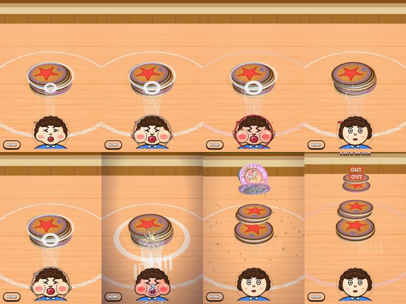
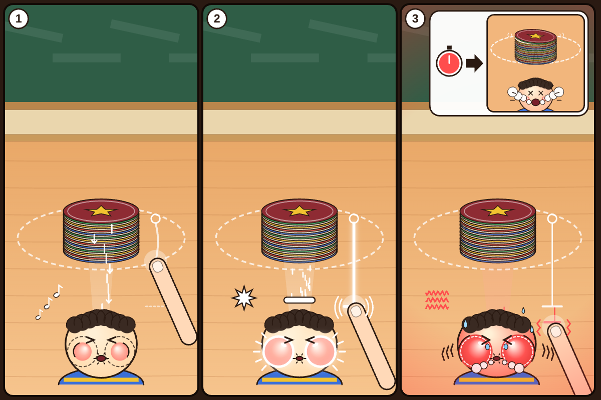
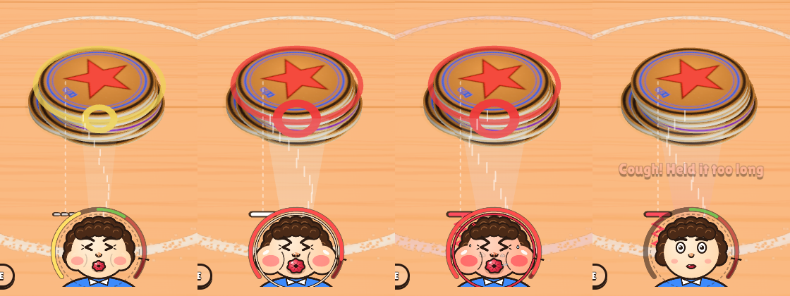
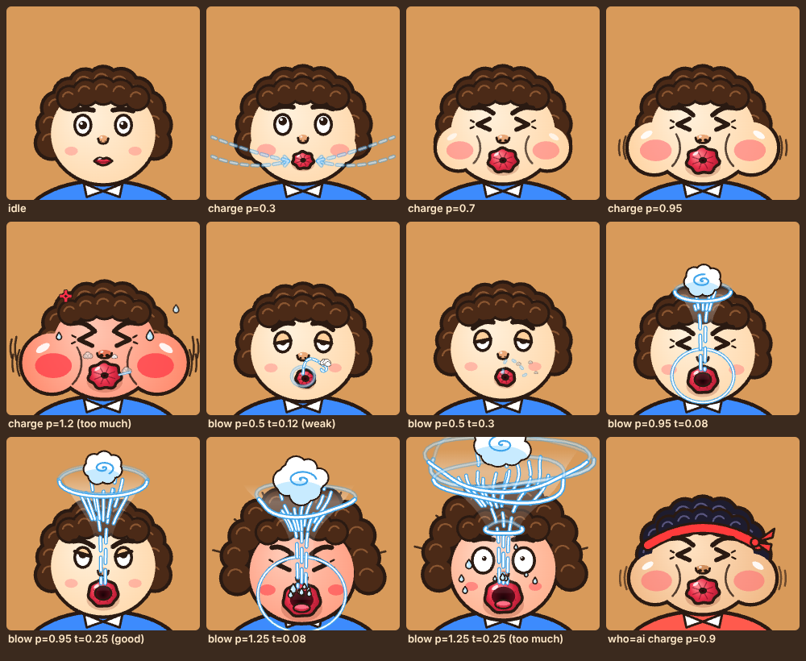

# 3차 피드백 반영 — 숨 곡선 · 분필 원 · 높이 조준 · 부는 얼굴 · 숨 주머니 (2026-10-12)

## 🧭 핵심 가설

- **"초록인데 안 넘어가고 빨강이 더 넘어간다"는 감각 문제가 아니라 실제 물리 결과였다.** (확인됨, `tools/powercurve.mjs`)
  - 옛 규칙(너무 세면 조준 흔들림 + 힘 상한)으로는 세게 불수록 계속 더 넘어갔다.
  - 그래서 숨 비율을 물리에 다시 매핑했다. 약함은 들썩만, 초록은 최대, 셈은 돌풍(분필 원 밖 무효)이다.
  - 이제 세기별 결과가 눈에 보이게 갈린다.
- **멈출 근거는 '정답'이 아니라 '고정된 숨 주머니의 끝(꽉)'이어야 한다.** (미검증)
  - 정답은 언제나 꽉 아래, 더미 양에 비례한 자리에 있다. 그래서 꽉을 멈춤점으로 줘도 정답이 새지 않고, 감은 실력으로 남는다.
  - 판가름 기준(16~40번째 숨):
    - 꽉 ±5%에서 놓는 비율이 10% 이상이면 → 꽉을 정답으로 착각하는 것이다.
    - 장수와 놓은 숨의 상관이 0.5 미만이면 → 더미 양을 보고 숨을 조절하지 않는 것이다.
- **작은 라이벌판은 실력보다 선공이 승부를 가른다.** (확인됨, 학습자 봇 30판)
  - 내가 먼저 불면 80~100%, AI가 먼저 불면 0~53%이고, AI 실력 손잡이는 거의 영향이 없다.
  - 그래서 라이벌판도 가위바위보로 선공을 정한다(원작 방식). PvP 설계에 그대로 이어지는 문제다.

## 1. 재윤님 3차 피드백 → 무엇을 바꿨나

| 피드백 | 원인 (실측) | 바꾼 것 |
|---|---|---|
| 딱 좋은 숨인데 안 넘어가고, 빨강이 더 넘어감 | 물리가 단조라 세게 불수록 계속 더 넘어갔다. 최적점이 정답의 1.05~1.15배(빨강)에 있었다 | 숨 비율 → 물리 재매핑 (`rules.js resolveShot`) |
| 너무 세도, 너무 약해도 안 넘어가서 차이가 없어 보임 | 약한 숨도 꽤 넘어갔고(0.7배에서 3~4장), 센 숨의 손해는 조준 흔들림이라 눈에 안 보였다 | 약함 = 들썩만(0.6배 이하 ≈0장). 셈 = 돌풍이 더미를 밀어 **분필 원 밖으로** → OUT 무효 |
| 사람 표정부터 바람을 분다는 게 보여야 함 | 2D 얼굴은 볼만 부풀었다 | 얼굴 시안 3안 중 **B '뽀뽀 입'** 채택 (`face.js`). 들숨 줄이 입으로 빨려 들어가고, 입술이 쭉 나오고, 놓으면 입에서 바람 원뿔·충격파가 나간다 |
| 동그라미 가이드가 왜 왼쪽·오른쪽에 있는지 모르겠음 | 누른 좌우 위치와 좌우 당김이 조준을 옆으로 옮겼다 | **좌우 조준 삭제.** 누른 높이(어느 층)만 고르고, 입은 항상 더미 정면 한가운데를 분다 |
| (추가) 숨도 무한으로 못 모으니 숨 주머니 속에 멈춤점을 | 당길수록 계속 세져서, 게이지가 사라지면 멈출 근거가 없었다 | **숨 주머니**: 꽉 → 버팀 → 콜록 (설계 패널 만장일치 A안) |

## 2. 숨 곡선 (실측, 시드 8개, 조준 높이 0.75, `node tools/powercurve.mjs 8`)

| 숨 (정답 대비) | 0.5 | 0.6 | 0.7 | 0.8 | 0.9 | 1.0 | 1.05 | 1.1 | 1.2 | 1.3 |
|---|---|---|---|---|---|---|---|---|---|---|
| 6장 더미 | 0.1 | 0.5 | 3.3 | **4.4** | **4.4** | **4.4** | 3.9 | 3.5 | 0.4 | 0.0 |
| 12장 더미 | 0.0 | 0.5 | 3.1 | **7.3** | **7.3** | **7.3** | 7.0 | 6.4 | 1.6 | 0.0 |
| 20장 더미 | 0.0 | 0.0 | 1.5 | **8.8** | **8.8** | **8.8** | 7.3 | 4.9 | 2.4 | 0.0 |

- 초록(0.78~1.0)은 어디서 놓아도 똑같이 최대다. "초록이면 확실히 넘어간다."
- 1.2배를 넘으면 원 밖으로 날아가는 장수가 급증한다(12장 기준 원 밖 5~7장).
- 물리 바닥을 책상 크기(22×16)로 줄였다. 책상 밖으로 떨어진 딱지는 멈춰 있다가 다시 쌓을 때 돌아온다.

## 3. 숨 주머니 (설계 패널: 디자이너 4 → 심사 3 → 종합 1)

자세한 규격: [breath-pouch-spec.md](breath-pouch-spec.md). 목업에 들어간 것:

- **꽉(F = 1.12)**
  - 볼이 얼굴 둘레 주머니 고리에 닿는 지점이다. 들숨 소리가 뚝 끊기고, 둔탁한 '읍' 소리, 손끝 톡(진동 25ms), 숨 줄기 멈춤이 같이 온다.
  - 모든 판의 정답(최대 1.0)보다 위에 있어서, 꽉에서 놓으면 언제나 손해(돌풍)다.
- **손끝 걸림(디텐트)**: 꽉에서 손가락이 0.08만큼 더 가도 숨은 그대로다. 그 너머는 고무줄처럼 0.4배로 뻑뻑하게 벽(1.25)까지 간다. 꽉 아래는 예전과 1:1이라 정답 당김 거리는 그대로다.
- **버팀 → 콜록**
  - 꽉에서 버티면 1.4초(벽에서는 0.7초) 뒤 콜록한다. 그사이 얼굴이 빨개지고 떨리고, 땀이 나고 김이 샌다.
  - 꽉 너머로 우겨넣는 동안에는 분필 원이 빨갛게 맥동한다(원 밖으로 날아갈 거라는 예고).
  - 콜록은 강제 취소다. 기본값으로는 숨과 차례를 쓰지 않는다.
- **엄지 옆 멈춤 눈금**: 누른 점에서 꽉 거리만큼 아래, 손가락 48px 옆에 표시한다. 엄지가 얼굴을 가려도 보인다. 점선 → 실선(꽉) → 빨강 + 용수철(너머)로 바뀐다.
- **정답 누설 제거**: 게이지가 사라진 뒤에도 정답 기준 신호가 남아 있어서 지웠다.
  - 정답 대비 빨개지는 얼굴
  - 금색 볼 반짝이(0.95 = 20장 정답)
  - 충전 중 숨 줄기 굵기(정답에서 포화)
  - 8칸 음계(음이 시작되는 칸이 정답표가 됨)
  - 대신 고리·볼 크기·소리는 모두 **절대값**이다. 상대 얼굴의 고리는 가이드 단계에서만 보인다(상대 숨을 베끼지 못하게).

기각한 안과 이유 한 줄씩:

| 안 | 기각 이유 |
|---|---|
| B '가득 1.00 매듭' | 1.00 = 24장 정답이라 라이벌판이 자동 정답이 된다 |
| C '누른 시간 = 들숨' | 정답 창이 99~220ms라 오디오 지연보다 짧고, 당기는 손맛을 잃는다 |
| D '콜록 −0.35 재기준' | 벽 → 콜록 → 놓기가 정답에 떨어지는 매크로가 된다 |

## 4. 부는 얼굴 (`mockup/src/face.js`)

- 3안 병렬 디자인 중 A '풍선 볼'과 B '뽀뽀 입'이 완성됐다(C안은 작업이 멈춰 결과가 나오지 않았다). **B를 채택했다.** 입술이 주인공이라 '분다'가 가장 직접적으로 읽힌다.
- 표정은 놓은 뒤 결과 숨에 따라 갈린다.
  - 약함: 입이 삐죽, '피식' 김이 처진다.
  - 적정: 곧은 원뿔과 충격파 고리.
  - 돌풍: 머리 날림, 침방울, 눈 휘둥그레.
- 상대 얼굴은 화면 위에서 아래 더미로 분다.

## 5. 레벨 보정 변경

- 라이벌판(4번 칸)은 가위바위보로 선공을 정한다. 보스판은 보스 선공 그대로다. 결과적으로 4·14·24·34·44·54가 목표 60%에 맞았다(57~63%).
- 숨 3번 판은 손잡이 0.7 초과에서 숨 2번이 된다(손잡이 끝에서도 87~90%로 너무 쉬웠음).
- 하드판의 숨 1번 목표는 0.45N부터 시작한다(0.6 경계에서 클리어율이 위로 튀어 이분 탐색이 깨졌음).
- 1~60 전체를 재보정했다(학습자 봇은 초록 가운데 0.89를 노리고 좌우 오차 없음).
  - 보정 시드 기준: 56/60판이 목표 ±12%p.
  - 다른 시드로 독립 검증(판당 30회): ±12%p 52판, ±15%p 57판, 평균 오차 7.8%p. → `docs/design/level-curve-L1-60.txt`
  - 한계: 숨 1~2번짜리 하드판(L45·L55)과 L33은 시드에 따라 ±20~30%p 흔들린다. 보정 시도를 100회 이상으로 늘려야 한다(P1).
  - 더미 4~10장짜리 초반 판(L3·L7·L8)은 목표 1장 차이로 클리어율이 크게 튄다. 그래서 목표치 사이의 클리어율은 맞출 수 없다.

## 6. 아직 안 한 것 / 재윤님 결정 필요

- **콜록이 숨을 먹나?** 기본은 '아니오'(강제 취소)다. 홈 ⚙ 튜닝의 '콜록하면 숨 소모'를 1로 두면 맥없는 숨으로 소모된다. 직접 비교해 보시고 정해 주세요.
- **'무한으로 못 모은다'가 용량만인가, 시간도인가?** 지금은 꽉 아래에서는 시간 제한이 없다. PvP에는 숨에 영향 없는 슛클록 10초를 P1로 둔다.
- **분필 원 밖 = 무효**는 원작 기억과 다를 수 있다(BLOCKERS A7).
- 설계 패널이 제안했지만 아직 안 한 것:
  - 절대 잡음 봇(pouchLearner)으로 보정표 교차 검증
  - '정답 누설 0' 자동 검사(같은 숨이면 3장·20장 화면이 같아야 함)
  - 줄인 움직임 설정(prefers-reduced-motion)
  - 실기기 엄지 가림 측정
