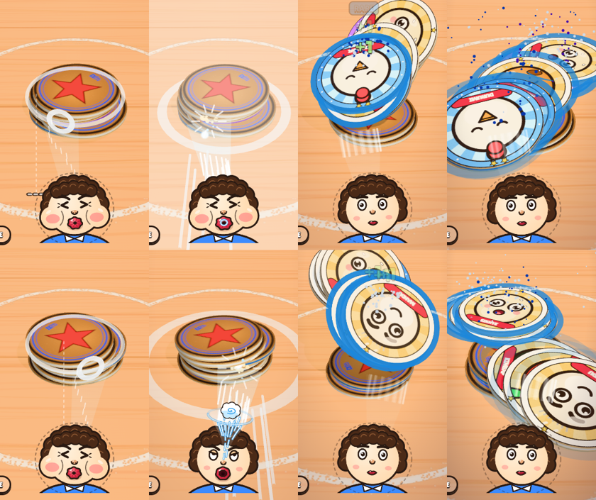
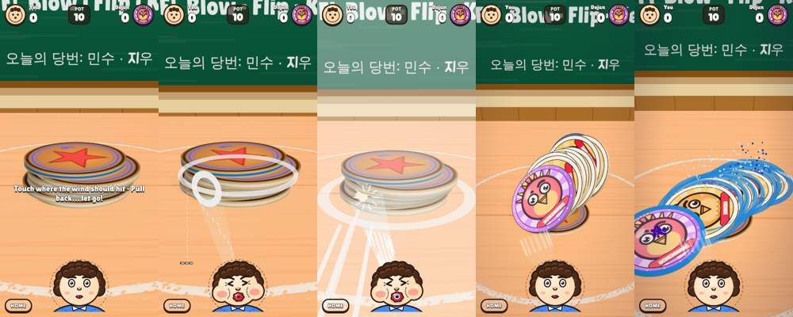

# 4차 피드백 반영 — 좌우·상하 조준과 닿은 곳에 맞는 물리 반응 (2026-10-13)

## 🧭 핵심 가설

- **가설 수정 (3차 → 4차):** 3차에서 좌우 조준을 아예 없앤 건 과잉 교정이었다. 문제는 좌우 조준 자체가 아니었다.
  - 동그라미가 손가락과 어긋난 곳에 찍혔다.
  - 결과가 조준 위치와 따로 놀았다.
- **원인 (확인됨, `tools/aimmap.mjs`):** 옛 바람 모델은 힘을 '바람이 실제로 닿는 테두리'가 아니라 '입에서 가장 가까운 테두리'에 줬다.
  - 그래서 옆으로 0.8 비켜 불어도 힘 받는 점이 앞쪽에서 약 12°밖에 안 움직였다(실제로 닿는 곳은 약 53°).
  - 결과적으로 옆을 불면 뒤집히는 장수만 줄었다. 방향·구르기·회전은 거의 그대로여서, 좌우 조준은 손해만 있는 선택이었다.
- **새 가설 (물리 반응은 확인됨, 손맛은 미검증):** 바람이 닿는 테두리에 힘을 주고 곡면에서 꺾이는 방향으로 밀면, 옆을 불었을 때 **반대쪽 대각선으로 굴러 넘어간다**.
  - 판가름 기준은 실기기에서 '왼쪽을 불면 오른쪽으로 간다'가 설명 없이 읽히는가다.
- **가설 수정 (교차 검토, 확인됨):** '다시 쌓을 때 삐져나온 딱지를 노리면 더 넘어간다'는 틀렸다.
  - 처음 근거(8.3 vs 6.8 vs 3.3)는 한쪽 방향 6시드의 우연이었다.
  - 거울로 뒤집어 16시드씩 짝 비교하면 옆 삐져나옴은 +1장 정도(오차 2배 수준)였고, 앞쪽 삐져나옴은 이득이 없었다.
  - 이 기능을 쓰던 AI는 아래쪽 딱지를 노려서 실력이 높을수록 약해졌다. 그 탓에 라이벌판 난이도 손잡이가 일부 거꾸로 움직였다.
  - 그래서 삐져나옴과 그것을 노리는 AI는 **끄고**, 실험 코드로만 남겼다.

## 1. 조작

- **누른 곳 = 바람이 닿는 곳.** 좌우와 높이 둘 다 누른 곳으로 정해진다.
  - 터치 광선을 **실제 원기둥**에 쏴서 맞은 점을 그대로 쓴다.
    - 처음 구현은 더미 중심을 지나는 세로 평면에서 읽었다. 위에서 내려다보는 카메라라 표적이 손가락보다 0.25~0.7 아래에 찍혔다(교차 검토).
    - 지금은 옆면 어디를 눌러도 표적이 손가락 밑 **1px 이내**다(헤드리스 실측).
    - 윗면을 누르면 맨 위 층, 더미 바깥 옆을 누르면 가장자리로 붙는다.
  - 표적 고리는 원기둥 **곡면 위**에 붙는다. 옆을 노리면 곡면을 따라 비스듬히 눕는다.
  - 당기는 동안 표적은 움직이지 않는다. 3차 이전의 '좌우로 당기면 반대로 움직이는 새총식'은 혼란의 원인이라 없앴다.
  - 다시 조준하려면 살짝만 당겼다 놓으면 취소된다.
- **조준 시점**: 내 차례에 조준하는 동안 카메라가 낮고 가까이 내려온다. 불고 나면 뒤집히는 장면을 보도록 원래 시점으로 돌아간다.
  - 위에서 내려다보면 10장 더미의 옆면이 화면에서 42px뿐이라 상하 조준이 엄지로는 거칠었다.
  - 조준 시점에서는 84px로 **2배**가 된다(실측). 폭도 약 1.6배(three.js 투영 계산 164 → 266px)다.
- **얼굴**: 노리는 쪽으로 고개·눈동자·바람 원뿔이 기운다(얼굴 ↔ 표적 연결). 상대는 아래로 불기 때문에 회전 부호를 뒤집어 같은 화면 쪽을 본다.
- **안내 문구**: '바람이 닿을 곳을 누르고 · 아래로 당겼다가… 놓기!' 폰 폭에서는 두 줄로 줄바꿈하고, 더미를 가리지 않게 위로 올렸다.
- **콜록**: 숨을 안 쓴다(재윤님 4차 결정). 튜닝 토글은 삭제했다.

## 2. 물리 반응 (`sim.js applyWind`)

| 무엇 | 어떻게 | 화면에서 |
|---|---|---|
| 닿는 점 | 제트 축을 각 딱지 평면에 투영해 테두리와 만나는 점(빗나가면 축에 가장 가까운 테두리) | 옆을 맞은 쪽이 들린다 |
| 들기 | 비스듬히 맞을수록 덜 파고듦: × (1 − 0.5·(1 − cosθ)) | 정면이 가장 잘 뜬다 |
| 밀기 | 진행 방향과 '맞은 면 안쪽' 사이로 꺾임(deflect 0.6·sinθ) | 반대쪽 대각선으로 날아간다 |
| 회전 | 옆을 스치는 바람이 테두리를 끌고 감(spin 8·sinθ) | 돌면서 넘어간다 |

실측 (`node tools/aimmap.mjs 6 12 0.9`, 12장, 높이 0.75, 반듯한 더미):

| 비켜 분 정도 (lat) | −0.9 | −0.6 | 0 | +0.6 | +0.9 |
|---|---|---|---|---|---|
| 옛 모델: 옆 이동 | +0.31 | +0.24 | 0 | −0.19 | −0.24 |
| **새 모델: 옆 이동** | **+1.11** | +0.53 | 0 | −0.62 | **−1.16** |
| 옛 모델: 옆으로 굴러 넘어감(0~1) | 0.25 | 0.12 | 0.05 | 0.14 | 0.18 |
| **새 모델: 옆으로 굴러 넘어감** | **0.78** | 0.49 | 0.05 | 0.52 | **0.79** |
| 새 모델: 뒤집힌 장수 | 2.8 | 5.2 | 7.3 | 2.8 | 2.3 |

- 옆 이동의 부호는 노린 쪽의 반대다. 오른쪽(+)을 불면 왼쪽(−)으로 간다.
- 가운데가 가장 많이 뒤집힌다. 옆을 노리는 건 '어느 쪽으로 넘길지'를 고르는 선택이고 장수는 손해다.
  - 지금은 그 선택이 득점과 연결되는 판 요소가 없다(아래 '아직 안 한 것').
- 숨 곡선(초록 = 최대)은 그대로 유지된다(`powercurve`: 12장 기준 약함 0.4장 / 초록 7.4장 / 1.2배 0.5장).

## 3. 상대와 봇

- 상대 AI는 좌우 오차(0.3/실력)를 갖고 가운데 언저리를 노린다. 삐져나옴 노리기는 꺼져 있다(위 가설 수정).
- 레벨 봇은 게임과 같은 기하를 쓴다(표적은 곡면 위). 학습자 봇의 좌우 오차는 0.25다.
- 레벨 1~60은 위 변경 기준으로 다시 보정했다. 결과는 아래 '레벨 보정'과 `docs/design/level-curve-L1-60.txt`에 있다.

## 4. 교차 검토 (3관점 × 반박 검증, 지적 15건 모두 확인)

| 지적 | 처리 |
|---|---|
| 삐져나옴 노리기가 고수 AI를 약하게 만들고 라이벌판 손잡이를 거꾸로 돌림 (blocker) | AI·봇에서 끔, 재보정 |
| 삐져나옴 보상이 실제 더미에서 없음 | 삐져나옴 끔, 문서 주장 정정 |
| 터치 위치보다 표적이 아래에 찍힘 | 원기둥에 광선 → 1px 이내 |
| 상대 얼굴의 바람 원뿔·고개가 표적 반대로 기욺 | 아래로 부는 얼굴은 부호 반전 |
| 다시 쌓기 끝에 기둥이 한 프레임에 툭 내려앉음 | 물리를 먼저 가라앉힌 자세로 트윈 |
| 상대 조준 뒤 내 얼굴이 기운 채 남음 | 취소·불기 끝에 초기화 |
| 안내 문구가 폰 폭을 넘어 잘림 | 줄바꿈 허용 |
| aimmap 주석의 좌우가 반대 | 수정(+z = 바람 진행 방향 기준 오른쪽) |
| 옆 조준 + 살짝 센 숨이 겹치면 손해가 커짐 | 물리적으로 그럴듯해 유지. 문서화 |
| (기존 결함) erp 0.2 + 중력 38에서 쌓인 원판이 두께 약 50%씩 겹쳐 박힘 | 제안된 고침(erp 상향)은 '영원히 떨림'을 되살림 → BLOCKERS에 물리 부채로 기록 |

## 5. 아직 안 한 것

- **좌우 조준이 득점과 연결되는 판 요소가 아직 없다.** 후보:
  - 한쪽을 막는 필통·지우개 장애물
  - 원 밖으로 밀어내면 안 되는 '경계선 가까운 더미'
  - 옆으로 넘겨야 하는 황금 딱지
  - 레벨 요소 카탈로그(GDD v0.2)에 넣고 재윤님과 고르기
- 실기기 확인: 누르는 순간에는 손가락이 표적을 가린다(당기기 시작하면 드러남). 조준 시점 카메라 이동이 어지럽지 않은지도 봐야 한다.
- 레벨 보정·검증 시도를 판당 100회 이상으로(P1). 30~40회 측정은 표본 잡음이 ±8%p다.
