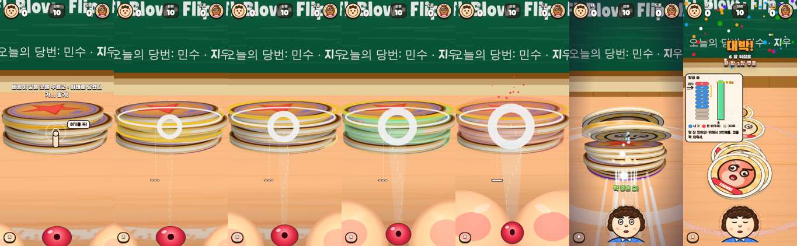
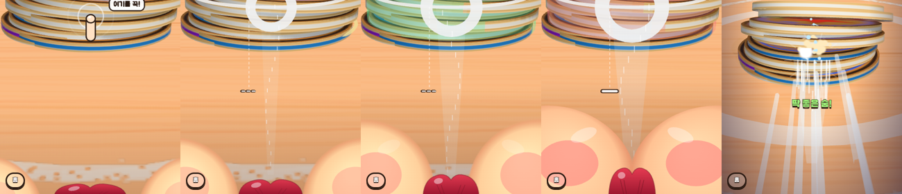
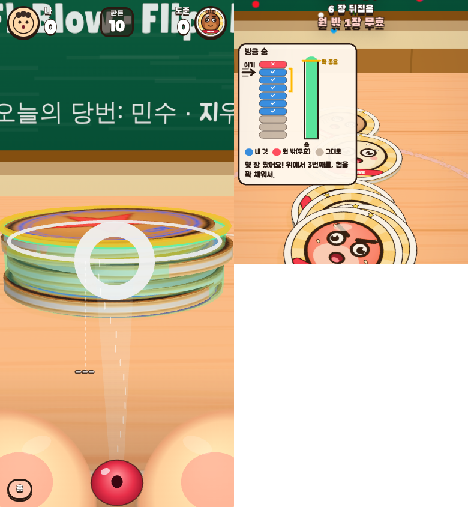

# 6차 피드백 반영 — 1인칭 볼·입술, 첫 터치 손가락 시범, '방금 숨' 카드 (2026-10-13)

## 🧭 핵심 가설

- **세 지적은 모두 '화면이 내 행동과 이어져 보이지 않는다'는 같은 문제였다.** (미검증)
  - 영수증은 추상 막대여서 '내가 어디를 불었는지'와 연결되지 않았다.
  - 첫 터치는 어디를 누르라는 안내가 없었다.
  - 정면 얼굴은 '내가 분다'는 느낌을 끊었다.
- **→ 1인칭:** 내 차례에는 카메라를 입 높이로 낮추고, 숨을 모을수록 화면 아래 양쪽에서 **내 볼**이 차오르게 했다. 가운데 아래에는 **내 윗입술**이 보인다.
- **→ 첫 터치:** 손가락이 위에서 3장째를 **꾹 → 아래로 쭉** 시범한다.
- **→ 쏜 뒤:** '방금 숨' 카드에 범례와 '여기 불었음' 화살표, '딱 좋음' 눈금, 한 줄 조언을 넣었다.
- **판가름:** 처음 하는 사람이 설명 없이 '누르고 → 당기고 → 놓기'를 하는가. 볼이 차는 것을 '내 숨'으로 읽는가. 카드를 보고 다음 숨을 고치는가.

## 1. 1인칭 (재윤님: "실제 딱지를 보고 있는 1인칭 — 바람을 모을수록 볼따구가 시야에 보이게")

- **카메라:** 내 차례에는 높이 `더미 높이 × 0.7 + 1.0`, 거리 5.2에서 더미 중심을 본다(세로 화면 기준).
  - 10장 더미 옆면이 121px, 폭은 화면의 87%다. 조준 시점(5차)은 84px였다. 수치는 three.js 투영 계산.
  - 더미는 화면 아래 입술·볼 영역 위에 놓인다.
  - 불고 나면 원래 시점으로 물러나 뒤집히는 장면을 보여 준다.
- **볼:** 화면 아래 양쪽 구석에서 밀고 들어오는 큰 살.
  - 크기 = 숨 주머니(절대값). 기다릴 때도 살짝 보여서 '내 얼굴'이라는 기준을 만든다.
  - 꽉: 볼이 눌려 납작해지고 떨린다.
  - 버팀: 볼이 붉어지고 흔들리며 입꼬리로 김이 샌다.
  - 콜록: 화면이 흔들리고 볼이 푹 꺼지며 회색 기침 구름이 나온다.
- **입술:** 내려다본 윗입술(큐피드 활). 오므릴수록 좁아지며 위로 쭉 나오고, 오므림 주름이 생긴다. 불 때는 입 틈에서 바람이 나온다.
- **숨 줄기:** 1인칭에서는 화면 아래 가운데, 내 입술에서 표적으로 나간다.
- **정면 얼굴:** 1인칭 모드에서는 내 정면 얼굴을 숨긴다. 상대 차례에는 상대 얼굴이 위에서 분다.
- 튜닝 '1인칭 시점'을 0으로 두면 5차 방식(정면 얼굴 + 조준 시점)으로 돌아간다.

## 2. 첫 터치 가이드 (재윤님: "처음엔 딱지 어디를 찍을지 가이드 — 찍으라고")

- 내 차례에 아직 누르지 않았으면 위에서 3장째(4장 이하 더미는 가운데) 앞면에 물결 고리가 생긴다.
- 손가락이 **꾹 누르고 → 정답 근처 길이만큼 아래로 쭉 당기는** 시범을 반복한다(2.6초 주기).
- 말풍선은 처음 3번에만 나온다: '여기를 꾹!' → '아래로 쭉 당겨요'.
- 높이 단계 1(4~8번째 숨)까지는 매 차례 나온다. 그 뒤에는 4초 동안 아무것도 안 누르면 다시 나온다.
- 기존의 떠 있는 동그라미 손 아이콘은 없앴다.

## 3. '방금 숨' 카드 (재윤님: "빨간 막대가 무슨 뜻인지 — 내가 불었다는 건가?")

- **제목:** '방금 숨'
- **더미 단면:** 쏘기 전 더미를 딱지 모양으로 그린다. 파랑 ✓ = 내 것, 빨강 ✗ = 원 밖(무효), 회색 = 그대로. 황금 딱지는 금 테두리.
- **'여기 →':** 바람 화살표가 내가 분 층을 가리킨다. 금 괄호는 노리기 좋은 2~4장째다.
- **숨 컵:** 이번 숨이 채운 만큼을 보여 준다. 금색 '딱 좋음' 눈금 = 꼭대기(정답의 0.9배). 넘치면 볼록해지고 빨간 방울이 생긴다.
- **범례:** 내 것 · 원 밖(무효) · 그대로.
- **한 줄 조언** (원인이 하나면 그 칸이 통통 튄다):

  | 원인 | 조언 |
  |---|---|
  | 숨 약함 | 물이 꼭대기에 닿을 때 놓기 |
  | 숨 셈 | 원 밖으로 날아가 무효 |
  | 너무 아래 | 위에서 3번째 |
  | 맨 위만 | 한두 장 아래 |
  | 옆 | 많이 넘기려면 가운데 |
  | ★판 | ★칸 반대쪽 옆 |
  | 절반 이상 땀 | 칭찬 |
  | 운 | 같은 자리·같은 숨으로 한 번 더 |

- 3.6초 동안 보인다.

## 4. 불 때 소리: '탁' → 입으로 '푸' (재윤님 6차 추가)

- **가설 (확인됨):** 옛 소리는 노이즈 스윕에 95Hz '쿵'과 180Hz 톤을 섞은 구조였다. 그래서 에너지의 48%가 200Hz 아래에 몰려 '탁'으로 들렸다(오프라인 렌더 측정).
- **새 합성 '푸'** (`audio.js renderPuh`):
  - ① 입술이 터지는 6ms짜리 'ㅍ'
  - ② 'ㅜ' 입 모양 숨소리: 포먼트 320·780Hz와 숨결 1.7kHz. 숨이 빠지며 조금씩 내려간다.
  - ③ 세기별로 다르게: 약함 = 짧은 '프'(160ms), 초록 = '푸우'(280ms), 셈 = 거친 '푸화'(370ms, 3kHz 이상 28%)

  | 소리 | 200Hz 아래 | 200Hz~1kHz |
  |---|---|---|
  | 옛 '탁' | 48% | 13% |
  | 새 '푸' (초록) | 10% | 27% |

- **일레븐랩스 실제 샘플:** `tools/sfx-elevenlabs.mjs`로 만들어 `mockup/assets/sfx/puh-*.mp3`에 두면, 빌드가 넣고 게임이 합성음 대신 쓴다.
  - 지금 클라우드 환경은 `api.elevenlabs.io`를 막고 있고 API 키도 없다. 환경 설정에서 허용 도메인과 `ELEVENLABS_API_KEY`를 추가하면 다음 세션에서 바로 만들 수 있다.

## 5. 아직 안 한 것

- 진짜 3D 얼굴 메쉬(볼·입술 모델링)는 아트 패스와 함께 한다(`docs/TODO.md`). 지금은 3D 카메라 위에 그린 2D 오버레이다.
- 실기기 확인: 볼이 화면을 너무 가리지 않는지, 손가락 시범이 실제 엄지와 헷갈리지 않는지.
