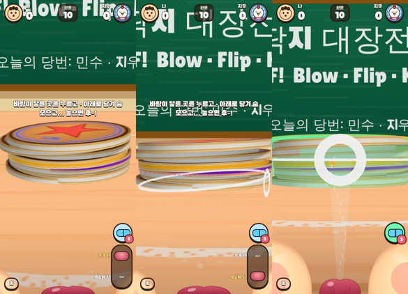

# 9차 — 입술 높이(아래서 퍼올리기)·물안경·콩닥 숨 기본·옆걸음 (2026-10-13)

## 🧭 핵심 가설

- **입술 높이 (확인됨, 16시드 × ±z, `tools/mouthmap.mjs`):** 정직한 물리에서 의미 있는 입 높이는 둘이다.
  - 눈높이 = 지금 입, 조준 높이를 따라간다.
  - 책상 = 입술을 책상에 댄다.
  - 책상 입은 8장 이상 더미의 **가운데 층을 ×1.2~3.3** 넘긴다(20장 가운데 1.13 → 3.66장).
  - 전체 최고 대비는 +10% 이하다. 맨 위를 책상 입으로 불면 손해다(14장 ×0.67).
  - 그래서 '아래를 노리는 길'이 열리지만 정답이 하나로 쏠리지는 않는다.
- **가설 수정 (확인됨):** '책상을 누르면 반사된 바람으로 퍼올린다'는 정직하게 재면 약한 수평 불기와 같았다. 합격선 8개 중 6개를 통과하지 못했다(`tools/scoopmap.mjs`).
  - 7차 시제품의 이득은 대부분 가짜였다. 입이 책상 밑에 있어서 가림 계산이 꺼졌고, 틈이 0인 테두리 밑으로 바람이 들어갔다.
- **물안경 (미검증):** 초록 가이드를 '물안경을 쓴 숨'에만 보여 주면 언제 쓸지가 결정거리가 된다. 상세는 `items-pvp.md`.
- **콩닥 숨 1(차분)을 기본으로 한다 (재윤님 결정).** 숨 기대값이 +12~23% 오른다(학습자 대비). 그래서 레벨 재보정이 필요하다(진행 중).

## 1. 입술 높이 2단 레일

- **자리:** 오른쪽 아래, HOME 버튼과 거울 자리. 칸은 위 '눈높이', 아래 '책상에 턱'. 탭으로 고른다(데스크톱은 ↑↓).
- **보이는 때:** 내 차례, 누르기 전, 1인칭일 때만. 평생 9숨 이후에 열린다. 판마다 눈높이로 돌아간다.
- **책상 자세:** 카메라가 (0, 0.36, 4.9)로 숙인다. 더미 앞 가운데가 화면 같은 높이에 온다.
  - 더미 앞면 아래에 분홍 점선(입 높이)이 보인다.
  - 물리 호출은 `blow({ mouthY: 0.15 })`이고, 바람 연출도 낮은 곳에서 올라간다.
- **6장 미만:** 책상 칸이 흐려지고, 고르면 '딱지가 적어서 퍼올릴 수 없어요'가 뜬다. 퍼올릴 각이 없기 때문이다.
- **눈높이:** `mouthY`를 아예 넘기지 않는다. 그래서 물리가 기존과 비트 동일하다(174/174, 399/399).
- **조언:**
  - 책상 입으로 맨 위를 불면 '한두 장 아래를'.
  - 눈높이로 너무 아래를 불면 '입을 책상까지 내려요'(최대 3번).
  - 책상 자세에서는 '위에서 2~4장째' 금 띠를 숨긴다. 책상 자세의 최적 층은 다시 재는 중이다(측정상 4장째).

| 장수 | 수평 최고 | 책상 입 최고 | 가운데 층: 수평 → 책상 |
|---|---|---|---|
| 6 | 4.69 | 5.13 | 4.69 → 4.59 |
| 10 | 6.94 | 7.09 | 5.63 → 6.84 |
| 14 | 9.25 | 8.69 | 5.38 → 8.00 |
| 20 | 6.56 | 6.84 | 1.13 → 3.66 |

- **한계:** 재윤님이 기억하는 큰 포물선은 정직한 항으로는 나오지 않는다(솟음 +2~12%).
  - 시뮬 더미가 실제 두께의 절반 정도로 눌려 있다(딱지 간격 0.05, 두께 0.11). 그래서 틈으로 드는 바람이 적게 잡혔을 수 있다. BLOCKERS의 물리 부채다.

## 2. 물안경 (초록 가이드 = 아이템)

- **숨 물결은 물안경을 쓴 숨에만 보인다.** 안경이 없으면 흰 물결도 없다. 물결이 꼭대기에 닿는 것 자체가 정답 신호이기 때문이다.
  - 남는 것: 볼(절대 숨), 콩닥 박동, 꽉 → 버팀 → 콜록, 쏜 뒤 '방금 숨' 카드.
- **칩:** 레일 위, 개수 배지. 누르기 전에 톡 누르면 쓴다. 다시 톡 누르면 벗는다. 놓을 때 1개를 쓰고, 콜록·취소면 안 쓴다.
  - 쓰면 1인칭 가장자리에 렌즈 테가 보인다.
  - 같은 숨 실수를 2번 연속하면 칩이 통통 튄다. 예전처럼 물결을 무료로 되살리지 않는다.
- **체험:** 레벨 L1~2, 자유 대전은 평생 첫 3숨. 시작 3개. 같은 판을 3번 연속 지면 +1(최대 9).
  - 손가락 시범의 '정답 길이 당김'과 들숨 음계 8칸도 물안경일 때만 나온다.
- 접근성 '가이드 항상 보기'는 그대로다(별 최대 2개).

## 3. 옆걸음 (재윤님: '오른쪽을 노리면 몸과 앵글이 그쪽으로')

- 누른 뒤 1인칭 몸이 옆으로 평행 이동해서 표적이 입술 바로 앞 가운데에 온다(199px / 가운데 195px).
- 회전하지 않는다. 회전하면 바람이 정면으로 맞아 '옆을 불면 반대쪽으로 굴러감'(4차)과 ★칸 판이 사라진다.

## 4. 남은 것

- **재보정:** 콩닥 숨 기본(봇 박동 방출 모델)과 책상 자세로 L1~60을 다시 맞춘다. 상대 AI의 aiSkill 단조성도 다시 확인한다.
- 책상 자세 최적 층 재측정 → `cues.idealWindow(n, type, pose)`.
- 상대 AI 자세(별도 rng).
- 아이템 2차(왕눈깔사탕 이어 불기 등)와 네트워크 PvP: `items-pvp.md`.
