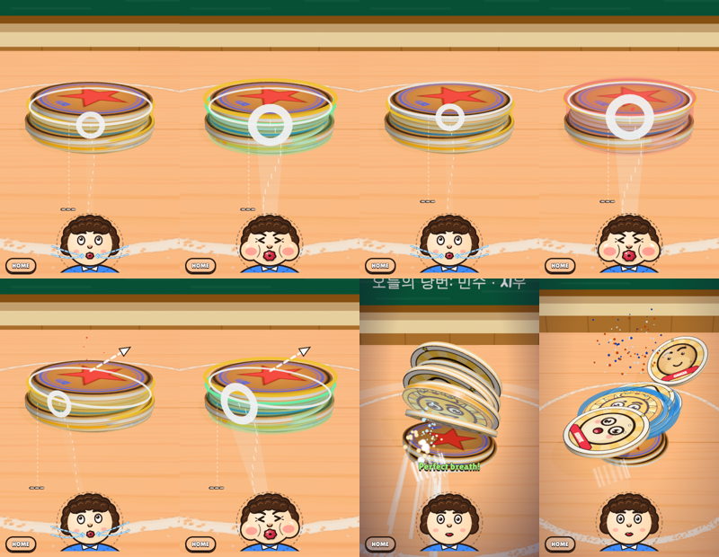
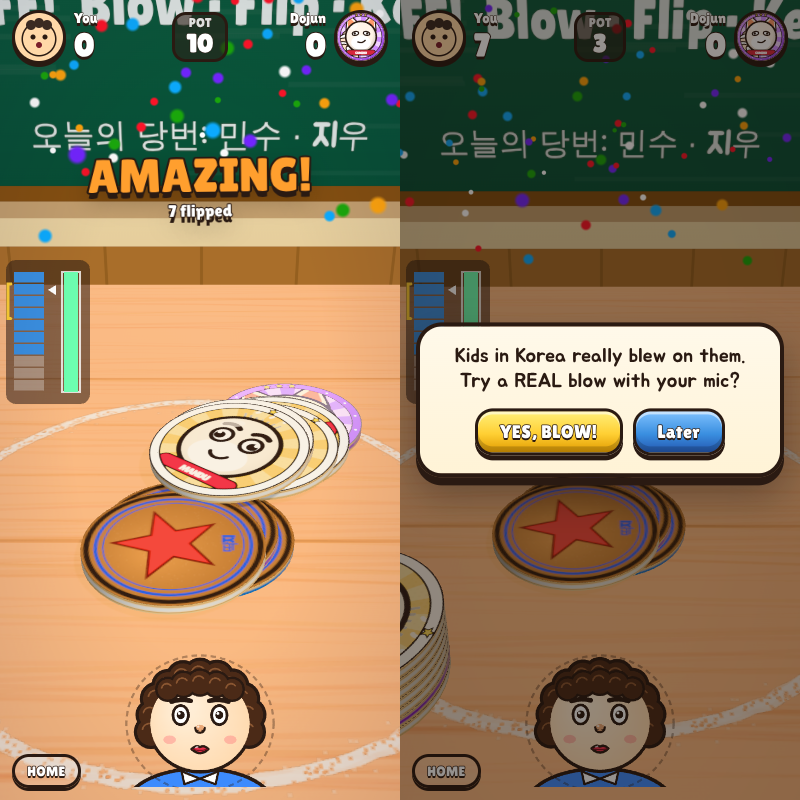
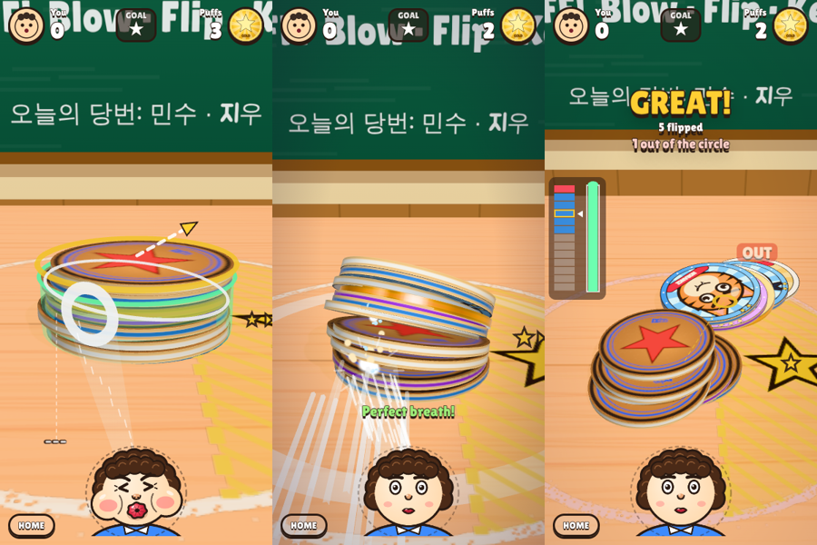

# 공략 지도 — 언제, 어디를, 얼마나 세게 (2026-10-13, 재윤님 5차)

## 🧭 핵심 가설

- **가설 (확인됨):** 물리 봇 실측을 정리하면 공략은 세 줄 규칙으로 요약된다. 재윤님과 플레이어가 감을 못 잡은 이유는 규칙이 복잡해서가 아니라, 화면이 이 세 줄을 보여 주지 않았기 때문이다.
  1. **높이: 위에서 세 번째 딱지를 노린다.**
  2. **세기: 더미가 높을수록 숨을 더 넣는다(초록).**
  3. **좌우: 기본은 가운데. 옆은 반대쪽으로 굴리고 싶을 때만 쓰고, 그때 세게 불면 손해다.**
- **다음 가설 (미검증):** 이 세 줄이 글 없이 화면에서 읽히면, 10번 안쪽의 숨으로 감이 생긴다. 이 부분은 설계 패널 결과를 반영한다(아래 '화면 신호').

## 1. 높이: 위에서 세 번째 딱지

`node tools/fromtop.mjs <장수> 12`로 측정했다. 조건은 가운데, 초록 숨(정답의 0.9배), 12시드.

| 장수 | 맨 위 | 2장째 | **3장째** | **4장째** | 5장째 | 6장째 | 8장째 |
|---|---|---|---|---|---|---|---|
| 6 | 3.5 | 4.7 | **5.1** | 4.8 | 3.0 (꽝 25%) | 1.9 (꽝 58%) | — |
| 10 | 4.9 | 6.0 | **6.9** | **7.3** | 5.8 (꽝 17%) | 4.3 (꽝 33%) | 0.7 (꽝 75%) |
| 14 | 5.6 | 7.8 | **9.5** | **9.5** | 8.8 | 7.0 | 2.6 (꽝 58%) |
| 20 | 5.2 | **6.3** | 5.7 | 3.9 (꽝 42%) | 3.3 | 3.4 | 1.4 (꽝 67%) |

- **맨 위**는 안전하지만 적게 넘어간다.
- **위에서 3~4장째**가 가장 많이 넘어가고, 꽝도 없다.
- **그보다 아래**로 가면 꽝 확률이 급격히 오른다. 맨 아래는 거의 헛방이다.
- 왜 그런가: 노린 딱지와 그 위의 몇 장이 한 덩어리로 들린다. 덩어리가 너무 무거우면(아래쪽을 노림) 들리지 않는다.

## 2. 세기: 더미 양만큼 (초록)

`node tools/atlas.mjs <장수>` 결과다(8시드). 아래 표는 가운데 조준, 각 장수에서 가장 좋은 높이 기준이다.

| 장수 | 약함 0.7배 | **초록 0.9배** | 셈 1.1배 |
|---|---|---|---|
| 3 | 1.5 | **3.0** | 2.3 |
| 6 | 3.4 | **4.9** | 3.0 |
| 12 | 3.4 | **7.6** | 6.1 |
| 20 | 1.1 | **5.8** | 4.6 |

- 약한 숨은 큰 더미를 거의 못 넘긴다(20장 1.1장).
- 센 숨은 딱지가 분필 원 밖으로 날아가 무효가 된다.
- 정답 숨은 더미가 높을수록 크다. 1장은 주머니의 40%, 20장은 85% 정도다.

## 3. 좌우: 가운데가 기본, 옆은 방향을 정할 때

같은 atlas 측정이다. 12장, 높이 0.75 기준이다.

| 숨 | 가운데 | 옆 0.45 | 옆 0.85 |
|---|---|---|---|
| 초록 0.9배 | **7.6** | 6.5 | 3.5 |
| 셈 1.1배 | 6.1 | 2.9 | **0.4** |

- 장수만 보면 모든 장수·높이·세기에서 가운데가 최고다.
- 옆을 불면 그 딱지들이 **반대쪽 대각선으로 굴러간다**. 이것이 옆을 부는 이유다. 예: ★칸(황금 딱지 옆으로 넘기기)에 보내기.
- **옆을 노릴 때 세게 불면 최악이다.** 비스듬히 맞아 덜 들리는데 밀기는 그대로 세서 원 밖으로 날아간다.

## 4. 황금 딱지 옆으로 넘기기 (새 판, 18·38·58번째…)

`node tools/goldenside.mjs 16 12 0.3` 결과다. 12장, 황금 딱지는 위에서 30% 깊이.

| 조준 | 황금 뒤집힘 | 그중 오른쪽 ★칸에 들어감 |
|---|---|---|
| 왼쪽 옆 | 63% | **63%** (모두 오른쪽으로) |
| 가운데 | 81% | 0% (거의 제자리) |
| 오른쪽 옆 | 31% | 0% (왼쪽으로 감) |

- 규칙: **★칸의 반대쪽 옆, 황금 딱지 높이를 초록 숨으로** 분다.
- 칸 밖에 뒤집힌 황금 딱지는 무효이고 다시 쌓는다. 숨이 남아 있으면 다시 도전할 수 있다.
- 측정 메모: 측정 도구(바람 +x 방향)에서는 세계 좌표축 쪽으로 약간 쏠림이 있다(54% vs 33%). 실제 게임의 플레이어 방향(−z)에서는 왼쪽 42%, 오른쪽 46%로 공평하다. 좌우 공평성은 게임 방향으로 잴 것.

## 5. 화면 신호 — 세 줄을 글 없이 (설계 패널: 디자이너 3 · 심사 3 · 종합, `mockup/src/cues.js`)

- **승자는 world 안**(더미 위 물리 비유, 심사 2:1)이고, coach 안의 '더미 영수증'을 이식했다.
- 물리 예측(착지 화살표·뚜껑 뜸)은 실측 성공률이 38~50%인데 확정처럼 약속하는 거짓 그림이 될 수 있어 **2차로 미뤘다**.
- 지금 들어간 것은 '내 입력을 비추는 자 + 고정 규칙 + 실제 결과'뿐이다.

| 규칙 | 화면 | 언제 (규칙별로 따로 세는 단계 0 = 1~3번째 숨, 1 = 4~8, 2 = 9~15, 3 = 16~) |
|---|---|---|
| 높이 | **틈 줄**: 조준 높이에 감기는 가는 흰 줄. **소매**: 그 위 '뚜껑' 장수가 보이는 옅은 흰 원통 | 늘 |
| 높이 | **금 띠**: 위에서 2~4장째(18장↑은 2~3장째). 틈 줄이 띠 안이면 맥동하고 '띵' 소리. 누르는 동안만 | 단계 0 |
| 숨 | **숨 물결(컵 채우기)**: 당기면 물이 더미 옆을 타고 차오른다. 정답의 0.9배 = **꼭대기에 딱**, 그 위는 볼록, 1.0배 초과면 물보라. 절대 대응이라 같은 당김이면 같은 장수만큼 찬다 | 단계 0 색(노랑·초록·빨강), 단계 1 흰색으로 옅게. 큰 더미(8장↑)를 3번 겪을 때까지 유지 |
| 좌우 | **기운 틈**: 옆을 누르면 틈 줄이 기운다(누른 쪽이 들림) | 늘(단계 2부터 덜 기욺) |
| 좌우 | **분필 화살표**: 굴러갈 쪽(반대쪽 대각선). ★판에서 ★쪽이면 촉이 금색 | 좌우 단계 0(옆을 누를 때), ★판은 8숨까지 |
| 쏜 뒤 | **더미 영수증**: 쏘기 전 더미를 층 막대로 그린다(파랑 = 넘김, 빨강 = 원 밖, 회색 = 그대로). 함께 그리는 것은 다음과 같다. ① 내가 분 층에 ◀ ② 금 괄호로 2~4장째 ③ 이번 숨이 채운 미니 컵 ④ 원인이 하나면 그 칸이 통통 튐 | 높이·숨 단계 ≤ 1, 또는 꽝·원 밖 2장↑, 또는 같은 실수 2연속(그 규칙만 2숨 동안 단계 0으로 되돌아감) |
| ★판 | **황금 굴러간 길**: 금색 점선과 끝 고리(칸 안 = 금, 밖 = 갈색) | 늘 |

- 정답 누설 가드:
  - 상대 차례에는 틈 줄과 조준점만 보인다(물결·띠·화살표 없음).
  - 원호 게이지는 없앴다. 정답 숨은 더미 위 물결이 맡는다.
  - 튜닝 '공략 단서 켜기'를 0으로 두면 모두 끈다.
- 검증:
  - `node tools/cuecheck.mjs`: 물결 = sweetHiFor 역함수, 0.9배에서 꼭대기, 2~4장째 창이 실측상 우위, ★ 부호
  - 헤드리스 스크린샷(아래)

- 판가름(다음 플레이 테스트):
  - ① 단서를 켜고 10번 분 뒤 '어디를·얼마나·왜'를 말할 수 있나.
  - ② 16번째 숨 이후 조준 층 중앙값이 위에서 2~4장째인가.
  - ③ 물결이 보이는 단계에서 돌풍(1.0배 초과)이 25% 이상이면 '가득'을 '넘치게'로 읽은 것이다.
- 2차(아직 안 함):
  - 물리 예측 기반 '뚜껑 빛'(예측 정확도 80% 게이트 통과 후)
  - 칠판 레슨판
  - L1~3 더미 크기 재배치 — 지금 가르치는 구간(숨 1~8)이 3~5장 더미에 걸려 높이 차이가 잘 안 보인다(심사 지적)
